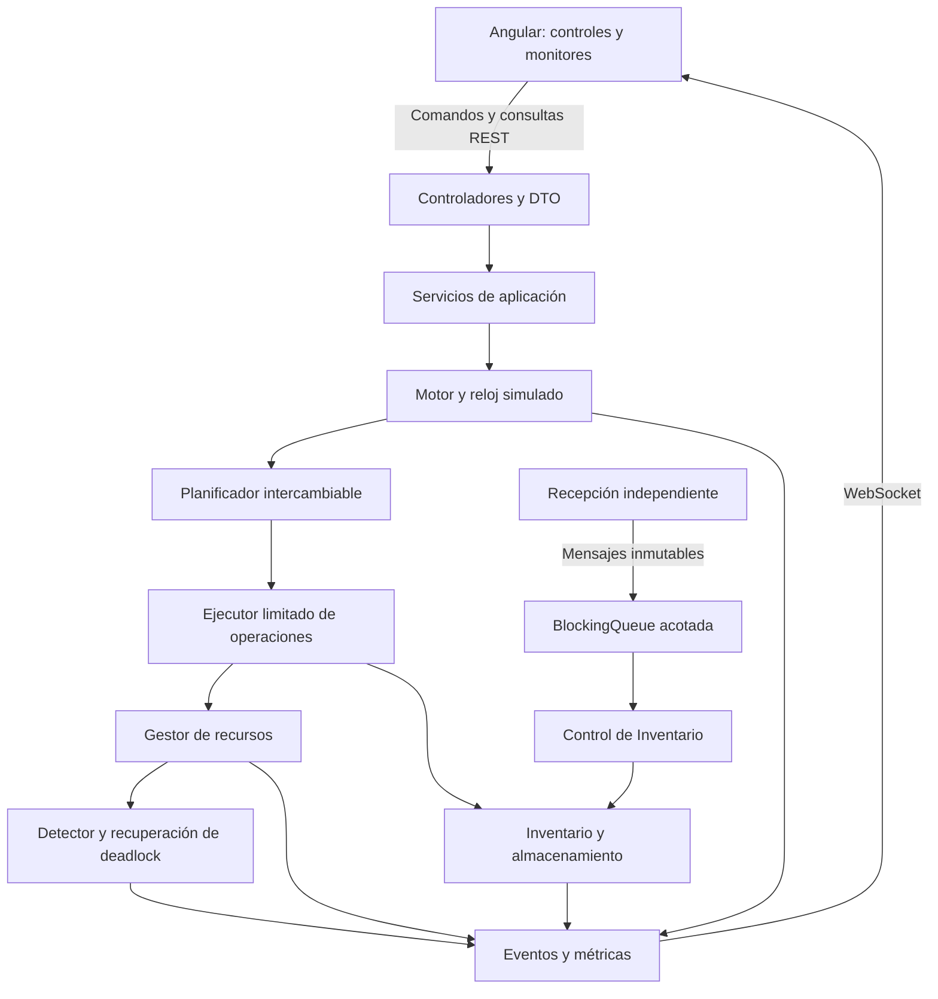

# REDXela — Propuesta de arquitectura y plan de desarrollo

**Curso:** Sistemas Operativos 2, CUNOC, segundo semestre de 2026.  
**Fecha del análisis:** 26 de octubre de 2026.  
**Entrega indicada en el enunciado:** martes 27 de octubre de 2026.  
**Estado:** propuesta para revisión; no representa funcionalidades implementadas ni pruebas ejecutadas.

## 1. Fuentes, alcance y decisiones principales

Se leyó completamente el [enunciado local](.docs/Proyecto_Final_Sistemas_Operativos_2.md). Es la fuente principal de requisitos. También se revisaron las clases de planificación de la práctica 1 y los cuatro archivos fuente C de la práctica 2 del [repositorio de prácticas](https://github.com/BrigidoAlvarado/practicas_SOPES2), en la revisión `6fc951f1863c289069ffab61cb45b360c71a003e`.

En este documento se distinguen tres procedencias:

- **E — Enunciado:** obligación establecida en el documento del curso.
- **U — Solicitud del usuario:** tecnología, restricción o precisión adicional solicitada para este proyecto.
- **D — Diseño propuesto:** decisión concreta para satisfacer las anteriores; sus valores pueden ajustarse durante la revisión.

Se propone un monolito modular Spring Boot, una interfaz Angular y estado en memoria. El backend ejecutará tareas concurrentes reales. La interfaz enviará comandos y presentará estados calculados en el servidor.

La ejecución normal adquirirá los recursos completos de cada etapa sin retener asignaciones parciales mientras espera. Un modo explícito de demostración permitirá romper esa regla para producir un deadlock real, detectarlo y recuperarlo mediante intervención manual. Ambos modos utilizarán el mismo gestor y los mismos recursos reales.

La capacidad del almacén, el número de trabajadores, las duraciones, la fórmula de aging y los detalles de las rutas operativas son decisiones propuestas. Las cantidades de equipo y los cinco niveles de servicio proceden del enunciado y no se sustituyen por valores arbitrarios.

## 2. Matriz de requisitos y trazabilidad

Las fases F1–F10 se detallan en la sección 12.

| ID | Origen | Requisito | Componentes responsables | Evidencia verificable | Fase |
|---|---|---|---|---|---|
| R01 | E | Backend Java con hilos y sincronización reales | Motor, ejecutores, gestor de recursos | Dos operaciones progresan concurrentemente; una tercera espera un recurso ocupado | F2, F3 |
| R02 | E | Exactamente 6 estaciones de empaque, 2 áreas de carga, 10 encargados, 3 montacargas, 4 estaciones de calidad y 1 escáner | `GestorRecursos`, `RecursoFisico` | Inventario de 26 unidades físicas; ninguna unidad tiene dos asignaciones simultáneas | F3 |
| R03 | E | Escáner compartido entre recepción y despacho | `RecepcionService`, etapa de despacho | Recepción y despacho compiten por el mismo identificador de escáner | F3, F5 |
| R04 | E | Alta de cuenta de cliente y selección de servicio | `ClienteService`, formulario de clientes | Un cliente nuevo se registra y crea un pedido con servicio seleccionado | F1, F8, F9 |
| R05 | E | Cinco niveles: Exprés, Prioritario, Estándar, Programado y Económico | `NivelServicio`, métricas SLA | Interfaz y métricas muestran los cinco niveles y sus objetivos | F1, F7, F9 |
| R06 | E | Objetivos de espera: casi instantáneo, 10, 30, 60 y 120 minutos | `ConfiguracionServicio`, `MetricasService` | Se calcula cumplimiento/incumplimiento en minutos simulados | F2, F7 |
| R07 | E | Pedido con ID único, cliente, servicio, productos, tipos, cantidades y estado | `Pedido`, `LineaPedido`, `Producto` | Validación del formulario y consulta completa del pedido | F1, F8 |
| R08 | E | Generación automática continua, todos los niveles y sin cupo total de clientes o pedidos | `GeneradorPedidos` | La generación continúa mientras la simulación está activa; crece la espera ante sobrecarga | F6 |
| R09 | E | Ingreso manual de pedidos durante la simulación | `PedidoService`, REST, Angular | Pedido manual aparece y participa en la planificación vigente | F8, F9 |
| R10 | E/U | Prioridad estricta, consideración de espera y SJF; comparación de políticas | `PoliticaPlanificacion`, `ComparadorPoliticas` | Orden esperado en casos conocidos y reproducción de una misma carga en las tres políticas | F4, F7 |
| R11 | E | Unidades totales como estimación base de trabajo | `PlanTrabajo`, `EtapaOperacion` | Con igual tipo de producto, más unidades producen mayor trabajo estimado | F1, F3 |
| R12 | E | Al menos cinco tipos, descripción y combinaciones distintas de recursos | `TipoMercancia`, `PerfilProcesamiento` | Cinco perfiles documentados y comprobados | F1, F3 |
| R13 | E | Contención realista de dos recursos compartidos entre operaciones | Despacho, gestor y escenario de conflicto | Dos pedidos del mismo camión necesitan su área de carga y el escáner | F3, F6 |
| R14 | E | Pedido sin recursos pasa a espera | Planificador, gestor, estados | Se indica el recurso faltante y el pedido se reactiva al liberarlo | F3, F4 |
| R15 | E | Recepción e Inventario independientes y comunicados mediante información ordenada | `RecepcionService`, `ControlInventario`, mensajes | Recepción publica mensajes; Inventario es quien actualiza existencias | F5 |
| R16 | E/U | Comunicación correcta ante productores más rápidos, sin pérdida ni bloqueo indefinido por presión | Colas acotadas, admisión y confirmaciones | Saturación visible, respuesta acotada al usuario y trazabilidad de cada recepción aceptada | F5 |
| R17 | E | Catálogo predefinido; seleccionar producto y cantidad recibida | `CatalogoProductos`, formulario de recepción | No es necesario crear productos desde Angular | F1, F5, F9 |
| R18 | E | Actualización automática de stock, ubicación y pedidos pendientes tras recepción | `InventarioService`, `AlmacenService`, notificaciones internas | Un pedido sin stock se vuelve elegible después de registrar mercadería | F5 |
| R19 | E | Capacidad limitada elegida por el estudiante | `Almacen`, `Ubicacion`, control de volumen | Ninguna recepción supera la capacidad física; excedentes quedan identificados pendientes | F5 |
| R20 | E | Un lote puede distribuirse entre ubicaciones no contiguas, pasillos y niveles | `Lote`, `FragmentoLote`, `Ubicacion` | Un lote ocupa huecos separados y se puede consultar su distribución | F5 |
| R21 | E/U | Generar deliberadamente un bloqueo circular real | `EscenarioDeadlock`, gestor de recursos | Dos hilos retienen recursos distintos y esperan mutuamente sin finalizar | F6 |
| R22 | E/U | Detectar y explicar operaciones y recursos involucrados | `DetectorDeadlock`, grafo de espera | Se identifica un ciclo derivado de asignaciones y solicitudes reales | F6 |
| R23 | E | Elegir manualmente quién continúa y devolver la otra operación a espera | `RecuperadorDeadlock`, Angular | La elegida termina; la desplazada libera sus recursos y se reencola sin duplicar efectos | F6, F9 |
| R24 | E | Interfaz gráfica con recursos, propietario, progreso, tiempo restante y cola ordenada | Monitores Angular, proyecciones del backend | Cambios visibles sin recargar; cada posición de cola tiene un criterio explicable | F8, F9 |
| R25 | E | Completados, espera promedio, procesamiento promedio y ocupación | `MetricasService`, dashboard | Resultados contrastables con una ejecución pequeña conocida | F7, F9 |
| R26 | E | Código comentado, excepciones controladas y explicación teórica defendible | Todos los módulos, documentación | Manejo de errores, comentarios de sincronización y manual técnico | Todas, F10 |
| R27 | E | Código fuente, manual de usuario y manual técnico con infraestructura y decisiones | Repositorio y `docs/` | Arranque desde instrucciones y demostración de requisitos | F10 |
| R28 | U | Spring Boot, Maven, REST y WebSocket; Angular con servicios y componentes independientes | Adaptadores backend, `core/` y `features/` frontend | Compilación compatible, operaciones REST y eventos WebSocket | F1, F8, F9 |
| R29 | U | Estado concurrente en memoria; evitar base de datos injustificada | Repositorios en memoria, servicios de dominio | Operación completa sin servicio de base de datos | F1–F10 |
| R30 | U | Iniciar, pausar, reanudar y controlar velocidad con un único tiempo simulado | `MotorSimulacion`, `RelojSimulado` | Pausa sin avance de trabajo ni SLA; aceleración coherente | F2 |
| R31 | U | Ejecución limitada, interrupciones correctas, liberación segura y pruebas concurrentes | Ejecutores, leases, coordinación de cierre | Hilos acotados, cancelación cooperativa y conservación de recursos ante fallos | F2, F3, F6, F10 |

Los objetivos de servicio no son una garantía matemática bajo cualquier carga. Con más llegadas que capacidad, o sin inventario, pueden incumplirse. El sistema debe mostrarlo y medirlo, sin ocultar pedidos ni alterar prioridades para aparentar cumplimiento.

## 3. Relación con las prácticas

### 3.1. Práctica 1: planificación

Se revisaron [Proceso.java](https://github.com/BrigidoAlvarado/practicas_SOPES2/blob/6fc951f1863c289069ffab61cb45b360c71a003e/Practica1/src/planificador/Proceso.java), [PlanificadorService.java](https://github.com/BrigidoAlvarado/practicas_SOPES2/blob/6fc951f1863c289069ffab61cb45b360c71a003e/Practica1/src/planificador/PlanificadorService.java), [AlgoritmoPlanificacion.java](https://github.com/BrigidoAlvarado/practicas_SOPES2/blob/6fc951f1863c289069ffab61cb45b360c71a003e/Practica1/src/planificador/AlgoritmoPlanificacion.java) y [ResultadoPlanificacion.java](https://github.com/BrigidoAlvarado/practicas_SOPES2/blob/6fc951f1863c289069ffab61cb45b360c71a003e/Practica1/src/planificador/ResultadoPlanificacion.java).

| Elemento observado | Adaptación a REDXela |
|---|---|
| `Proceso` conserva AT, BT, inicio, finalización y orden de entrada | `Pedido` conserva llegada, trabajo estimado, primer inicio, finalización y secuencia de admisión |
| FCFS desempata por llegada y orden de entrada | Se reutiliza como desempate determinista de las tres políticas |
| `buscarProcesoMasCorto` solo considera procesos que ya llegaron y no terminaron | SJF selecciona pedidos presentes y elegibles; no elige llegadas futuras ni pedidos sin stock |
| `esMejorOpcion` compara BT, AT y orden de entrada | Comparador SJF por unidades totales, llegada y secuencia |
| SJF es no expropiativo | Una etapa que empezó termina sin ser interrumpida por un pedido recién llegado; la recuperación de deadlock es excepcional |
| Servicio separado de entrada e impresión | Dominio y planificación separados de REST y Angular |
| Resultados agrupan métricas y segmentos de Gantt | Resultado de corrida y segmentos por operación/recurso, admitiendo solapamiento |

Se reutilizarán conceptos y comparaciones, adaptándolos con atribución. No se trasladará el bucle que incrementa un único `tiempoActual` por cada proceso: supone una CPU secuencial y no expresa operaciones concurrentes reales.

La fórmula `WT = TAT - BT` de la práctica no debe aplicarse usando el trabajo **estimado** como si fuera trabajo ejecutado. REDXela medirá intervalos reales de estados en tiempo simulado: espera de inventario, planificación, recursos y recuperación. Se conservarán `TAT = CT - AT` y `RT = primer inicio efectivo - AT`.

También se corregirá en el nuevo diseño el caso de promedios sobre una colección vacía y se usarán entradas independientes en cada comparación para evitar que los resultados mutables de una corrida contaminen la siguiente.

### 3.2. Práctica 2: comunicación

| Fuente revisada | Concepto observado | Aplicación propuesta |
|---|---|---|
| [Problema1/main.c](https://github.com/BrigidoAlvarado/practicas_SOPES2/blob/6fc951f1863c289069ffab61cb45b360c71a003e/Practica2/Problema1/main.c) | Dos pipes para solicitud y respuesta entre padre e hijo | Mensaje de recepción con identificador de correlación y confirmación de procesamiento |
| [Problema2/main.c](https://github.com/BrigidoAlvarado/practicas_SOPES2/blob/6fc951f1863c289069ffab61cb45b360c71a003e/Practica2/Problema2/main.c) | Dos consumidores toman trabajo del mismo canal | Trabajadores limitados y cola segura; cada tarea se admite una sola vez |
| [Problema3/centro.c](https://github.com/BrigidoAlvarado/practicas_SOPES2/blob/6fc951f1863c289069ffab61cb45b360c71a003e/Practica2/Problema3/centro.c) y [sucursal.c](https://github.com/BrigidoAlvarado/practicas_SOPES2/blob/6fc951f1863c289069ffab61cb45b360c71a003e/Practica2/Problema3/sucursal.c) | Productores independientes y contrato compartido `Reporte` mediante FIFO | DTO inmutable compartido como contrato, sin acceso directo al estado interno de Inventario |

No se reutilizarán literalmente `fork`, descriptores, FIFO del sistema de archivos ni `usleep`. En Java se emplearán tareas, colas y condiciones. Se demostrará comunicación entre componentes concurrentes de una JVM; no se afirmará que son procesos independientes del sistema operativo.

## 4. Plataforma y arquitectura

### 4.1. Versiones propuestas y compatibilidad verificada

| Tecnología | Selección | Fundamento |
|---|---|---|
| Java | JDK 21 LTS | API de concurrencia suficiente, versión LTS y compatible con Spring Boot seleccionado |
| Spring Boot | 4.1.2 estable | La documentación consultada la identifica como estable; admite Java 17–27 y Maven desde 3.6.3 |
| Maven | 3.9.16, mediante Wrapper | Versión GA mantenida y superior al mínimo de Spring Boot |
| Angular y Angular CLI | Familia 21.2.x, ambos alineados | Angular 21 tiene soporte LTS; evita una migración innecesaria al iniciar el proyecto |
| Node.js | 24.22.1 LTS | Pertenece a la rama 24 LTS y satisface el rango `^24.0.0` de Angular 21 |
| TypeScript | 5.9.x | Satisface `>=5.9.0 <6.0.0` de Angular 21 |
| RxJS | 7.8.x | Satisface `^7.4.0` de Angular 21 |

Fuentes oficiales consultadas: [requisitos Spring Boot](https://docs.spring.io/spring-boot/system-requirements.html), [compatibilidad Angular](https://angular.dev/reference/versions), [soporte Angular](https://angular.dev/reference/releases), [versiones Node.js](https://nodejs.org/en/about/previous-releases), [historial Maven](https://maven.apache.org/docs/history.html) y [hoja de soporte Java](https://www.oracle.com/java/technologies/java-se-support-roadmap.html).

Al iniciar F1 se fijarán los parches exactos disponibles de Angular 21.2, TypeScript 5.9 y RxJS 7.8 en el manifiesto y el lockfile. La selección de familias está definida; no se usarán `latest`, versiones experimentales, RC ni SNAPSHOT. Spring Boot administrará las versiones de sus dependencias.

### 4.2. Organización del sistema



El dominio contendrá pedidos, etapas, recursos, inventario y reglas; no dependerá de controladores HTTP. Los servicios de aplicación coordinarán casos de uso. Los adaptadores REST/WebSocket traducirán entradas y publicarán proyecciones inmutables.

Se utilizará un solo módulo Maven con paquetes por funcionalidad. No se necesita Spring Modulith, microservicios, broker externo, base de datos ni una arquitectura distribuida.

Para WebSocket se propone el protocolo nativo del navegador con mensajes JSON y un único flujo de eventos. REST atenderá los comandos; WebSocket notificará cambios. Esto evita añadir STOMP o un broker para una demostración local.

## 5. Modelo del dominio

### 5.1. Clases principales

| Clase o concepto | Atributos principales | Responsabilidad y relaciones |
|---|---|---|
| `Cliente` | ID, nombre, correo único, servicio preferido | Tiene muchos pedidos; registra una cuenta de cliente |
| `NivelServicio` | Código 1–5, nombre, objetivo de espera | Independiente del tipo de mercancía |
| `Producto` | ID, nombre, tipo, volumen por unidad | Catálogo predefinido; aparece en líneas y lotes |
| `TipoMercancia` | Nombre, descripción, perfil de recursos | Define necesidades y coeficientes de procesamiento |
| `Pedido` | ID, cliente, nivel contratado, líneas, unidades totales, llegada, secuencia, estado, primer inicio, fin | Agregado de seguimiento; conserva el servicio contratado aunque el cliente cambie su preferencia |
| `LineaPedido` | Producto y cantidad positiva | Parte de un pedido; no admite productos inexistentes |
| `PlanTrabajo` | Pedido, etapas ordenadas, trabajo estimado | Deriva trabajo de unidades y perfiles de mercancía |
| `EtapaOperacion` | ID, pedido/recepción, tipo de etapa, requisitos, trabajo restante, intento, estado | Unidad de ejecución y recuperación; un pedido tiene varias etapas |
| `RecursoFisico` | ID, tipo, capacidad unitaria | Identifica E01–E06, C01–C02, B01–B10, M01–M03, Q01–Q04 y S01 |
| `AsignacionRecursos` | Token, operación, intento, unidades asignadas, inicio, cerrada | Lease liberable una sola vez; enlaza recursos con propietario lógico |
| `SolicitudRecursos` | Operación, recursos requeridos, instante, motivo | Permite explicar espera y construir dependencias |
| `Recepcion` | ID, productos, cantidades, estado, correlación | Seguimiento desde registro hasta almacenamiento confirmado |
| `MensajeMercaderiaRecibida` | ID de mensaje, recepción, secuencia, líneas, instante | Contrato inmutable de Recepción hacia Inventario |
| `Lote` | ID, recepción, producto, cantidad recibida | Un lote por producto recibido; contiene varios fragmentos físicos |
| `Ubicacion` | Pasillo, estante, nivel, capacidad, volumen ocupado | Representa espacio físico identificable |
| `FragmentoLote` | Lote, ubicación, cantidad física y reservada | Relación entre lote y ubicación; permite distribución no contigua |
| `ReservaInventario` | Pedido, asignaciones de fragmentos, estado | Reserva todas las líneas o ninguna; evita sobreventa |
| `ConfiguracionSimulacion` | Factor temporal, semilla, trabajadores, tasas, duraciones y capacidad | Parámetros validados de una corrida |
| `EventoSimulacion` | Corrida, secuencia, tiempo simulado, tipo, entidad y versión | Seguimiento, métricas y publicación |
| `ConflictoDeadlock` | ID, versión, operaciones, recursos, aristas, causa y estado | Evidencia de ciclo y control de resolución |
| `ResultadoCorrida` | Política, escenario, métricas, incumplimientos y pendientes | Comparación sin compartir estado mutable entre ejecuciones |

Crear cuenta significa registrar una identidad de cliente y su servicio. El enunciado no exige roles, JWT, recuperación de contraseñas ni una plataforma de autenticación; no se incluyen en el alcance inicial.

### 5.2. Estados y transiciones

Estados principales de pedido:

```text
CREADO → ESPERANDO_INVENTARIO → EN_COLA
EN_COLA → EN_PROCESO → COMPLETADO
EN_PROCESO → ESPERANDO_RECURSOS → EN_PROCESO
EN_PROCESO → BLOQUEADO_DEADLOCK → RECUPERANDO → EN_COLA
```

Un pedido con stock inicial puede pasar directamente de `CREADO` a `EN_COLA`. `EN_PROCESO` expone la etapa actual: retiro, empaque, calidad o despacho. Los estados de error y cancelación se registran explícitamente; no se simula una finalización exitosa tras una excepción.

El estado `BLOQUEADO_DEADLOCK` se deriva de una detección real. Asignarlo no crea el bloqueo.

Una recepción recorre `REGISTRADA`, `EN_RECEPCION`, `PENDIENTE_PUBLICACION`, `PENDIENTE_ALMACENAMIENTO` y `ALMACENADA`; también puede quedar en `ERROR`. La aceptación REST no equivale a que el stock ya esté disponible.

La simulación recorre `CONFIGURADA`, `EJECUTANDO`, `PAUSANDO`, `PAUSADA`, `DETENIENDO` y `DETENIDA`. Reiniciar crea otra corrida solo después de terminar la anterior.

### 5.3. Servicios y mercancías

| Nivel | Servicio | Objetivo del enunciado | Interpretación de diseño |
|---|---|---|---|
| 1 | Exprés | Casi instantáneo | Umbral inicial configurable de 30 segundos simulados; no es una cifra impuesta por el docente |
| 2 | Prioritario | Máximo 10 minutos en espera | Comparar con espera hasta primer inicio efectivo |
| 3 | Estándar | Máximo 30 minutos en espera | Misma definición |
| 4 | Programado | Máximo 60 minutos en espera | Misma definición; no implica por sí solo una fecha futura de entrega |
| 5 | Económico | Máximo 120 minutos en espera | Misma definición |

Se mostrarán adicionalmente espera acumulada y tiempo de retorno para no ocultar bloqueos posteriores al inicio. La expresión del enunciado sobre tiempo objetivo y espera se documentará con esta interpretación explícita.

Perfiles iniciales propuestos. Las cantidades de esta tabla describen necesidades de las etapas correspondientes, no recursos retenidos durante todo el pedido.

| Tipo | Descripción | Retiro | Empaque | Calidad | Despacho |
|---|---|---|---|---|---|
| General | Artículos pequeños de manejo ordinario | 1 encargado | 1 encargado + 1 estación | No aplica | 1 encargado + 1 área + escáner |
| Frágil | Artículos con protección y revisión de integridad | 1 encargado | 1 encargado + 1 estación | 1 encargado + 1 estación de calidad | 1 encargado + 1 área + escáner |
| Pesado | Bultos que requieren movimiento mecánico | 2 encargados + 1 montacargas | 1 encargado + 1 estación | No aplica | 2 encargados + 1 montacargas + 1 área + escáner |
| Voluminoso | Bultos que necesitan dos superficies de empaque | 2 encargados + 1 montacargas | 2 encargados + 2 estaciones | No aplica | 2 encargados + 1 montacargas + 1 área + escáner |
| Electrónica paletizada | Equipos sobre pallet con verificación funcional | 1 encargado + 1 montacargas | 1 encargado + 1 estación | 1 encargado + 1 estación de calidad | 1 encargado + 1 montacargas + 1 área + escáner |

Los cinco perfiles tienen combinaciones distintas. Para pedidos mixtos, las líneas se agrupan por tipo y se procesan secuencialmente dentro de cada etapa, sin sumar estaciones innecesariamente. Diferentes pedidos sí trabajan en paralelo. El progreso pondera las unidades y el trabajo previsto de cada grupo.

## 6. Diseño de concurrencia y tiempo

### 6.1. Hilos y ejecutores

| Componente | Ejecución propuesta | Espera o activación |
|---|---|---|
| Coordinador de planificación | Un hilo propio | `Condition` por nuevas llegadas, stock, recursos liberados o cambios de política |
| Operaciones de pedidos | `ThreadPoolExecutor`, máximo inicial de 16 trabajadores | Solo se despachan etapas con cupo de ejecución y recursos asignables |
| Recepción | Un trabajador independiente | Cola de recepciones aceptadas y avisos de disponibilidad de recursos |
| Control de Inventario | Un consumidor independiente | `BlockingQueue.take()` y avisos de espacio liberado |
| Reloj y activaciones temporales | `ScheduledExecutorService` pequeño | Actualizar tiempo y despertar trabajo temporal; sus callbacks no ejecutan etapas largas |
| Detector y administración | Ejecutor separado de los trabajadores de pedidos | Cambios de asignaciones y comprobación periódica de respaldo |
| Publicación WebSocket | Despachador independiente | Proyecciones/eventos pendientes; no escribe sobre sockets bajo locks del dominio |

No se crea un hilo por cada pedido pendiente. Las etapas liberan el trabajador cuando terminan o regresan a espera. La cola interna del ejecutor se acota y no se utiliza como una segunda cola FIFO que anule el orden del planificador.

Antes de enviar una etapa se obtiene un cupo de ejecución. Si el envío falla, se devuelven el cupo y todos sus recursos. Una identidad de operación e intento impide dos ejecuciones simultáneas de la misma etapa.

### 6.2. Propiedad del estado compartido

- El planificador protege sus colecciones y decisiones de admisión con un lock corto.
- Inventario y almacenamiento comparten una única sección crítica para reservar stock, ubicar lotes y liberar espacio de forma atómica.
- El gestor de recursos protege permisos, propietarios y solicitudes con otro lock corto.
- Las transiciones de un pedido se validan por operación e intento bajo su protección correspondiente.
- Ningún componente mantiene su lock mientras espera otro servicio, hace I/O, publica WebSocket o ejecuta trabajo temporal.

Se evitará anidar locks entre módulos. Las llamadas se separan mediante resultados y compensaciones: por ejemplo, una reserva de stock se devuelve si una admisión posterior falla. Las notificaciones se realizan después de cerrar la sección crítica.

Una colección concurrente por sí sola no hace atómica una operación de comprobar y descontar varias líneas. Esa atomicidad pertenece al servicio de inventario.

### 6.3. Gestor de recursos

Cada una de las 26 unidades físicas tendrá un semáforo binario. Las capacidades por tipo se obtienen agrupando esas unidades. Esto permite mostrar exactamente qué estación o montacargas ocupa cada operación y representar solicitudes de unidades concretas cuando sea necesario.

Todas las adquisiciones pasan por el gestor. Bajo su lock se seleccionan las unidades, se consumen sus permisos mediante `tryAcquire` y se registra el lease. Si el conjunto completo no está disponible, la operación normal no conserva adquisiciones parciales y queda en la cola de espera.

La prioridad se decide en el planificador; no se delega al orden de los semáforos. En particular, `tryAcquire()` sin tiempo no respeta la opción de fairness de `Semaphore`, por lo que activar esa opción no sustituiría una política de admisión. Véase la [documentación oficial de Semaphore](https://docs.oracle.com/en/java/javase/21/docs/api/java.base/java/util/concurrent/Semaphore.html).

El lease conserva el token y el intento de su propietario lógico. Su cierre es idempotente y solo devuelve permisos realmente adquiridos. No se libera un recurso basándose únicamente en que una pantalla diga que está ocupado.

Invariantes del gestor:

1. Por cada tipo: disponibles + asignados = capacidad declarada.
2. Una unidad física tiene cero o un propietario lógico.
3. Cada lease se libera como máximo una vez.
4. Una espera normal no conserva recursos de una etapa anterior.
5. Las solicitudes y asignaciones observadas por el detector pertenecen a una instantánea coherente.

### 6.4. Reloj simulado

Se propone un factor inicial de **60**: un segundo real equivale a un minuto simulado. El factor es configurable.

El reloj acumula tiempo a partir de `System.nanoTime()`, que es monotónico. En cada cambio de velocidad se acumula primero el intervalo con el factor anterior y después se instala el nuevo. Durante la pausa el incremento simulado es cero.

Todo instante del dominio se expresa en la misma unidad de tiempo simulado: llegadas, SLA, aging, trabajo pendiente, ocupación y métricas. La hora civil solo sirve como etiqueta humana.

Una etapa calcula su trabajo pendiente contra el reloj y espera mediante una condición temporal. Al pausar, reanudar o cambiar la velocidad se despierta para recalcular la espera. No se convierte una duración una sola vez a tiempo real ni se utiliza `Thread.sleep()` para coordinar trabajadores.

Se propone inicialmente `duración de grupo = coste fijo de etapa + coeficiente del tipo y etapa × unidades`. Los coeficientes positivos serán parte de la configuración y se conservarán en las comparaciones.

El tiempo restante es una estimación de trabajo pendiente. Si falta stock, un recurso o una resolución manual, se mostrará esa dependencia: el sistema no puede prometer una hora de finalización en esos estados.

### 6.5. Pausa y cierre

Pausar congela el reloj y suspende generación, nuevas admisiones y avance del trabajo. Los componentes reconocen puntos seguros antes de confirmar `PAUSADA`; una transacción corta ya iniciada termina antes de ese reconocimiento. Los recursos que ya posee una etapa permanecen asignados y su ocupación no acumula tiempo simulado durante la pausa.

Las consultas y la administración de un conflicto siguen disponibles. Una resolución durante la pausa puede liberar y reencolar operaciones, pero no inicia trabajo hasta reanudar.

Detener despierta condiciones, interrumpe esperas interruptibles y espera el cierre cooperativo. Reiniciar no borra mapas mientras existan tareas antiguas: primero confirma su terminación y después crea una corrida con un nuevo identificador. Se evitarán `Thread.stop`, `suspend` y `resume`.

## 7. Planificación, flujo y métricas

### 7.1. Políticas concretas

Las políticas son no expropiativas por etapa. Se aplican sobre las operaciones elegibles, manteniendo visible el pedido al que pertenecen.

| Política | Clave de orden |
|---|---|
| Prioridad estricta | Nivel contratado ascendente, llegada ascendente, secuencia de entrada ascendente |
| Prioridad con aging | `nivel - floor(esperaElegibleAcumulada / 5 minutos)`, luego llegada y secuencia |
| SJF | Unidades totales del pedido ascendentes, luego llegada y secuencia |

El valor de aging puede bajar de 1: no se limita a un rango que impida distinguir pedidos muy antiguos. La espera elegible se acumula durante la espera de planificación y recursos; no se reinicia después de cada reintento. Se informa aparte el tiempo sin stock.

El orden se recalcula al admitir trabajo. No se utilizará una `PriorityBlockingQueue` cuyo comparador cambie con la hora sin reordenar sus elementos. Para el volumen académico se propone una colección protegida y selección explícita del mejor candidato.

El planificador recorre el orden de prioridad y admite el primer candidato cuyos requisitos se puedan satisfacer. Si uno no tiene stock o recursos, puede avanzar otro que use recursos disponibles. La interfaz distinguirá el orden de preferencia de la razón por la que un pedido aún no es ejecutable.

La prioridad estricta y SJF pueden producir starvation bajo cargas sostenidas; es una propiedad que debe evidenciar la comparación. Aging reduce ese riesgo bajo una carga atendible, pero no crea capacidad ni garantiza SLA en sobrecarga.

### 7.2. Recorrido completo de un pedido

1. El cliente existente o recién registrado elige productos, cantidades y nivel. El generador produce el mismo comando de creación.
2. Se validan productos existentes, cantidades positivas, totales sin desbordamiento e ID único.
3. Se registran llegada y secuencia en tiempo simulado. Se construye el plan por unidades y tipos.
4. Si no hay stock para todas las líneas, queda en `ESPERANDO_INVENTARIO`, sin retener equipo ni trabajador.
5. El planificador selecciona un candidato con stock. Inventario reserva todas sus líneas atómicamente; si otra operación cambió la disponibilidad, vuelve a espera.
6. Se adquieren cupo de ejecución y recursos completos para retiro. Si no es posible iniciar, se compensa la reserva de admisión y se conserva el pedido pendiente.
7. Al completar retiro se descuentan físicamente los fragmentos reservados y se libera volumen del almacén. Las unidades pasan a mercadería en preparación, no desaparecen del balance.
8. Se ejecutan empaque, calidad cuando corresponda y despacho. Entre etapas se liberan recursos y el planificador decide la siguiente admisión.
9. En despacho se comparte S01 con Recepción y se utiliza un área de carga. Si existe un conflicto demostrado, la operación espera resolución.
10. La confirmación de despacho finaliza el pedido una sola vez. Se liberan recursos y se registran métricas y eventos.

Un pedido mixto no repite etapas ya confirmadas al reintentarse otra. Las operaciones tendrán checkpoints explícitos; en particular, recuperar despacho nunca vuelve a descontar inventario.

### 7.3. Métricas y comparación

- **AT:** llegada; **CT:** finalización; **RT:** primer trabajo efectivo menos AT; **TAT:** CT menos AT.
- **Espera:** suma de intervalos de espera, desglosada por stock, planificación, recursos y recuperación.
- **Procesamiento:** suma de tiempo de trabajo activo; se distingue del tiempo de ocupar un trabajador o retener recursos estando bloqueado.
- **Ocupación por tipo:** integral de unidades asignadas sobre tiempo simulado, dividida por capacidad × duración observada.
- **Rendimiento:** pedidos completados por minuto simulado.
- **Servicio:** cumplimiento de primera atención por nivel, retrasos, máximos y percentiles de espera.
- **Estado al cierre:** completados, pendientes, errores y pedidos aún sin primera atención. No se excluyen silenciosamente los pendientes de la evaluación.

El tiempo perdido en intentos recuperados se mostrará por separado. Si una ocupación se mide durante un deadlock, los recursos retenidos siguen ocupados aunque no produzcan trabajo.

Para comparar políticas se prepara un `EscenarioCarga` inmutable con las mismas llegadas, clientes, líneas, niveles, stock inicial, recepciones programadas, configuración y trabajo por etapa. Cada política usa una corrida nueva y repositorios independientes. Durante la comparación no se incorporan entradas manuales ajenas al escenario.

La semilla permite construir la carga, pero no basta si el orden de consumo aleatorio depende de hilos: las entradas y duraciones se materializan antes de ejecutar. Se realizarán varias repeticiones equivalentes y se mostrarán variaciones, porque la planificación de hilos del sistema operativo puede producir diferencias pequeñas.

## 8. Inventario, almacenamiento y comunicación

### 8.1. Modelo físico propuesto

El almacén inicial tendrá **100 ubicaciones de 10 unidades de volumen**, para una capacidad total de **1,000 unidades de volumen**: 5 pasillos × 5 estantes × 4 niveles. Cada producto define su volumen por unidad; el espacio no se confunde con la cantidad de artículos.

La asignación será first-fit determinista por código de ubicación. Se distribuyen unidades enteras de un lote entre huecos disponibles. No se exige contigüidad y no se necesita compactación para la entrega.

Ejemplo: un lote de 12 artículos de volumen 1 puede almacenar 4 unidades en P01-E01-N01, 3 en P03-E02-N04 y 5 en P05-E01-N02 si esos son los huecos disponibles. Cada fragmento conserva el lote y producto originales.

Un lote se registra completamente o permanece pendiente de espacio; no se publica una parte como si toda la recepción estuviera completada. Una recepción con varios productos puede confirmar lotes individuales y muestra cuáles siguen pendientes.

Se rechazará una entrada individual imposible de almacenar incluso con el almacén vacío. La falta temporal de espacio genera un lote pendiente visible y reevaluable. Reservar stock no libera espacio; retirarlo físicamente sí.

Invariantes:

- Stock disponible = stock físico almacenado − stock reservado.
- Para cada fragmento: `0 ≤ reservado ≤ físico`.
- Suma de volumen ocupado por ubicación ≤ capacidad de esa ubicación.
- El balance distingue almacenado, preparación, despachado y recibido pendiente.
- Reservar todas las líneas es una transacción en memoria; no hay reservas parciales de un pedido sin una política explícita.

### 8.2. Canal entre Recepción y Control de Inventario

Se propone `ArrayBlockingQueue<MensajeMercaderiaRecibida>` con capacidad inicial de **100 mensajes** y un solo consumidor de Inventario, para conservar el orden de aplicación.

El contrato incluye identificador único, recepción, secuencia, productos, cantidades y tiempo simulado. Los DTO son inmutables. La cola proporciona publicación segura entre hilos; véase [BlockingQueue](https://docs.oracle.com/en/java/javase/21/docs/api/java.base/java/util/concurrent/BlockingQueue.html).

Flujo:

1. REST intenta admitir una recepción con una clave de idempotencia y un crédito del límite de recepciones en curso.
2. Si se acepta, devuelve `202` con ID consultable. Si no hay capacidad de admisión, devuelve `429` sin afirmar que la recepción fue aceptada.
3. Recepción ejecuta descarga y escaneo con los recursos reales requeridos. Después libera el equipo antes de publicar o esperar capacidad del canal.
4. Publica el mensaje. Si el canal está lleno, conserva la recepción como pendiente de publicación y reintenta al recibir una señal de espacio, sin perderla ni retener equipo.
5. Inventario consume, verifica duplicados y registra el lote y sus ubicaciones bajo su sección crítica.
6. Confirma el resultado mediante un mensaje de confirmación correlacionado. Recepción actualiza su propio estado al recibirlo.
7. Tras almacenar, Inventario notifica disponibilidad al planificador, que reevalúa pedidos pendientes automáticamente.

El límite global inicial será de 100 recepciones aceptadas aún sin terminar. Ese crédito cubre conjuntamente las colas, la publicación pendiente y los lotes esperando espacio: vaciar una cola hacia otra lista no debe eludir el límite. El canal de confirmaciones también se acota y los créditos no se reciclan hasta que se ha registrado el resultado terminal correspondiente.

Un lote sin espacio pasa al conjunto pendiente de Inventario. El consumidor continúa con otros mensajes que sí puedan almacenarse, evitando que un lote grande bloquee todos los posteriores. Al liberarse volumen se reevalúan los pendientes en orden conocido.

Las esperas de colas se interrumpen al detener la simulación. Un fallo del consumidor se hace visible y deshabilita nuevas admisiones, en lugar de mantener productores esperando sin explicación. Una recepción aceptada permanece trazable hasta almacenamiento, error explícito o cancelación controlada.

La ausencia de base de datos implica que esta trazabilidad es válida durante la vida del proceso. No se promete conservación ante caída completa de la JVM ni entrega exactamente una vez después de reiniciar; la idempotencia evita dobles aplicaciones dentro de la corrida.

## 9. Generación, detección y recuperación de deadlock

### 9.1. Escenario real y reproducible

Se utilizarán dos operaciones de despacho de pedidos distintos asignados al **mismo camión**, atendido en **C01**. Ambas necesitan C01 y el único escáner S01. C02 no sustituye C01 porque corresponde a otro puesto/camión; no se reduce artificialmente la capacidad total del centro.

Antes de iniciar la prueba se verifica que los pedidos tengan stock y hayan alcanzado despacho, que existan dos cupos de ejecución y que C01 y S01 estén libres. Solo se prepara un conflicto a la vez. Si falta una precondición, se informa y no se ocupa parcialmente el sistema.

En el modo de demostración:

1. Operación A obtiene C01.
2. Operación B obtiene S01.
3. Un `CountDownLatch` de coordinación confirma que ambas poseen su primer recurso. Se libera la coordinación y no queda como causa del bloqueo final.
4. A solicita S01 reteniendo C01.
5. B solicita C01 reteniendo S01.


El gestor registra las solicitudes y los hilos esperan mediante `Condition.await()` mientras mantienen sus permisos ya adquiridos. `await()` libera el lock de metadatos del gestor, pero no devuelve los permisos físicos. Por tanto, el detector y el controlador de recuperación siguen pudiendo entrar al gestor.

Esto es un deadlock real de recursos de aplicación: sin recuperación, ninguna operación satisface la condición necesaria para avanzar. No depende de pintar estados ni de vencer un timeout. La espera con `Condition` es suspensión real de hilos; su contrato se explica en la [documentación oficial](https://docs.oracle.com/en/java/javase/21/docs/api/java.base/java/util/concurrent/locks/Condition.html).

### 9.2. Detección

El gestor mantiene en una instantánea atómica:

- Recurso físico → operación propietaria.
- Operación → recursos retenidos.
- Operación → solicitud actual y unidades aceptables.

Para solicitudes de una unidad física exclusiva, se agrega la arista `A → B` cuando A espera una unidad retenida por B. Un recorrido DFS detecta ciclos. El ciclo se valida contra la versión actual antes de anunciarlo o resolverlo.

No se diagnostica deadlock solo porque dos operaciones esperen mucho. Tampoco se agregan indiscriminadamente aristas a todos los propietarios de un pool: si sirve cualquiera de tres montacargas, un ciclo aparente puede tener salida. El detector considera alternativas disponibles y operaciones capaces de liberar unidades; solo confirma dependencias inevitables. El escenario obligatorio usa C01 y S01 concretos, por lo que su ciclo no presenta esa ambigüedad.

En ejecución normal, la adquisición por conjunto evita que una operación retenga recursos mientras espera otros. El escenario controlado es el único punto donde se permite deliberadamente esa condición.

El conflicto expone operaciones, pedidos, unidades físicas, orden de adquisición, aristas y una explicación: A retuvo C01 antes de solicitar S01, mientras B retuvo S01 antes de solicitar C01.

Las condiciones de Coffman quedan demostradas: exclusión mutua, retención y espera, ausencia de retiro automático de permisos y espera circular. La recuperación rompe la retención mediante cooperación de una víctima.

### 9.3. Recuperación manual segura

Si el usuario selecciona A para continuar:

1. Se valida el ID y la versión del conflicto; una resolución obsoleta no se aplica a otro intento.
2. Se marca B como víctima de recuperación y se impide su readmisión inmediata.
3. Se activa su token de cancelación y se despierta/interrumpe su espera interruptible.
4. El trabajador de B sale de la espera y ejecuta su `finally`: retira su solicitud y cierra únicamente sus leases válidos, incluido S01.
5. B confirma que terminó ese intento. Cancelar un `Future` por sí solo no se toma como prueba de que terminó la limpieza.
6. El coordinador garantiza a A la siguiente asignación del recurso liberado necesario para salir del conflicto; terceros no se adelantan y cambian la elección manual.
7. A recibe S01, confirma despacho y libera sus recursos.
8. B vuelve a cola en su checkpoint de despacho. Usa después la adquisición normal por conjunto y conserva la espera acumulada.

La interfaz administrativa nunca ejecuta `unlock()` sobre un `ReentrantLock` adquirido por un trabajador. Aunque los semáforos no tienen propiedad de hilo, la recuperación conserva la propiedad lógica y hace que el intento víctima libere sus propios leases.

La etapa demostrada no efectúa un despacho irreversible antes de obtener todos los recursos y confirmar el checkpoint. El reintento no repite retiro ni empaque, no duplica el descuento de stock y no marca el pedido como completado dos veces.

Si el usuario elige B se aplica el mismo protocolo invirtiendo los papeles. Los tiempos límite de pruebas o diagnóstico no resuelven el ciclo automáticamente. Si se detiene la corrida, se cancelan cooperativamente ambas operaciones y se verifica la devolución completa de recursos.

## 10. API y organización de Angular

### 10.1. Contratos REST propuestos

| Operación | Contrato orientativo |
|---|---|
| Registrar/listar clientes | `POST /api/clientes`, `GET /api/clientes` |
| Consultar catálogo y servicios | `GET /api/catalogo`, `GET /api/niveles-servicio` |
| Crear y consultar pedidos | `POST /api/pedidos`, `GET /api/pedidos`, `GET /api/pedidos/{id}` |
| Registrar y consultar recepción | `POST /api/recepciones`, `GET /api/recepciones/{id}` |
| Consultar inventario y ubicaciones | `GET /api/inventario`, `GET /api/almacen/ubicaciones` |
| Consultar recursos y planificación | `GET /api/recursos`, `GET /api/planificacion` |
| Iniciar/pausar/reanudar/detener | `POST /api/simulacion/iniciar`, `/pausar`, `/reanudar`, `/detener` |
| Cambiar velocidad y política | `PATCH /api/simulacion/configuracion` |
| Preparar conflicto y resolverlo | `POST /api/deadlocks/escenario`, `POST /api/deadlocks/{id}/resolver` |
| Consultar métricas y comparar | `GET /api/metricas`, `POST /api/comparaciones` |
| Obtener estado coherente de visualización | `GET /api/simulacion/snapshot` |

Se validan DTO y transiciones en el backend. Cambiar política afecta próximas admisiones; no interrumpe una etapa activa. Se responderá con errores claros para entradas inválidas, recursos de escenario no disponibles y conflictos de versión.

### 10.2. Actualizaciones en tiempo real

Los eventos llevan `corridaId`, secuencia, tiempo simulado, tipo, ID de entidad y versión. Angular aplica actualizaciones inmutables y descarta eventos antiguos o de otra corrida.

La conexión comienza suscribiéndose y obteniendo un snapshot con secuencia base; durante ese paso se conservan las notificaciones posteriores para evitar perder el intervalo entre consulta y suscripción. Si se detecta un salto de secuencia o una reconexión, se obtiene otro snapshot.

El flujo hacia clientes lentos tiene capacidad acotada. Se pueden agrupar proyecciones de progreso y enviar una nueva instantánea cuando sea necesario; la lentitud de un navegador no puede bloquear recursos de bodega. El transporte visual no sustituye el registro de efectos del dominio.

### 10.3. Componentes y servicios

| Funcionalidad | Contenido |
|---|---|
| `DashboardComponent` | Estado general, completados, ocupación, alertas y eventos recientes |
| `ClientesComponent` | Alta de cuenta, selección de cliente y servicio preferido |
| `PedidosComponent` | Creación manual, lista, detalle, etapa, progreso y trabajo restante |
| `PlanificacionComponent` | Política activa, cola y claves de orden, razones de inelegibilidad |
| `RecursosComponent` | Las 26 unidades, propietario, uso y operaciones esperando |
| `RecepcionesComponent` | Producto/cantidad, estado de recepción y presión del canal |
| `InventarioComponent` | Físico, reservado, disponible y pedidos esperando stock |
| `AlmacenComponent` | Capacidad y distribución de lotes por pasillo, estante y nivel |
| `EstadisticasComponent` | Promedios, SLA, rendimiento y comparación de políticas |
| `DeadlocksComponent` | Grafo, explicación, operaciones y selección de quién continúa |
| `ControlesSimulacionComponent` | Inicio, pausa, velocidad, generador y detención |

Los componentes serán standalone y se organizarán por funcionalidad. `ApiService` y servicios específicos encapsulan REST; `EventosService` gestiona WebSocket y reconexión; un almacén sencillo con signals mantiene las proyecciones. No se añade NgRx para este alcance.

Angular no ordena la cola operativa ni decide reservas, permisos, detección o recuperación. Puede ordenar una tabla de consulta, pero el orden real de admisión procede del servidor.

## 11. Estructura de directorios propuesta

```text
redXela-sopes-2/
├── .docs/
│   └── Proyecto_Final_Sistemas_Operativos_2.md  # Fuente original
├── PROPUESTA_ARQUITECTURA.md
├── backend/
│   ├── pom.xml
│   ├── mvnw
│   ├── mvnw.cmd
│   ├── .mvn/wrapper/
│   └── src/
│       ├── main/
│       │   ├── java/gt/edu/usac/cunoc/redxela/
│       │   │   ├── RedXelaApplication.java
│       │   │   ├── configuracion/   # Beans, ejecutores y parámetros
│       │   │   ├── clientes/        # Cuenta e identidad de cliente
│       │   │   ├── catalogo/        # Productos, servicios y tipos
│       │   │   ├── pedidos/         # Agregado, etapas y casos de uso
│       │   │   ├── simulacion/      # Ciclo de vida, reloj y generador
│       │   │   ├── planificacion/   # Políticas y selección
│       │   │   ├── recursos/        # Semáforos, leases y solicitudes
│       │   │   ├── recepcion/       # Productor, contratos y confirmaciones
│       │   │   ├── inventario/      # Consumidor, existencias y reservas
│       │   │   ├── almacenamiento/ # Ubicaciones, lotes y fragmentos
│       │   │   ├── deadlock/        # Escenario, grafo y recuperación
│       │   │   ├── metricas/        # Intervalos, resultados y comparación
│       │   │   └── eventos/         # Contrato y publicación WebSocket
│       │   └── resources/application.yml
│       └── test/java/gt/edu/usac/cunoc/redxela/
│           └── ...                 # Misma organización funcional
├── frontend/
│   ├── angular.json
│   ├── package.json
│   ├── package-lock.json
│   └── src/app/
│       ├── core/                   # HTTP, WebSocket y estado visual
│       ├── shared/                 # Tablas, indicadores y formatos
│       └── features/
│           ├── dashboard/
│           ├── clientes/
│           ├── pedidos/
│           ├── planificacion/
│           ├── recursos/
│           ├── recepciones/
│           ├── inventario/
│           ├── almacen/
│           ├── estadisticas/
│           ├── deadlocks/
│           └── simulacion/
├── docs/
│   ├── manual-tecnico/
│   └── manual-usuario/
└── README.md
```

Dentro de cada paquete funcional se separan modelos, servicios, DTO y controladores solo cuando existan. No se crearán capas vacías ni repositorios genéricos innecesarios. `inventario` controla existencias y reservas; `almacenamiento` calcula la distribución física, coordinados por la misma transacción en memoria.

## 12. Plan incremental y criterios de finalización

Se adelanta el diseño de checkpoints y eventos para no reconstruir el motor al incorporar deadlock y WebSocket. La implementación de API completa e interfaz sigue después de verificar el núcleo. Cada fase debe pasar sus criterios antes de continuar.

| Fase | Trabajo concreto | Dependencias | Pruebas y criterio de finalización | Requisitos principales |
|---|---|---|---|---|
| F1. Base y dominio | Fijar versiones, crear proyectos, modelos, catálogo, cinco perfiles y validaciones | Revisión de esta propuesta | Ambos proyectos compilan; pedidos mixtos válidos; rechazo de cantidades/productos inválidos; capacidades y servicios exactos | R04–R07, R11, R12, R17, R28, R29 |
| F2. Motor y reloj | Ciclo de vida, factor temporal, pausa, eventos básicos, ejecutores y cierre | F1 | Reloj de prueba avanza con precisión; pausa no acumula tiempo; reanudar conserva trabajo; detener no deja tareas antiguas | R01, R30, R31 |
| F3. Recursos y etapas | Semáforos físicos, leases, cupos, rutas por mercancía y checkpoints | F1, F2 | Nunca se exceden capacidades; dos pedidos concurren; excepciones devuelven permisos; una etapa espera sin retener recursos parciales | R02, R03, R11–R14, R31 |
| F4. Planificador | Tres políticas, desempates, admisión y motivos de espera | F2, F3 | Casos pequeños producen el orden esperado; aging cambia la selección; SJF usa unidades; ejecutor no invierte el orden decidido | R10, R14 |
| F5. Recepción, inventario y almacén | Reservas atómicas, retiro, canal, confirmaciones, lotes, capacidad y reactivación | F3, F4 | Dos pedidos no reservan la misma última unidad; lote fragmentado no contiguo; recepción reactiva pedido; saturación sin pérdida; falta de espacio visible | R03, R15–R20, R29 |
| F6. Generación y deadlock | Generador continuo, escenario determinista, detección y recuperación manual | F2–F5 | Los cinco niveles llegan; dos hilos quedan realmente bloqueados; ciclo identificado; ambas elecciones se prueban; víctima vuelve a cola sin duplicar efectos | R08, R13, R21–R23, R31 |
| F7. Métricas y comparación | Intervalos, ocupación integral, SLA y reproducción de carga | F2, F4–F6 | Cálculo manual coincide con corrida pequeña; mismo escenario en las tres políticas; pendientes visibles; corridas sin estado compartido | R06, R10, R25 |
| F8. REST y WebSocket | DTO, validación, errores, comandos, snapshot y flujo de eventos | F1–F7 | Pruebas de API; reconexión recupera estado; eventos con corrida/secuencia; un cliente lento no bloquea el motor | R07, R09, R24, R28 |
| F9. Angular funcional | Formularios, controles, tablas, monitores, almacén y resolución | F8 | Flujo completo desde UI; cambios sin recarga; el usuario puede explicar cola y resolver conflicto seleccionando cualquiera de las dos operaciones | R04, R09, R17, R23–R25 |
| F10. Integración y entrega | Escenarios completos, cierre robusto, manuales y guion de defensa | F1–F9 | Arranque reproducible, pruebas completas, cero fugas de recursos, evidencias por requisito y entregables disponibles | R26, R27, R31 y verificación de todos |

### 12.1. Estrategia de pruebas concurrentes

Se usarán JUnit y las utilidades de concurrencia de Java. `CountDownLatch`, barreras y condiciones organizarán los interleavings de prueba. No se usará `Thread.sleep()` para esperar que una carrera ocurra.

Pruebas indispensables:

1. Cien solicitudes concurrentes contra un recurso unitario: ocupación máxima de uno y todos los permisos devueltos.
2. Reserva concurrente de la última unidad y de pedidos con varias líneas: solo una reserva incompatible tiene éxito y ninguna queda parcial.
3. Excepción e interrupción después de cada adquisición: no aparecen permisos adicionales ni leases huérfanos.
4. Recepciones más rápidas que el consumidor: todas las aceptadas tienen resultado rastreable; las rechazadas por presión no aparecen como almacenadas.
5. Lote con huecos no contiguos, capacidad insuficiente temporal y producto que nunca cabe: comportamiento diferenciado y sin superar volumen.
6. Deadlock coordinado: ambos primeros recursos adquiridos, ambas solicitudes pendientes y ciclo confirmado antes de resolver.
7. Recuperación eligiendo A y después B en corridas nuevas: ganador avanza, víctima se reencola, stock y finalizaciones no se duplican.
8. Detención mientras existen espera de stock, cola llena, pausa o deadlock: todos los trabajadores terminan cooperativamente.
9. Cambio de velocidad durante una etapa: trabajo y métricas permanecen en el mismo tiempo simulado.
10. Reconexión de Angular y eventos de una corrida anterior: snapshot correcto y descarte de actualizaciones obsoletas.

Los timeouts de las pruebas solo limitan una prueba fallida; no son el mecanismo de sincronización ni la resolución del deadlock. Cada prueba limpia sus ejecutores en `finally`.

### 12.2. Prioridad por la fecha de entrega

Todas las funciones obligatorias deben permanecer en el alcance. Si el tiempo se reduce, se simplifica su presentación: tablas y barras antes que un almacén 3D, un grafo sencillo antes que animaciones y exportaciones opcionales.

Los primeros hitos demostrables serán: pedido concurrente de punta a punta; reposición que desbloquea stock; deadlock real con recuperación; comparación de políticas; demostración integral desde Angular. Los manuales se redactarán junto con cada decisión importante, no únicamente al final.

No se presupone que completar todas las fases en un día sea trivial. Cada hito permitirá distinguir qué está verificado de lo que sigue pendiente y evitará presentar pantallas como evidencia de concurrencia inexistente.

## 13. Riesgos técnicos y prevención

| Riesgo | Consecuencia | Medida concreta |
|---|---|---|
| Comprobar stock y descontarlo en pasos separados | Sobreasignación y existencias negativas | Una sección crítica para todas las líneas y fragmentos de la reserva |
| Publicar recursos ocupados antes/después de consumir permisos sin coordinación | Grafo falso y propietario incorrecto | Metadatos y permisos cambian bajo el mismo lock del gestor |
| Liberar dos veces durante cancelación | Más recursos disponibles que capacidad real | Lease idempotente, token de intento y comprobación de propietario lógico |
| Mantener locks del dominio durante espera o I/O | Bloqueos accidentales de todo el sistema | Secciones críticas cortas, condiciones que sueltan el lock y publicación posterior |
| Llenar el pool con pedidos que esperan stock | No hay trabajadores para producir progreso | Espera de stock sin ocupar trabajador; solo etapas ejecutables se admiten |
| Ejecutar detector o recuperación en el pool bloqueado | El conflicto no puede resolverse | Ejecutor de administración independiente |
| Reintentar una operación antes de que termine la anterior | Ejecución duplicada y corrupción | Confirmación explícita de limpieza y cambio de número de intento |
| Resolver con `unlock` desde REST | Violación de propiedad de `ReentrantLock` | Cancelación cooperativa y limpieza en el trabajador víctima |
| Confundir un ciclo con alternativas disponibles con deadlock | Falsos positivos | Dependencias sobre unidades concretas o comprobación de alternativas de pool |
| Reiniciar una corrida con hilos antiguos activos | Estados y métricas mezclados | Esperar terminación y usar identificador de corrida en tareas y eventos |
| Reordenación dinámica incorrecta de aging | Cola que no refleja la política | Selección explícita con tiempo simulado actual en cada admisión |
| FIFO oculta dentro del ejecutor | Política visible distinta de ejecución | Adquirir cupo antes de despachar y evitar backlog de tareas fuera del planificador |
| Starvation de prioridad estricta/SJF | Pedidos bajos o grandes esperan mucho | Medición explícita, comparación con aging y carga atendible para evaluar progreso |
| Lote grande bloqueando al consumidor | Mercadería posterior no se registra | Pendientes de almacenamiento aparte y revaluación por espacio, dentro del mismo límite de admisión |
| Esperar capacidad de cola reteniendo escáner o carga | Bloqueo de recepción y despacho | Liberar equipo antes de publicar mensajes o esperar canal |
| Restituir stock tras un fallo después del retiro | Inventario ficticio o almacén sobrellenado | Checkpoints y balance de mercadería en preparación; recuperar la etapa pendiente |
| Mezclar reloj real con simulado | SLA, ETA y ocupación inconsistentes | Un reloj monotónico escalado, pausado y compartido |
| Afirmar memoria infinita por llegadas sin límite | Agotamiento de RAM | Sin cupo funcional acumulado de pedidos; monitoreo de backlog, paginación y corrida de demostración controlada |
| WebSocket lento o desconectado | Bloqueo del dominio o pantalla desactualizada | Publicador independiente, colas acotadas y recuperación por snapshot |

El enunciado exige llegadas continuas sin un cupo fijo, pero ninguna solución en memoria puede conservar infinitos pedidos. La propuesta no impone un máximo académico arbitrario de clientes/pedidos: reconoce crecimiento bajo sobrecarga, pagina consultas y limita ejecutores y canales internos. Si se necesitara operación indefinida con historial completo y sobrecarga sostenida, habría que justificar almacenamiento persistente como un cambio de alcance.

## 14. Contenido de los entregables

El **manual técnico** documentará arquitectura y paquetes, versiones y arranque, semáforos y propiedad lógica, invariantes de inventario, políticas, reloj, productor-consumidor, presión del canal, condiciones de Coffman, grafo de espera, protocolo de recuperación, fórmulas de métricas y resultados de pruebas.

El **manual de usuario** explicará registro de cliente, creación de pedidos, controles, lectura de colas y recursos, registro de mercadería, consulta de lotes, preparación y resolución del conflicto, comparación de políticas y limitación del estado en memoria.

El **README** incluirá prerrequisitos, comandos de compilación y ejecución, puertos, configuración mínima y un guion breve de demostración. El código fuente incluirá comentarios donde expliquen invariantes, orden de sincronización o decisiones que el estudiante deba defender.

Esta propuesta fija el diseño inicial. El siguiente paso de implementación es F1, conservando el enunciado y esta matriz como criterios de revisión.
