# REDXela — Manual Técnico

**Universidad de San Carlos de Guatemala**

Centro Universitario de Occidente · División de Ciencias de la Ingeniería

Carrera de Ciencias y Sistemas · Curso Sistemas Operativos 2

**Proyecto REDXela · Segundo semestre de 2026**

**Docente:** Ing. Otto Soto

**Versión documental:** 1.0 · 27 de octubre de 2026

## Alcance y procedencia

Este es el Manual Técnico oficial y autocontenido. Explica la implementación de `main` en el commit `5466e58`, base de la rama `docs/manual-tecnico-completo`. Esa base ya incluye el Manual de Usuario aprobado. Los ejemplos numéricos identificados como didácticos explican el código; no son mediciones de una ejecución.

El commit base eliminó el enunciado, el informe F10 y la guía de demostración. Se consultaron íntegramente sus versiones anteriores en Git: [enunciado original](https://github.com/BrigidoAlvarado/redXela-sopes-2/blob/86adb90/docs/Proyecto_Final_Sistemas_Operativos_2.md), [informe de verificación F10](https://github.com/BrigidoAlvarado/redXela-sopes-2/blob/86adb90/docs/INFORME_VERIFICACION_FINAL.md) y [guía de demostración](https://github.com/BrigidoAlvarado/redXela-sopes-2/blob/86adb90/docs/GUIA_DEMOSTRACION.md). No se presuponen presentes en el árbol actual. `PROPUESTA_ARQUITECTURA.md` tampoco está en esta base; no se usa para atribuir funcionalidades al sistema. Las comparaciones con alternativas son argumentos técnicos, no una reconstrucción de decisiones históricas.

Se contrastaron código de producción backend, configuración, pruebas relevantes, servicios y pantallas Angular, README, Manual de Usuario y documentos históricos F1–F9. Estos últimos pueden describir alcances anteriores: cuando discrepan, aquí se describe el código actual. Las rutas enlazadas son relativas al repositorio y los nombres Java pertenecen a `gt.edu.usac.cunoc.redxela`, salvo indicación distinta.

## Índice

1. [Introducción](#1-introducción)
2. [Análisis del problema y requisitos](#2-análisis-del-problema-y-requisitos)
3. [Arquitectura general](#3-arquitectura-general)
4. [Infraestructura y tecnologías](#4-infraestructura-y-tecnologías)
5. [Modelo de dominio](#5-modelo-de-dominio)
6. [Motor de simulación](#6-motor-de-simulación)
7. [Concurrencia y administración de hilos](#7-concurrencia-y-administración-de-hilos)
8. [Semáforos y exclusión mutua](#8-semáforos-y-exclusión-mutua)
9. [Planificación de pedidos](#9-planificación-de-pedidos)
10. [Procesamiento de pedidos](#10-procesamiento-de-pedidos)
11. [Productor-consumidor y comunicación entre áreas](#11-productor-consumidor-y-comunicación-entre-áreas)
12. [Inventario y reservas](#12-inventario-y-reservas)
13. [Administración de almacenamiento](#13-administración-de-almacenamiento)
14. [Deadlock: generación, detección y recuperación](#14-deadlock-generación-detección-y-recuperación)
15. [Métricas y comparación de políticas](#15-métricas-y-comparación-de-políticas)
16. [API REST y WebSocket](#16-api-rest-y-websocket)
17. [Arquitectura Angular](#17-arquitectura-angular)
18. [Seguridad de concurrencia y manejo de excepciones](#18-seguridad-de-concurrencia-y-manejo-de-excepciones)
19. [Pruebas y validación](#19-pruebas-y-validación)
20. [Limitaciones y decisiones de alcance](#20-limitaciones-y-decisiones-de-alcance)
21. [Conclusiones técnicas](#21-conclusiones-técnicas)
22. [Matriz de decisiones de diseño](#22-matriz-de-decisiones-de-diseño)
23. [Trazabilidad contra el enunciado](#23-trazabilidad-contra-el-enunciado)
24. [Índice de evidencias y referencias](#24-índice-de-evidencias-y-referencias)

## 1. Introducción

El problema de REDXela es coordinar pedidos de tamaños, servicios y mercancías distintos que compiten por equipos y personas limitados. Recibir mercancía, reservar stock y despachar ocurren concurrentemente; una comprobación seguida de una modificación sin coordinación puede asignar dos veces una unidad de stock o un equipo. Además, adquirir recursos en distinto orden puede detener dos despachos por espera circular.

El sistema representa ese problema con tareas Java reales, planificación de etapas, semáforos por unidad física, exclusión mutua sobre inventario, mensajes entre áreas y un escenario controlado de deadlock. Angular permite observarlo y enviar acciones al backend. El objetivo académico es explicar qué tarea puede progresar, por qué espera y cómo se conserva la consistencia al pausar, detener o recuperar un conflicto.

Una política de atención expresa preferencia; no crea stock ni equipos. Un objetivo de servicio es una meta medible; no garantiza cumplimiento cuando la demanda supera la capacidad. La separación entre espera, procesamiento y ocupación permite mostrar esas diferencias.

## 2. Análisis del problema y requisitos

La siguiente matriz fue contrastada con la implementación antes de redactar las explicaciones. **O** significa obligación del enunciado; **D** identifica una decisión cuyo valor o mecanismo concreto quedó a criterio del desarrollo.

| Requisito | Problema técnico | Solución implementada | Evidencia |
| --- | --- | --- | --- |
| O: múltiples pedidos concurrentes | Trabajo simultáneo con capacidad finita | Tareas por etapa en `ThreadPoolExecutor`; espera fuera del ejecutor | `ProcesadorPedidosTest`, `EjecutorTrabajos` |
| O: cantidades exactas de recursos | Impedir uso simultáneo de una misma unidad | 26 semáforos binarios en `GestorRecursos` | `TipoRecurso`, `GestorRecursosTest` |
| O: clientes, pedidos manuales y cinco servicios | Validar identidad y clasificar atención | Registros inmutables, UUID, validaciones y formularios | `ClienteServiceTest`, `PedidoServiceTest`, `ApiIntegracionTest` |
| O: generación continua de clientes y pedidos | Carga sin un hilo por llegada | Un generador, clientes en su servicio y mismo procesador | `GeneradorPedidosTest` |
| O: comparar políticas de atención | Resultados con carga equivalente | PRIORIDAD, AGING y SJF; escenario fijo aislado | `PlanificadorPedidosTest`, `ComparacionPoliticasTest` |
| O: unidades como estimación de trabajo | Duraciones relacionadas con carga | Duración por paso proporcional a sus unidades | `ProcesadorPedidos.duracion` |
| O: mínimo cinco mercancías y perfiles distintos | Separar cuándo atender de qué recursos usar | Cinco tipos con mapa de necesidades por etapa | `TipoMercancia`, `CatalogoTest` |
| O: dos áreas independientes coordinadas | Comunicar sin escribir estructuras ajenas | Mensajes de recepción en cola acotada, consumidor de inventario | `RecepcionService`, `InventarioIntegracionTest` |
| O: no perder datos ante producción rápida | Presión sobre consumidores y almacén | Límite de 100 recepciones no terminales y rechazo de nuevas solicitudes | `colaAcotadaYContencionDelUnicoEscaner` |
| O: catálogo predefinido y recepción automática | Identificar producto y actualizar el sistema | Catálogo de diez productos, escaneo, cola, almacenamiento y aviso | `CatalogoProductos`, `RecepcionService.consumir` |
| O: lotes en posiciones no contiguas | Fragmentación y capacidad | Fragmentos por lote/producto en ubicaciones; First Fit completo | `loteFragmentadoEntreHuecosNoContiguosSinExcederCapacidad` |
| O: provocar, explicar y resolver bloqueo circular | Deadlock real entre operaciones | Despachos con C01/S01, adquisición inversa, detector específico y elección manual | `DemostracionDeadlockTest`, `DeadlockPage` |
| O: interfaz en tiempo real, cola, progreso y métricas | Observar estado backend sin duplicar lógica | REST, STOMP, seis vistas y métricas bajo demanda | `ApiIntegracionTest`, pruebas Angular |
| O: backend Java, sincronización real, comentarios y excepciones | Corrección y defensa de fundamentos | Locks, monitores, semáforos, interrupciones y pruebas | Secciones 6–19 |
| O: fuente y ambos manuales | Entrega comprensible | Código versionado, este documento y Manual de Usuario | Sección 23 |
| D: reloj y ciclo de vida | Acelerar demostración y pausar coherentemente | Un reloj monotónico, factor inicial 60, pausa cooperativa | `RelojSimuladoTest`, `MotorSimulacionTest` |
| D: capacidad y distribución | Concretar el almacén permitido por el enunciado | 5 × 5 × 4 ubicaciones de volumen 10 | `InventarioService` |
| D: objetivo Exprés | Convertir «casi instantáneo» a comparación numérica | 30 segundos simulados; restantes objetivos 10/30/60/120 minutos | `NivelServicio`, `MetricasService` |

Las obligaciones no imponen Spring Boot, Angular, base de datos ni microservicios. La pila elegida satisface la aplicación web y conserva el trabajo concurrente en Java. El registro manual operativo se permite con el motor ejecutándose; durante pausa o detención se rechaza, interpretación explícita del control de simulación, no disponibilidad irrestricta en cualquier estado.

## 3. Arquitectura general

### Problema, fundamento y solución

El centro necesita un estado compartido que distintos hilos puedan consultar y modificar consistentemente. Se usa un **monolito modular**: una JVM de Spring conecta servicios Java mediante beans, y una aplicación Angular sirve de interfaz. La modularidad separa dominio, motor, recursos, recepción, inventario, planificación, métricas y API sin convertirlos en procesos distribuidos.

**Arquitectura general**

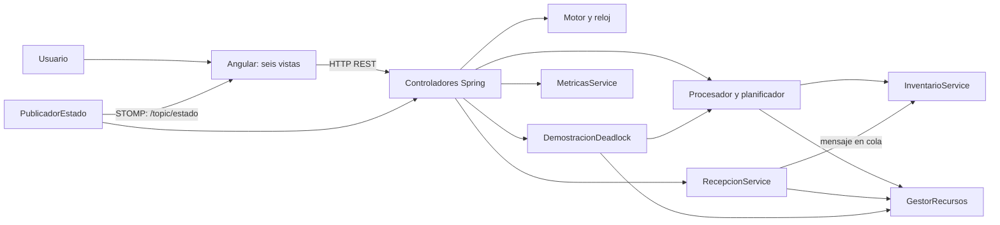

La UI solicita acciones a la API; los servicios de una JVM coordinan pedidos, recursos e inventario. Las flechas son dependencias o intercambio de información, no procesos remotos internos.

La arquitectura coloca todas las decisiones operativas en la JVM. Un navegador no controla la exclusión mutua de otro navegador ni debe convertirse en una segunda fuente de inventario. Las peticiones HTTP pueden llegar a la vez desde distintas vistas o clientes; los servicios coordinan ese acceso.

### Justificación y alternativas

Un monolito permite que un único monitor proteja reserva y almacenamiento y que los semáforos representen las unidades auténticas para todas las áreas. Microservicios exigirían coordinación remota, fallos parciales y transacciones adicionales sin resolver mejor el objetivo académico. Una aplicación de escritorio Java también sería viable para el enunciado, pero la pila web permite separar presentación y ejecución con acceso desde un navegador.

REST proporciona respuestas explícitas para comandos y consultas; STOMP sobre WebSocket difunde instantáneas de observación. Usar únicamente sondeo HTTP funcionaría con más consultas, pero no aprovecharía el canal de actualizaciones. WebSocket como único canal exigiría definir correlación, respuestas y errores de todos los comandos; aquí ese contrato ya lo aporta HTTP.

El estado en memoria evita que una base de datos o transacciones SQL oculten la sincronización que se desea estudiar. Su compromiso es la pérdida de datos al cerrar la aplicación, consumo de memoria durante cargas largas y ausencia de durabilidad. No equivale a un sistema logístico de producción.

### Interacción y evidencia

Una acción sigue Angular → controlador → servicio. El controlador traduce solicitudes y errores, no reimplementa algoritmos. `DominioConfiguration`, `SimulacionConfiguration` y `ProcesamientoConfiguration` conectan y cierran los servicios. `PublicadorEstado` reúne vistas para STOMP. La evidencia está en esas configuraciones, `ApiController`, `ComunicacionConfig`, `main.ts` y `ApiIntegracionTest`; véanse los enlaces de la sección 24.

## 4. Infraestructura y tecnologías

| Tecnología y versión declarada | Propósito | Configuración comprobada |
| --- | --- | --- |
| Java 21 | Hilos, monitores, semáforos, dominio y ejecutores | `backend/pom.xml`, `java.version=21` |
| Spring Boot 4.1.2 | Inyección, servidor HTTP, serialización y WebSocket | Parent del POM; starters webmvc y websocket |
| Maven 3.9.16 / Wrapper 3.3.4 | Compilación, pruebas y empaquetado reproducible | `backend/.mvn/wrapper/maven-wrapper.properties` |
| Angular y CLI 21.2.0 | Componentes standalone, rutas y presentación | `frontend/package.json` |
| TypeScript 5.9.3 | Contratos y comprobación estática | `package.json`, `tsconfig.json` con modo estricto |
| Node.js 24; `.nvmrc` 24.22.1 | Herramientas de instalación y compilación Angular | `engines >=24.0.0 <25` |
| STOMP JS 7.2.1 y RxJS 7.8.2 | Canal STOMP y peticiones HTTP con timeout | `package.json`, servicios frontend |
| Memoria principal | Registros, colas, reservas y ubicaciones | Colecciones de servicios; no driver de BD |

Son versiones fijadas en el repositorio; no se afirma aquí una auditoría externa del soporte vigente. HTTP transporta JSON, WebSocket mantiene una conexión bidireccional y STOMP añade destinos de suscripción. El broker simple está dentro de Spring, sin RabbitMQ ni Kafka.

### Despliegue lógico

**Despliegue lógico de desarrollo**

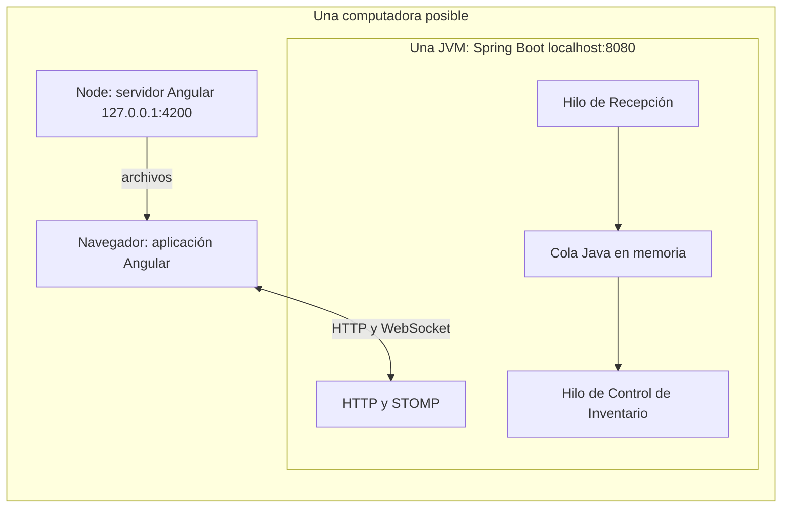

Node sirve Angular durante desarrollo; los dos hilos de las áreas comparten la misma JVM y se comunican por una cola en memoria.

Angular se ejecuta en el navegador y Node sirve los archivos durante el desarrollo; el negocio se ejecuta en la JVM de Spring. Ambos servidores pueden estar en una misma computadora. Los hilos de Recepción y Control de Inventario pertenecen a esa misma JVM; no son dos procesos del sistema operativo. La comparación crea instancias Java aisladas dentro del proceso, no contenedores ni JVM adicionales.

### Compilación y ejecución

Requiere JDK 21 (`JAVA_HOME` correcto), Node 24, npm y red en la primera descarga. Desde la raíz, en terminales distintas:

```bash
cd backend
./mvnw verify
./mvnw spring-boot:run
```

```bash
cd frontend
npm ci
npm test
npm run build
npm start
```

En Windows se usa `mvnw.cmd`. Abrir `http://127.0.0.1:4200`; el backend escucha en `http://localhost:8080`. La raíz HTTP del backend no es una página: consultar `/api/simulacion`. El JAR se genera en `backend/target/redxela-0.1.0.jar`; se puede ejecutar con `java -jar backend/target/redxela-0.1.0.jar`. La salida Angular está en `frontend/dist/redxela/browser/`; no se configura aquí un despliegue productivo de esos estáticos.

`application.yml` fija cuatro trabajadores y factor 60. Los trabajadores se configuran al crear el bean; la velocidad cambia también durante la corrida. CORS permite los dos orígenes locales de puerto 4200, por lo que cambiar puertos o desplegar en otro origen exige ajustar configuración. No hay autenticación; CORS no sustituye control de acceso.

```text
backend/src/main/java/gt/edu/usac/cunoc/redxela/
  api/ configuracion/           Integración Spring y contratos
  catalogo/ clientes/ pedidos/  Dominio, generación y ejecución
  simulacion/ planificacion/   Ciclo de vida, reloj y comparación de candidatos
  recursos/                    Unidades físicas y permisos
  recepcion/ inventario/        Canal entre áreas y almacén
  conflicto/ metricas/          Deadlock y consultas estadísticas
backend/src/test/java/          Pruebas JUnit
frontend/src/app/core/          REST, STOMP, estado y contratos
frontend/src/app/pages/         Seis vistas operativas
frontend/src/app/app.routes.ts  Navegación
```

### Compromisos y evidencia

Spring reduce código de infraestructura y permite probar servicios sin levantar HTTP; usar sockets manuales obligaría a implementar un protocolo innecesario. Angular y TypeScript aportan componentes y contratos, con costo de una cadena de compilación separada. Maven Wrapper evita depender del Maven global, aunque la primera ejecución requiere descargas. `package-lock.json` fija la instalación npm. `.gitignore` excluye `target`, `node_modules`, `dist` y cachés Angular.

## 5. Modelo de dominio

### Datos y relaciones

El dominio utiliza records inmutables y copias defensivas para evitar cambios concurrentes en una solicitud ya admitida. `PedidoService` almacena pedidos en `ConcurrentHashMap`; `AtomicLong` asigna `secuenciaEntrada`, usada como desempate y no como tiempo. `ClienteService` protege con un mismo monitor sus índices por UUID y correo. Normaliza el correo en minúsculas, exige formato básico y evita duplicados; no verifica buzones ni implementa cuentas autenticadas.

**Modelo de dominio simplificado**

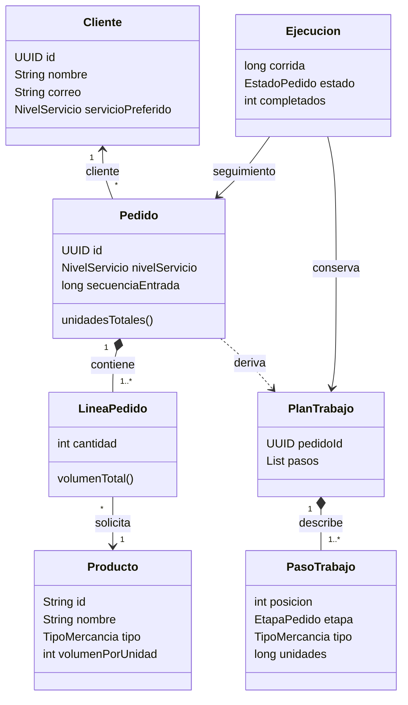

El modelo separa los registros inmutables de la ejecución mutable interna; el diagrama simplifica atributos y omite clases de transporte.

Este UML es un recorte del modelo: separa la descripción `PlanTrabajo` del progreso interno `Ejecucion` de `ProcesadorPedidos`. No representa todos los métodos ni los DTO de HTTP. Un pedido tiene un cliente, un nivel contratado y varias líneas; cada producto tiene su tipo y volumen. El nivel preferido del cliente no obliga al nivel del pedido.

| Elemento | Atributos o reglas principales |
| --- | --- |
| `Cliente` | `UUID id`, nombre, correo, `servicioPreferido`; campos requeridos |
| `Pedido` | UUID, cliente, nivel, lista defensiva de líneas, secuencia positiva; sin productos repetidos |
| `LineaPedido` | Producto canónico, cantidad `int > 0`; `volumenTotal()` usa `long` |
| `Producto` | Código normalizado, nombre, tipo, volumen entero positivo |
| `PlanTrabajo` | ID y lista inmutable de pasos; se construye una vez al admitir |
| `PasoTrabajo` | Posición, etapa, tipo y unidades agrupadas de ese tipo |
| `Ejecucion` interna | Corrida, plan, completados, estado, tiempos, asignados, banderas de admisión y conflicto, futuro |

`Pedido.estado()` devuelve siempre `CREADO`: es un registro de entrada. La fuente de estado operativo es `ProcesadorPedidos.consultar`, que produce `Progreso`. Exponer solo el record inicial daría una imagen equivocada del procesamiento.

### Catálogo y servicios

El catálogo es predefinido por requisito. Mantenerlo inmutable evita que una edición cambie el volumen o los recursos necesarios de un pedido activo. Permitir alta dinámica demandaría reglas adicionales de compatibilidad; no está implementado.

| Código | Nombre real | Tipo | Volumen por unidad |
| --- | --- | --- | --- |
| GEN-01 | Cuaderno universitario | GENERAL | 1 |
| GEN-02 | Paquete de camisetas | GENERAL | 1 |
| FRA-01 | Juego de vasos | FRAGIL | 2 |
| FRA-02 | Lámpara de vidrio | FRAGIL | 2 |
| PES-01 | Caja de herramientas | PESADO | 3 |
| PES-02 | Saco de material | PESADO | 4 |
| VOL-01 | Silla empacada | VOLUMINOSO | 5 |
| VOL-02 | Mesa plegable | VOLUMINOSO | 5 |
| ELE-01 | Equipo de cómputo paletizado | ELECTRONICA_PALETIZADA | 4 |
| ELE-02 | Equipo de sonido paletizado | ELECTRONICA_PALETIZADA | 3 |

**Nivel de servicio** decide preferencia y objetivo de primera atención. **Tipo de mercancía** decide recursos y etapas; ambas clasificaciones son independientes.

| Nivel | Enumeración | Objetivo simulado |
| --- | --- | --- |
| 1 | EXPRES | 30 s, decisión para concretar «casi instantáneo» |
| 2 | PRIORITARIO | 10 min |
| 3 | ESTANDAR | 30 min |
| 4 | PROGRAMADO | 60 min |
| 5 | ECONOMICO | 120 min |

Las etapas están ordenadas `RETIRO`, `EMPAQUE`, `CALIDAD`, `DESPACHO`. Calidad se omite si el tipo no la requiere. El plan agrupa unidades por tipo y recorre primero todas las retiradas, después empaques, calidades y despachos. No crea un paso por artículo.

### Perfiles de mercancía

B = encargado de bodega; E = empaque; M = montacargas; Q = calidad; C = carga; S = escáner. Las cantidades son **simultáneas por paso**, no equipos multiplicados por unidades de mercancía.

| Tipo y característica | Retiro | Empaque | Calidad | Despacho |
| --- | --- | --- | --- | --- |
| GENERAL: artículos pequeños ordinarios | B×1 | B×1, E×1 | — | B×1, C×1, S×1 |
| FRAGIL: protección y revisión de integridad | B×1 | B×1, E×1 | B×1, Q×1 | B×1, C×1, S×1 |
| PESADO: movimiento mecánico | B×2, M×1 | B×1, E×1 | — | B×2, M×1, C×1, S×1 |
| VOLUMINOSO: dos superficies de empaque | B×2, M×1 | B×2, E×2 | — | B×2, M×1, C×1, S×1 |
| ELECTRONICA_PALETIZADA: pallet y verificación funcional | B×1, M×1 | B×1, E×1 | B×1, Q×1 | B×1, M×1, C×1, S×1 |

Los perfiles completos son distintos aunque compartan pasos. Esto modela contención realista sin cambiar la prioridad por tipo. `RequisitosRecursos` valida que cada cantidad sea positiva y no supere la capacidad.

### Riesgos, alternativas y evidencia

Usar objetos mutables con setters permitiría cambiar una línea mientras se reserva; las copias inmutables reducen ese riesgo. La inmutabilidad no protege por sí sola el progreso ni las reservas, que necesitan monitores. Un pedido válido puede pedir más stock del que alguna vez podrá reservarse en este almacén: el dominio no garantiza viabilidad logística futura. `CatalogoTest`, `ClienteServiceTest`, `PedidoServiceTest` y `PlanTrabajoTest` verifican catálogo, perfiles, duplicados, registros concurrentes, copias y agrupación.

## 6. Motor de simulación

### Problema y fundamento

Acelerar duraciones sin una referencia común produciría métricas incompatibles: un pedido podría contar tiempo real y otro acelerado, o acumular espera durante una pausa. `MotorSimulacion` centraliza ciclo de vida y puerta de progreso; `RelojSimulado` calcula tiempo monotónico. El estado y la identidad de corrida se leen juntos mediante `estadoCorrida()` para evitar combinar una corrida nueva con un tiempo anterior.

**Ciclo de vida del motor**

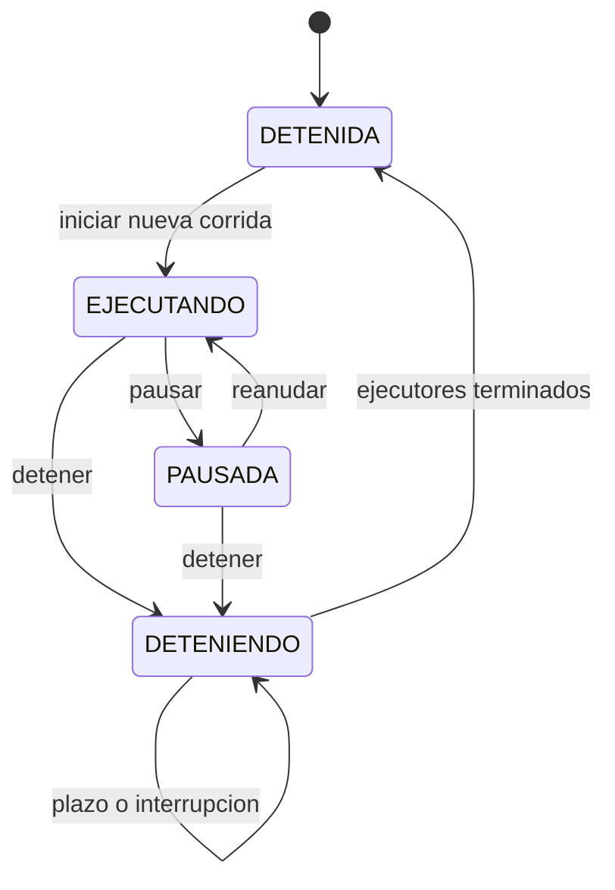

DETENIENDO permanece mientras no se confirme el cierre; una corrida nueva solo comienza desde DETENIDA.

`DETENIENDO` es una garantía de cierre, no un estado decorativo: impide reiniciar mientras no se confirme la terminación del ejecutor anterior. `detener()` es idempotente desde DETENIDA; iniciar, pausar y reanudar exigen su estado de origen. No se crean dos corridas simultáneas porque las transiciones comparten un `ReentrantLock(true)`.

### Reloj único y factor

El reloj no tiene hilo propio. Cada consulta acumula `deltaRealNanos × factor` desde la referencia anterior; usa `System.nanoTime()`, que sirve para intervalos y no representa una fecha del calendario. `Duration` expresa cantidades, no mide por sí sola el avance. Internamente se publican nanosegundos simulados y la API los convierte a milisegundos simulados.

Al cambiar factor, primero se acumula con la velocidad anterior y después se instala la nueva. Ejemplo didáctico: dos segundos reales a factor 60 acumulan 120 s simulados; otro segundo a factor 120 deja 240 s, no recalcula retroactivamente los dos primeros. En pausa `avanzando=false`; al reanudar se toma una nueva referencia real. Un `double` conserva fracciones entre consultas; la salida `long` satura en `Long.MAX_VALUE`. Los límites de cierre, HTTP y pruebas se miden en tiempo real porque deben operar incluso con reloj pausado.

### Pausa cooperativa y secuencia

`ContextoTrabajo` queda ligado a una corrida. `avanzar(Runnable)` toma el lock del motor, comprueba estado/corrida/interrupción y confirma un paso corto. Si está pausado, espera con `Condition.await()`. `esperar(Duration)` fija un objetivo simulado y utiliza `awaitNanos(ceil(restante/factor))`; esa espera libera el lock. Pausar, reanudar y cambiar velocidad despiertan la condición; el predicado se verifica en un bucle para tolerar despertares espurios.

**Secuencia de pausa y reanudación**

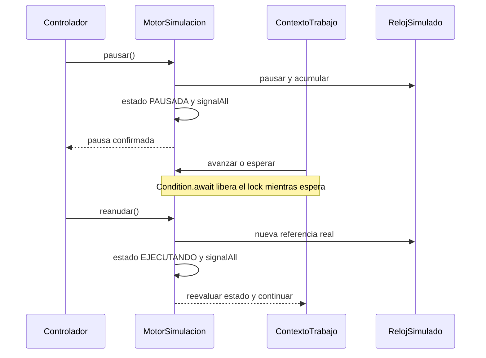

La condición libera el lock mientras se espera y revalida el predicado antes de permitir progreso.

El retorno de `pausar()` garantiza que terminó el paso corto que ya tenía la puerta y que otro paso cooperativo no se confirma hasta reanudar. No congela arbitrariamente una instrucción Java. Limpieza de recursos en `finally` puede ocurrir durante cancelación; no es trabajo logístico nuevo. Las operaciones en espera del escenario de deadlock pueden recibir un permiso liberado, pero deben pasar nuevamente por `avanzar` antes de efectuar trabajo.

`Thread.sleep()` solo demora un hilo real, no ofrece un predicado de pausa ni recalcula velocidad y no libera un monitor que se haya retenido. `Thread.suspend()` o `stop()` podrían congelar un hilo poseedor de un lock y dejar invariantes a medias. La condición y la interrupción cooperativa permiten liberar recursos de forma explicable. Una alternativa de ticks periódicos necesitaría un hilo y contadores adicionales; calcular bajo demanda evita ese costo y permite pruebas con una fuente temporal controlada.

### Detención y reinicio paso a paso

1. Bajo lock, `detener()` congela el reloj, marca DETENIENDO, cancela futuros y hace `shutdownNow()` de los ejecutores normal y de conflicto.
2. Señala la condición para que salgan las tareas pausadas.
3. Fuera del lock espera `awaitTermination` y hace `join` a los hilos creados. Un `Future` cancelado puede seguir ejecutando su `finally`; por eso cancelación no basta como prueba de terminación física.
4. Si todos terminaron, descarta los ejecutores y marca DETENIDA. Si vence el plazo de cinco segundos por ejecutor o se interrumpe el controlador, no declara un cierre exitoso: conserva DETENIENDO. Los propios trabajadores no pueden invocar un cierre que espere su terminación.
5. Una nueva llamada válida a `iniciar()` incrementa corrida, crea ejecutor y reinicia tiempo a cero; conserva el factor. Los contextos viejos fallan por identidad.

**Límite importante:** una nueva corrida no crea otra aplicación. Clientes, pedidos históricos, inventario y recepciones pendientes pueden permanecer en sus servicios. Se separan tiempos y métricas por corrida, no se vacía todo el estado. La comparación de políticas sí crea servicios nuevos para evitar residuos.

**Evidencia:** `MotorSimulacion`, `RelojSimulado`, `EjecutorTrabajos`; pruebas `iniciosConcurrentesSoloCreanUnaCorrida`, `esperaSimuladaDescuentaPausaYConservaTrabajoRestante`, `tareaQueIgnoraInterrupcionImpideDeclararDetenidaOIniciarOtraCorrida` y `RelojSimuladoTest`. Ninguna garantía cubre una tarea externa que ignore el contrato cooperativo o ejecute una espera larga dentro de `avanzar`.

## 7. Concurrencia y administración de hilos

### Qué se ejecuta realmente

Un hilo Java es un flujo de ejecución con pila propia que comparte memoria con los demás hilos de la JVM. **Concurrencia** significa actividades pendientes con ejecución intercalada; **paralelismo**, ejecución física a la vez en varios núcleos. La simultaneidad observada depende del planificador del sistema operativo: enviar dos tareas no garantiza el mismo instante de inicio ni el orden físico exacto.

| Actividad | Mecanismo real | Ciclo de vida |
| --- | --- | --- |
| Etapas normales de pedidos y escaneo de recepción | `EjecutorTrabajos`, por defecto cuatro trabajadores | Ejecutor por corrida; hilos no daemon, terminación comprobada |
| Selección de pedidos | Un `redxela-coordinador-pedidos`, daemon | Creado con el procesador; espera avisos y se une al cerrar |
| Coordinación de recepción y consumo | `redxela-recepcion` y `redxela-control-inventario`, daemon | Dos hilos del servicio, señales y cierre mediante interrupción/join |
| Generación | Un `redxela-generador-pedidos`, daemon | Al activar; espera tiempo simulado; se detiene/interrumpe |
| Preparar deadlock | Un `redxela-coordinador-deadlock`, daemon | Espera despachos y envía las dos operaciones |
| Dos operaciones de conflicto | Ejecutor separado de dos trabajadores | Creación perezosa por corrida; el motor lo cancela y espera |
| Comparación HTTP | `newSingleThreadExecutor()` en `ComparacionesController` | Una comparación activa; crea secuencialmente escenarios aislados |
| Atención HTTP y broker/publicación | Hilos administrados por Spring/Tomcat | Infraestructura del servidor; no se fija aquí un número global |

**Distribución y coordinación de hilos**

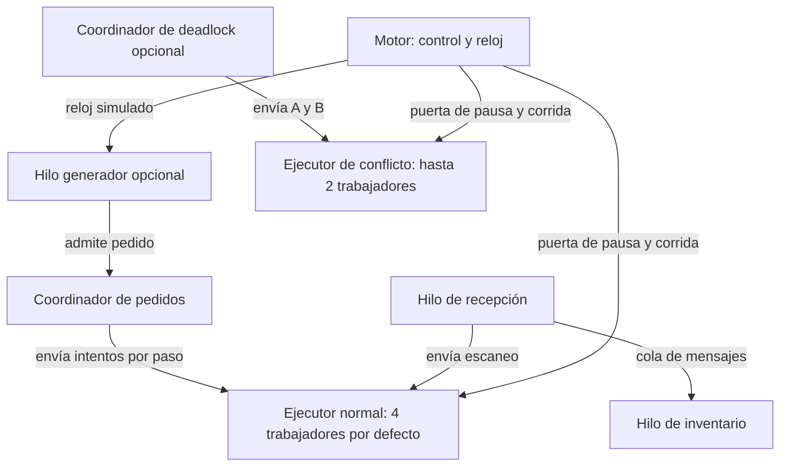

Los coordinadores esperan señales; solo las tareas admitidas usan los ejecutores. Spring y Tomcat también administran hilos de infraestructura.

El diagrama distingue coordinadores de trabajos físicos. La comparación tiene sus propios servicios y trabajador; no usa el inventario de la corrida principal. No debe interpretarse «cuatro trabajadores» como cuatro hilos totales de toda la aplicación.

### Cupos, cola y espera eficiente

`EjecutorTrabajos` usa `ThreadPoolExecutor` con tamaño central y máximo iguales al número configurado, una `ArrayBlockingQueue` de ese tamaño y un semáforo de cupos. `enviar()` hace `tryAcquire` al cupo: si no hay, lanza `RejectedExecutionException`. Por ello no acumula indefinidamente tareas ejecutables detrás de los trabajadores. La cola interna permite la transferencia durante el final de una tarea; no duplica la colección de pedidos pendientes.

`afterExecute` devuelve el cupo y avisa; la devolución ocurre después de la tarea, no solo al completar el Future. Se registran los `FutureTask` para cancelarlos; `done()` retira los terminados. Si falla el envío, se cancela el futuro y se devuelve su cupo. Al interrumpir una tarea se restablece la señal y no se declara éxito ficticio.

El coordinador de pedidos espera en un semáforo de avisos, drena señales acumuladas y selecciona hasta agotar candidatos o cupos. Una solicitud por recursos **sí ocupa brevemente un trabajador para intentar la combinación**, pero, si falla, retorna enseguida y deja el pedido en espera. No conserva un trabajador bloqueado en `acquire` normal. `versionBloqueada` evita reintentar la misma falta de recursos hasta que cambie la versión de liberación. Si no hay inventario, no se envía siquiera el intento de etapa.

### Justificación, alternativas y límites

Un hilo por pedido aumentaría pilas y cambios de contexto cuando la demanda crece. Un ejecutor con cola ilimitada escondería presión y haría difícil aplicar la política a las próximas etapas. El límite más una colección de pendientes controlada conserva esa decisión en el coordinador. Separar coordinador y trabajador evita que seleccionar o esperar stock consuma la capacidad que debería procesar trabajo.

No se usan virtual threads: reducirían el costo de un hilo bloqueado, pero no resuelven inventario ni límites físicos y hacen menos visible el límite académico de trabajadores. No se usa espera activa para recursos; las liberaciones y cambios despiertan coordinadores. Los avisos son señales, no mensajes logísticos: drenar sus permisos no descarta pedidos. Aun así, las colecciones históricas en memoria no tienen límite global y una carga sostenida puede agotarla. Los coordinadores daemon también se cierran explícitamente; daemon no significa que hayan terminado correctamente.

### Generación y flujo común

`GeneradorPedidos` espera inicialmente 30 s simulados mediante `motor.esperarTiempo`. Después, dentro de `avanzarSiEjecutando(corrida, ...)`, registra un cliente y un pedido y llama a `procesador.procesar`. Recorre cíclicamente cinco niveles; combina un producto principal rotativo con otros mezclados, 1–3 líneas distintas y cantidades aleatorias de 1–20. No tiene semilla reproducible configurada; por eso la comparación usa otro escenario fijo. Un cambio de intervalo se aplica a la siguiente espera iniciada; no reprograma el objetivo ya calculado.

La primera atención depende de recursos y stock, no de que el pedido sea automático. Pausa congela una espera aún en curso; detención invalida la corrida y hace terminar al generador. Existe una ventana entre el retorno de `esperarTiempo` y `avanzarSiEjecutando`: si se pausa exactamente allí, la puerta devuelve `false` y `generar` sale del bucle. En ese caso reanudar el motor no reactiva el generador automáticamente; debe iniciarse otra vez. Es un riesgo deducido del código, no un fallo reproducido en esta revisión. `detener()` del generador interrumpe su hilo y espera `join`. El cierre del motor confirma sus ejecutores; coordinadores independientes y generador responden a señales/interrupciones con sus propios ciclos de vida.

**Evidencia:** `EjecutorTrabajos.enviar`, `ProcesadorPedidos.coordinar/despachar/ejecutar`, `RecepcionService.producir`, `GeneradorPedidos.generar`; pruebas `dosTareasEjecutanEnParaleloYSaturacionSeRechazaSinColaOculta`, `esperaPorRecursosSinRetenerTrabajadorYContinuaAlLiberarlos` y `GeneradorPedidosTest`.

## 8. Semáforos y exclusión mutua

### Problema y representación

Que dos tareas lean «disponible» no implica que ambas puedan usar una estación. La exclusión exige una operación de adquisición indivisible. Un semáforo mantiene permisos: `tryAcquire()` consume uno si existe; `acquire()` espera hasta conseguirlo; `release()` lo devuelve. `GestorRecursos.Unidad` crea **un `Semaphore(1)` no justo por cada unidad física**, no uno con toda la capacidad por tipo.

| Tipo | Identificadores | Cantidad |
| --- | --- | --- |
| ESTACION_EMPAQUE | E01–E06 | 6 |
| AREA_CARGA | C01–C02 | 2 |
| ENCARGADO_BODEGA | B01–B10 | 10 |
| MONTACARGAS | M01–M03 | 3 |
| ESTACION_CALIDAD | Q01–Q04 | 4 |
| ESCANER | S01 | 1 |

**Asignación de recursos a operaciones**

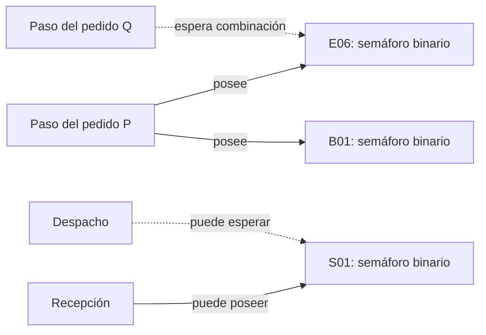

El gestor registra propietarios y solicitudes; una línea de espera no significa que una operación posea el recurso.

El propietario es una operación, como `UUID:indicePaso` o `recepcion:UUID`; no es la identidad del hilo. Los semáforos Java no imponen que quien libera sea el hilo que adquirió. Por eso la disciplina de asignaciones y cierre es parte de la corrección. A diferencia de un `ReentrantLock`, no puede asumirse una comprobación de propiedad de hilo en `release()`.

### Adquisición completa y liberación

1. `intentarAsignar` entra al monitor `synchronized` del gestor y rechaza una operación vacía o ya poseedora de recursos ordinarios.
2. Recorre `TipoRecurso.values()` y sus unidades; omite las reservadas para una recuperación y usa `tryAcquire`.
3. Si falta una cantidad, libera todos los permisos tomados en ese intento, registra requisitos en `esperando` y devuelve `Optional.empty()`.
4. Si la combinación está completa, registra propietario e inicio de ocupación de cada unidad, retira la espera y devuelve una `Asignacion`.
5. Al finalizar trabajo o fallar, `Asignacion.close()` bajo el mismo monitor devuelve permisos, acumula ocupación, borra propietario, incrementa `version` y avisa. La bandera `cerrada` vuelve idempotente ese objeto de asignación.

**Flujo de adquisición ordinaria**

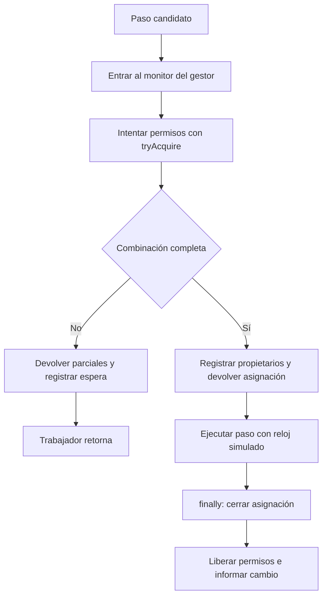

El intento parcial no sobrevive al fallo; el cierre de la asignación es idempotente.

La atomicidad observable resulta de combinar semáforos reales con el monitor que protege sus metadatos. Los permisos parciales de un intento fallido no se publican como asignación y no permanecen retenidos entre reintentos. `estado()` copia unidades sin adquirirlas. Durante la transferencia del conflicto puede existir unidad reservada para el ganador y aún sin propietario; `disponible=false` expresa que no es utilizable por un trabajo ajeno. `disponibles(tipo)` cuenta permisos, mientras `estado()` también considera esa reserva: no son consultas semánticamente idénticas durante recuperación.

### Fundamento, alternativas y contención concreta

La adquisición completa elimina la condición de **retención y espera** entre asignaciones físicas ordinarias: no se espera por un segundo recurso mientras se conserva una parte. Esto previene el deadlock físico normal. No demuestra ausencia de deadlocks por cualquier combinación de monitores: ese problema se aborda con secciones breves y disciplina de locks.

Un semáforo contador por tipo también limitaría capacidad, pero no diría qué estación concreta está ocupada ni permitiría nombrar C01/S01. Un `boolean ocupado` protegido por monitor bastaría para una simulación básica, pero no demostraría permisos reales. Un orden global de adquisición bloqueante es otra prevención válida; aquí exigiría mantener trabajadores esperando, mientras `tryAcquire` y reencolar conserva capacidad útil. No se implementa algoritmo del banquero ni cálculo general de estados seguros.

**Ejemplo didáctico:** P y Q necesitan una estación de empaque y un encargado. Si E01–E05 ya están ocupadas, P obtiene E06+B01 y trabaja. Q intenta primero las estaciones —ese tipo precede a los encargados en el recorrido— y, al no encontrar ninguna libre, retorna sin asignación. Cuando P cierra su asignación se incrementa la versión y Q vuelve a competir. En otro intento, si Q toma una estación libre pero todos los encargados están ocupados, devuelve esa estación antes de retornar. Si había suficientes estaciones y encargados libres, ambos podrían trabajar a la vez en unidades distintas.

La preferencia de planificación no se convierte en justicia FIFO de los semáforos. Con demanda continua puede haber inanición de una combinación difícil de conseguir. No se garantiza plazo máximo solo por usar semáforos.

**Evidencia:** `GestorRecursos.intentarAsignar`, `Asignacion.close`, `fotoConflicto`; `GestorRecursosTest` prueba exclusión, combinación completa, cierre idempotente y competencia concurrente. `InventarioIntegracionTest.recepcionYDespachoRealEsperanElMismoEscaner` comprueba que S01 no está duplicado.

## 9. Planificación de pedidos

### Problema y algoritmo real

No se planifican hilos del sistema operativo ni una CPU única. Se decide qué pedido pendiente intentará ejecutar su siguiente paso, con varios trabajadores. `PlanificadorPedidos` es una clase de comparadores sobre `Candidato(Pedido, esperaNanos)`; no mantiene cola propia. `ProcesadorPedidos.ejecuciones` sigue siendo la fuente única y su coordinador selecciona con `min(comparador)`.

**Selección y asignación de pedidos**

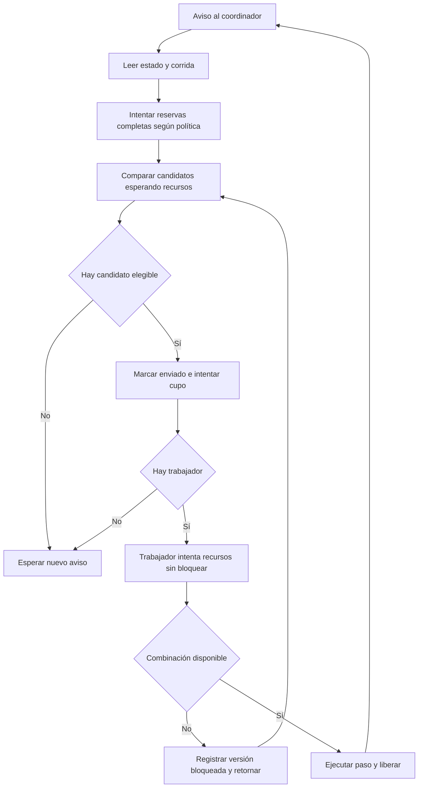

La preferencia ordena candidatos, pero la factibilidad depende de stock, cupos y recursos.

La selección distingue preferencia y factibilidad. Antes de seleccionar etapas se intentan reservas completas en el orden de la política, pero se sigue con otros pedidos cuando uno no tiene stock. Después, el intento breve del trabajador comprueba recursos; un fallo deja al pedido pendiente y permite avanzar a otro. `consultarCola()` presenta incluso pedidos sin inventario, aunque no sean elegibles para ejecutar físicamente.

| Política | Clave de comparación exacta | Ventaja y fundamento | Desventaja y limitación |
| --- | --- | --- | --- |
| PRIORIDAD | `nivelServicio().nivel()` ascendente | Planificación por prioridad estática; favorece servicio contratado | Los niveles bajos pueden sufrir inanición si siguen llegando altos |
| AGING | `nivel - esperaNanos / intervaloNanos` ascendente | Envejecimiento por espera; reduce postergación de pedidos antiguos | No crea stock ni capacidad; no prueba espera acotada bajo sobrecarga |
| SJF | `unidadesTotales()` ascendente | SJF usa tamaño como aproximación del trabajo | Pedidos grandes pueden esperar mucho; unidades no incluyen todas las diferencias de tipo |

Todos desempatan por `secuenciaEntrada` ascendente, equivalente a FCFS entre claves iguales. La división entera de nanosegundos no negativos implementa `floor`; el intervalo inicial es cinco minutos y debe ser positivo y representable. No se limita la prioridad efectiva a 1: puede ser cero o negativa.

### Semántica exacta de aging

```java
return candidato.pedido().nivelServicio().nivel()
        - candidato.esperaNanos() / intervaloNanos(intervalo);
```

En la integración, `candidato` usa `espera(e, ahora)`: suma espera acumulada y el intervalo abierto si el estado es ESPERANDO_RECURSOS o ESPERANDO_INVENTARIO. **Incluye espera de inventario**, no solamente tiempo elegible para recursos. No aumenta mientras EN_PROCESO y conserva el acumulado entre etapas. Esta es la implementación actual; la expectativa inicial de F1 de usar exclusivamente tiempo elegible no se materializó. No se corrige el algoritmo en esta rama documental.

No se mantiene una `PriorityBlockingQueue` con claves temporales mutables porque necesitaría reordenarse para cada cambio del reloj. Recalcular al seleccionar es sencillo con las cargas académicas; cuesta recorrer los candidatos y no pretende escalar a millones de pedidos. Un hilo que incremente prioridades agregaría sincronización y podría divergir del tiempo simulado.

### Ejemplo numérico de las tres políticas

Ejemplo didáctico en un mismo instante de selección, con todos elegibles e intervalo de 5 min:

| Pedido | Nivel | Unidades | Secuencia | Espera | Prioridad efectiva |
| --- | --- | --- | --- | --- | --- |
| A | ECONOMICO = 5 | 20 | 1 | 25 min | 5 − 5 = 0 |
| B | EXPRES = 1 | 12 | 2 | 0 min | 1 − 0 = 1 |
| C | ESTANDAR = 3 | 5 | 3 | 0 min | 3 − 0 = 3 |

**Ejemplo de orden por política**

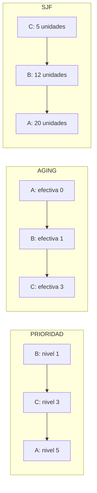

Los tres órdenes son el cálculo didáctico de la tabla anterior, en una sola instantánea y con todos los candidatos elegibles.

Así PRIORIDAD da B→C→A, AGING da A→B→C y SJF da C→B→A. El gráfico representa preferencia en esa instantánea, no un diagrama de Gantt medido. Con varios trabajadores y recursos distintos pueden empezar varios pasos concurrentemente y el orden físico puede variar.

`cambiarPolitica` e `intervaloAging` se protegen con el monitor del procesador y notifican al coordinador. La actualización afecta futuras selecciones; no cancela la etapa activa. La planificación es no expropiativa **por paso**, no una reserva del centro para todo el pedido. La cantidad total usada por SJF permanece fija a lo largo del plan; no se usa trabajo restante recalculado.

**Evidencia:** `PlanificadorPedidos.comparador/prioridadEfectiva`, `ProcesadorPedidos.despachar/consultarCola`; `PlanificadorPedidosTest` verifica órdenes y desempates; `PlanificacionIntegracionTest` verifica reloj, pausa, cambios sin interrupción, otros candidatos ante falta de recursos y pasos no repetidos. Son adaptaciones conceptuales de FCFS/SJF de las prácticas, no reproducción de una CPU secuencial ni reutilización afirmada de código externo.

## 10. Procesamiento de pedidos

### Recorrido y secuencia entre servicios

1. `PedidoService.crear` valida cliente, nivel y líneas del catálogo y registra el pedido inmutable.
2. `ProcesadorPedidos.procesar` admite una sola ejecución por ID, con corrida, llegada simulada y un `PlanTrabajo` construido una vez.
3. La ejecución comienza ESPERANDO_INVENTARIO. El coordinador intenta reserva completa; si no existe stock, no envía un trabajador.
4. Al reservar pasa a ESPERANDO_RECURSOS y participa en planificación.
5. El trabajador intenta la combinación completa, registra primera atención si corresponde y marca EN_PROCESO.
6. `contexto.esperar(duracion(paso))` modela trabajo; la pausa congela ese avance.
7. En el punto corto de finalización, un paso RETIRO confirma `inventario.retirar(id,tipo)`. Se acumula tiempo y se incrementa `completados` una vez.
8. En `finally` cierra asignación, limpia recursos y banderas. Si quedan pasos se reencola; si no, marca COMPLETADO y completa el futuro.

**Flujo completo de un pedido**

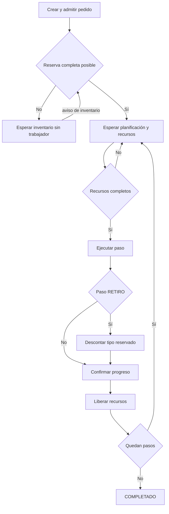

La repetición vuelve a seleccionar la próxima etapa y conserva el checkpoint; los caminos de error se describen en el texto.

**Secuencia de servicios por paso**

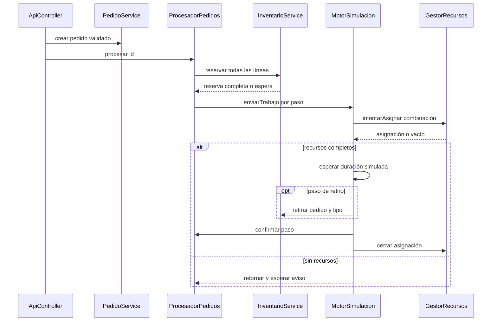

La interacción real ejecuta el intento de recursos dentro del trabajo enviado; no existe un servicio adicional de ejecución de pedidos.

El flujo muestra que reservar disminuye disponibilidad y retirar disminuye físico. El retiro ocurre **al terminar su paso**, no en cada cambio de etapa ni al finalizar todo el pedido. La secuencia separa el coordinador del trabajador para explicar dónde se toma la decisión y dónde se ejecuta.

### Estados reales y progreso

**Estados operativos principales de ejecución**

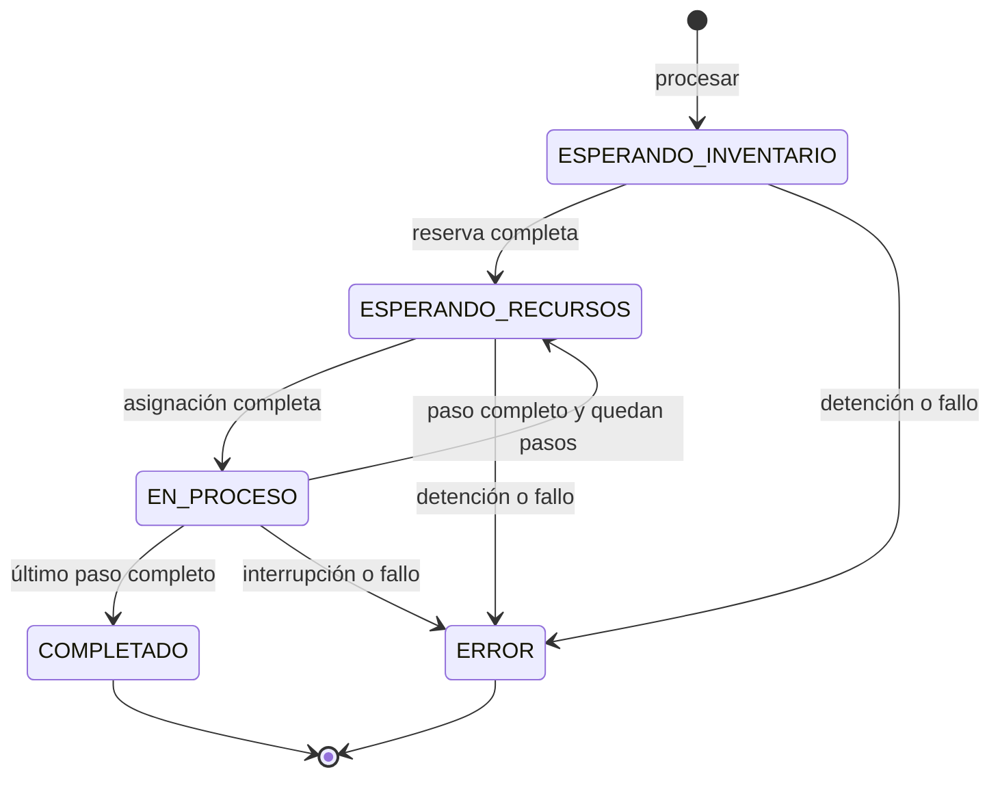

Se muestran las transiciones utilizadas normalmente; el enum declara valores adicionales y el conflicto se explica en la sección 14.

El enum `EstadoPedido` incluye CREADO, ESPERANDO_INVENTARIO, EN_COLA, EN_PROCESO, ESPERANDO_RECURSOS, BLOQUEADO_DEADLOCK, RECUPERANDO, COMPLETADO, ERROR y CANCELADO. Sin embargo, el progreso actual usa principalmente ESPERANDO_INVENTARIO, ESPERANDO_RECURSOS, EN_PROCESO, COMPLETADO y ERROR. `EN_COLA` no es una fase adicional obligatoria; `CANCELADO` no tiene comando específico y la detención se registra como ERROR. Durante conflicto, Angular deriva BLOQUEADO_DEADLOCK o RECUPERANDO de `DemostracionDeadlock.Vista`; el procesador conserva espera/ejecución operativa. El diagrama no inventa transiciones para todos los valores declarados.

El porcentaje es `100 × pasosCompletados / pasosTotales`, por lo que avanza por pasos completos, no por cada milisegundo. La estimación restante solo se publica EN_PROCESO: suma duraciones nominales de pasos pendientes y resta el tiempo transcurrido del actual, con mínimo cero. No predice esperas futuras por inventario o recursos y no es una fecha comprometida.

### Duración y ejemplos didácticos

`duracion(PasoTrabajo)` es **1000 ms + 100 ms × unidades del tipo en ese paso**, en tiempo simulado. No cambia por nivel de servicio.

- 1 unidad GENERAL: tres pasos de 1100 ms → 3300 ms nominales sin esperas.
- 10 unidades GENERAL: tres pasos de 2000 ms → 6000 ms nominales.
- 10 unidades FRAGIL: retiro, empaque, calidad y despacho, cuatro pasos de 2000 ms → 8000 ms.
- Un pedido de 2 GEN-01 y 3 FRA-01 tiene 7 pasos: 3 generales de 1200 ms y 4 frágiles de 1300 ms → 8800 ms nominales. Todas las retiradas preceden a cualquier empaque.

Estos valores son trabajo nominal, no necesariamente el procesamiento medido: la confirmación de fin depende del planificador de hilos. SJF compara unidades totales (5 en el ejemplo mixto), por lo que solo aproxima la duración, especialmente entre tipos con calidad.

### Justificación, fallos y evidencia

Plan y progreso separados evitan reconstruir la ruta al reintentar y repetir retiros. `enviado` impide enviar dos veces el mismo paso; `completados` es el checkpoint y no se incrementa si no terminó. Retener recursos de todo el pedido bloquearía equipos que no usa la etapa; liberarlos por paso permite concurrencia y nueva selección de política. La alternativa de ejecutar todas las etapas del pedido en un único trabajador simplificaría el flujo, pero reduciría oportunidades de replanificar y podría monopolizar capacidad.

`ApiController.crearPedido` usa la puerta del motor para crear y admitir coherentemente ante pausa/detención. Si falla antes de quedar admitido, elimina únicamente el objeto recién creado mediante `descartarNoAdmitido`; si ya se admitió, conserva el ID y comunica el error. No es una transacción genérica ni garantiza deshacer efectos de un fallo arbitrario. El generador usa el mismo procesador, pero no incorpora ese descarte excepcional del controlador; un fallo de ejecución no controlado podría dejar un registro creado sin admitir.

Ante interrupción o `RuntimeException`, se marca ERROR, se liberan permisos en `finally`, se cancela la reserva pendiente y el futuro se completa excepcionalmente. Mercancía ya retirada permanece descontada. `ProcesadorPedidosTest`, `PlanTrabajoTest`, `PlanificacionIntegracionTest` y `AdmisionPedidoTest` verifican estos puntos; no se implementa recuperación automática de pedidos con error.

## 11. Productor-consumidor y comunicación entre áreas

### Problema, fundamento y solución

Recepción puede aceptar ingresos más rápido de lo que Inventario puede ubicarlos. Si cada área escribiera las listas internas de la otra, compartirían invariantes y fallos. El patrón **productor-consumidor** desacopla la producción de mensajes de su consumo mediante un canal seguro. En esta implementación ambas responsabilidades están en `RecepcionService`, con dos hilos independientes; el consumidor invoca operaciones públicas de `InventarioService`, sin modificar sus colecciones privadas.

**Productor-consumidor entre áreas**

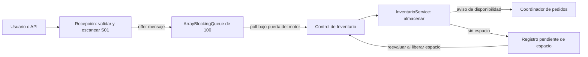

Las flechas representan mensajes y avisos dentro de una JVM; el registro pendiente conserva un ingreso que todavía no cabe.

`IngresoMercaderia(UUID id, String producto, int cantidad)` es el mensaje. La `ArrayBlockingQueue` tiene capacidad 100 en la configuración Spring. Su publicación y extracción proporcionan visibilidad entre hilos; no se necesita serializar el mensaje como si cruzara la red. Un `Semaphore` de aviso despierta al consumidor; el mensaje y su trazabilidad permanecen en cola/registro, no en ese aviso.

### Recepción paso a paso

1. `registrar` resuelve un producto del catálogo y valida cantidad. Rechaza cantidades que no cabrían ni en el almacén vacío, considerando unidades completas por ubicación.
2. Bajo monitor, verifica que no esté cerrado, que el motor observado esté ejecutándose y que existan menos de 100 recepciones no terminales. Registra el UUID en ESPERANDO_ESCANER y devuelve aceptación.
3. El hilo productor solicita un trabajador. Su tarea intenta S01 mediante el gestor existente. Si no lo obtiene, retorna y reintenta tras una liberación; no mantiene un trabajador esperando el escáner.
4. Con S01, espera un segundo simulado. **Libera el escáner antes de publicar**.
5. En `contexto.avanzar` hace `cola.offer(ingreso)` y cambia a EN_COLA bajo monitor. No usa `put` indefinido mientras ocupa el escáner.
6. El consumidor, dentro de `motor.avanzarSiEjecutando`, extrae con `poll` y marca PENDIENTE_ESPACIO. Después intenta almacenar cada pendiente con la misma puerta de pausa.
7. Si `almacenar` devuelve true, pasa a ALMACENADA. Si no cabe, conserva mensaje en su registro con motivo Espacio insuficiente; un lote grande no impide intentar otros pendientes pequeños. Al retirar mercancía se despierta al consumidor para reevaluarlos.

**Secuencia de recepción**

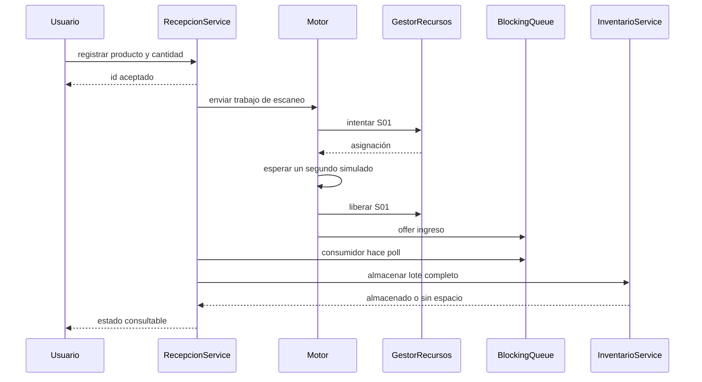

La aceptación precede al escaneo y la publicación. El consumidor es otro hilo de RecepcionService, que llama a InventarioService.

La secuencia separa aceptación HTTP, escaneo y confirmación de almacenamiento. Extraer de la cola no implica completar recepción: el registro PENDIENTE_ESPACIO conserva su identidad. El FIFO corresponde al orden de **publicación**, no a una garantía de finalización de todas las solicitudes en orden de llegada; los escaneos y la capacidad pueden cambiar el orden de progreso.

### Presión, pausa y detención

El límite de 100 abarca ESPERANDO_ESCANER, ESCANEANDO, EN_COLA y PENDIENTE_ESPACIO. Cada solicitud admitida dispone de un crédito hasta quedar terminal; así no se aceptan 100 mensajes más otros cientos esperando escanear. Si se agota, `RejectedExecutionException` se convierte en HTTP 429. Una alternativa con cola ilimitada ocultaría saturación y agotaría memoria; bloquear indefinidamente al hilo HTTP no daría una respuesta útil al usuario. Un broker externo resolvería otro alcance con costo operativo innecesario.

El consumidor no extrae ni almacena durante pausa: los `poll` y la confirmación usan la puerta del motor. Reanudar emite señales aunque avisos anteriores se hayan consumido. Al detener, se interrumpe el escaneo; los pendientes se conservan para la siguiente corrida. Si el mensaje ya fue publicado, su estado evita volver a escanearlo. `InventarioService.lotes` rechaza una segunda incorporación del mismo UUID; no se presenta como una deduplicación silenciosa de cualquier reintento.

Al cerrar el servicio se interrumpen y unen productor/consumidor, se cancelan trabajos y se marcan pendientes como ERROR. El mapa de trabajos elimina tareas terminadas, incluso canceladas antes de ejecutar; los registros terminales consultables no tienen retención acotada. «Sin pérdida de aceptados» significa consistencia durante la vida del proceso, no durabilidad ante apagado o caída de la JVM.

### Ejemplo, alternativas y evidencia

Ejemplo didáctico: Recepción acepta R1 con GEN-01×12, escanea usando S01, lo libera y publica `{id: R1, producto: GEN-01, cantidad: 12}`. Inventario puede consumirlo después. Si no hay espacio, R1 queda pendiente sin sumar doce unidades ficticias. Otra recepción menor puede completar, y cuando se libera capacidad R1 se reevalúa.

Esto relaciona comunicación por pipes/FIFO de las prácticas C con comunicación entre tareas Java: hay productores, consumidores y transferencia ordenada de información, pero **no hay `fork`, procesos separados ni tuberías POSIX**. Se eligió `BlockingQueue` por su contrato seguro y capacidad acotada; una lista compartida requeriría implementar señales y visibilidad manualmente.

**Evidencia:** `RecepcionService.registrar/producir/escanear/consumir/close`, `InventarioService.almacenar`; pruebas F5 `recepcionesAceptadasSeProcesanSinPerdida`, `colaAcotadaYContencionDelUnicoEscaner`, `pausaNoAlmacenaPendientesAunqueSeLibereEspacio`, `detenerMientrasSeEscaneaReintentaSinDuplicar` y `detenerDurantePublicacionNoDuplicaElMensaje`.

## 12. Inventario y reservas

### Problema y fundamento

Leer stock y reservar después en operaciones separadas causa una condición de carrera de tipo comprobar-y-actuar. `InventarioService` usa **el mismo monitor** para existencias, reservas, fragmentos y capacidad. `existencia` calcula físico desde fragmentos y reservado desde las reservas; no mantiene contadores físicos paralelos que puedan divergir.

```text
disponible(producto) = físico(producto) − reservado(producto)
```

`reservar(Pedido)` comprueba todas las líneas y añade un mapa por ID solo si alcanzan todas. Repetir la reserva del mismo pedido es error. No elimina fragmentos ni libera espacio: las unidades aún están físicamente guardadas. `retirar(id,tipo)` al final del paso RETIRO elimina las líneas del tipo correspondiente, reduce fragmentos y volumen y elimina esa parte de la reserva. Un segundo retiro del mismo tipo se rechaza.

**Reserva atómica y reactivación**

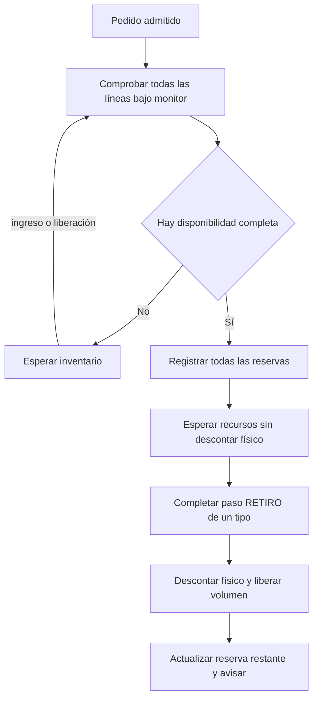

La comprobación de todas las líneas y su reserva son atómicas; retirar se realiza después por tipo y por paso.

La reserva y la reactivación son pasos distintos: al llegar stock, Inventario avisa; el coordinador vuelve a comprobar pedidos pendientes según la política, y solo los que reservan pasan a esperar recursos. La señal no reserva automáticamente todo para el primer pedido que despierte.

### Ejemplo numérico y garantías

Ejemplo didáctico: hay cinco unidades físicas, cero reservadas. P y Q piden cinco cada uno. Si P entra primero al monitor, deja físico 5, reservado 5 y disponible 0. Q observa disponible 0 y no obtiene reserva. Al retirar P, queda físico 0 y reservado 0; Q sigue esperando. Sin exclusión, ambos podrían leer 5 y reservar 10, produciendo disponibilidad negativa.

Si P pidiera además FRA-01×2 y faltara una unidad de esa línea, no obtendría **ninguna** reserva, ni siquiera las cinco GEN-01 disponibles. Una reserva parcial permitiría que varios pedidos conservaran stock distinto sin completar ninguno; todo-o-nada facilita avance y cancelación. La política puede favorecer otro pedido que sí tenga todas sus líneas.

Cancelar una reserva libera compromisos todavía no retirados; no repone físicamente artículos ya retirados. Esta distinción conserva la realidad operativa en una interrupción. El procesador guarda el checkpoint y no vuelve a ejecutar los pasos de retiro completados al recuperarse del deadlock.

### Justificación y límites

Un único monitor resulta adecuado para diez productos y cien ubicaciones: mantiene invariantes que cruzan varios productos sin bloqueos por línea ni transacciones. Locks por producto podrían aumentar paralelismo pero exigirían orden global y coordinación con ubicaciones; una transacción SQL trasladaría la exclusión al motor de BD. Las alternativas son razonables para otra escala, no están implementadas.

Las consultas y reservas recorren colecciones; el costo aumenta con los registros históricos. No se publica una garantía de tiempo máximo para reservar. El dominio acepta pedidos demasiado grandes para reunir simultáneamente todo el stock posible: pueden esperar indefinidamente aunque se reponga; es una limitación logística. Los errores de invariantes lanzan excepción explícita, no inventan stock para completar un retiro.

**Evidencia:** `InventarioService.existencia/reservar/retirar/cancelarReserva`, `ProcesadorPedidos.despachar`; `dosPedidosNoReservanLasMismasUnidades`, `reservaCompletaYRetiroNoRepetido`, `esperaInventarioSeReactivaPorRecepcionSinDobleRetiro` y `detenerLiberaReservasYConservaElRetiroConfirmado`.

## 13. Administración de almacenamiento

### Organización y First Fit

El enunciado permite definir capacidad; se adoptaron cinco pasillos, cinco estantes por pasillo y cuatro niveles por estante: **100 ubicaciones de 10 unidades de volumen**, total nominal 1000. No es un dato físico proporcionado por el enunciado. Es un tamaño pequeño que permite demostrar capacidad finita, fragmentación y consultas comprensibles.

**Organización del almacén**

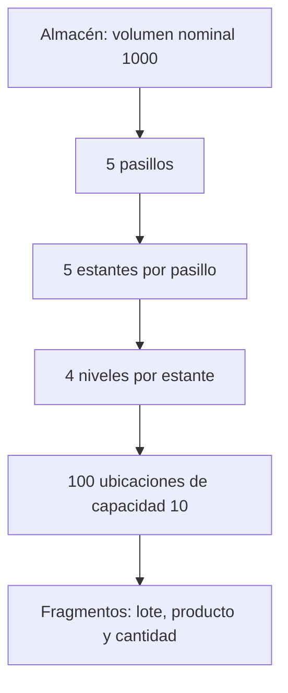

El total proviene de 5 × 5 × 4 ubicaciones y el volumen por unidad del producto determina cuántos artículos caben.

Los identificadores van de P01-E01-N01 a P05-E05-N04. Cada ubicación conserva volumen ocupado y una lista de `Fragmento(lote,producto,cantidad)`. Un mismo lugar puede contener fragmentos de varios productos o lotes; no hay restricción de exclusividad por SKU. El volumen entero por producto relaciona unidades de stock con espacio.

`almacenar` hace una comprobación completa antes de modificar:

```text
capacidadEnUnidadesDelProducto = suma floor((10 − ocupadoUbicacion) / volumenPorUnidad)
```

Si el lote cabe, recorre posiciones en orden pasillo–estante–nivel y almacena `min(restante, espacioEntero)` unidades en cada una. Ese es **First Fit** por recorrido fijo. Si no cabe, devuelve false y deja inventario intacto. Bajo el mismo monitor que los retiros no puede sobrepasar capacidad por un ingreso concurrente.

### Fragmentación: ejemplo didáctico

Supóngase que GEN-01 (volumen 1) encuentra huecos de 4, 3 y 5 unidades en P01-E01-N01, P02-E03-N02 y P04-E01-N03, con las posiciones intermedias llenas. Un lote de 12 unidades se distribuye 4+3+5 sin necesidad de contigüidad.

**Lote en huecos no contiguos**

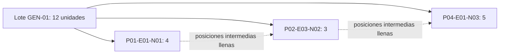

El ejemplo presupone ocupados los espacios intermedios; First Fit rellena los primeros huecos suficientes en orden.

El diagrama representa un ejemplo de huecos previos, no una medición. First Fit no obliga a repartir entre pasillos: si la primera posición tiene espacio suficiente se utiliza. La distribución no contigua se produce por la ocupación anterior.

El volumen agregado no siempre basta. Para volumen 3 y huecos de 4 y 7, caben `floor(4/3)+floor(7/3)=1+2=3` unidades, no cuatro, aunque ambos huecos sumen once unidades de volumen. El espacio residual menor al tamaño del artículo es fragmentación de aprovechamiento por unidades indivisibles.

### Justificación, alternativas y pendientes

First Fit requiere un recorrido simple, conserva ubicación y evita algoritmos de compactación innecesarios. **Best Fit** elegiría el hueco más ajustado y **Worst Fit** el mayor, pero añadirían selección y no garantizan ausencia de fragmentación; no están implementados. Un contador de volumen total no permitiría saber dónde está guardada la mercancía ni comprobar huecos suficientes para unidades completas.

Los lotes pendientes permanecen en registros de recepción y se reevalúan al liberar espacio. No se retiene parcialmente un lote nuevo en ubicaciones mientras el resto espera. Un lote grande no encabeza una cola bloqueante de almacenamiento: el consumidor intenta los demás pendientes. Al retirar, se recorren fragmentos en orden y se reduce ocupado; no se hace compactación ni traslado de artículos. El identificador del lote sigue asociado a los fragmentos restantes.

**Evidencia:** `InventarioService` constructor, `almacenar`, `retirar` y `ubicaciones`; `loteFragmentadoEntreHuecosNoContiguosSinExcederCapacidad` y `pendientePorEspacioNoBloqueaOtrosYSeReevaluaAlRetirar`. Las ubicaciones y los fragmentos son consultables por REST y Angular; la fragmentación no contigua tiene evidencia automatizada, sin afirmar una demostración visual exhaustiva de ese caso.

## 14. Deadlock: generación, detección y recuperación

### Problema y distinción de conceptos

El enunciado exige provocar un bloqueo circular auténtico y elegir manualmente quién continúa. El sistema usa **prevención** en el flujo ordinario, **detección** sobre asignaciones del conflicto y **recuperación** mediante cancelación cooperativa del perdedor. No son sinónimos: prevenir evita que aparezca la condición; detectar reconoce una condición existente; recuperar modifica su ejecución para permitir progreso.

`DemostracionDeadlock` aparta el próximo despacho compatible de dos pedidos registrados, conserva el checkpoint del procesador y usa las unidades existentes C01 y S01. La interfaz admite exclusivamente líneas GENERAL; el backend comprueba el próximo despacho y que no haya empezado ya. Preparar antes de recibir stock vuelve reproducible la llegada de ambos a despacho.

### Adquisición inversa real

1. El coordinador espera a que `listoParaConflicto` sea true para ambos; marca sus despachos enviados y crea dos trabajos en el ejecutor de conflicto.
2. A obtiene C01 y un encargado; B obtiene S01 y un encargado. El personal se registra como `despacho-conflicto:UUID:personal`, separado del identificador usado para el ciclo.
3. Cada operación reduce `primeros`, un `CountDownLatch(2)`, y espera a la otra **fuera** de la puerta del motor.
4. A anuncia espera por S01 y B por C01. Cada una llama a `adquirirFisicoEsperado`, que hace `Semaphore.acquire()` fuera del monitor del gestor.
5. A conserva C01 y B S01; ninguna puede adquirir su segundo recurso. No están durmiendo para fingir bloqueo: esperan permisos ausentes.

**Grafo de asignación y espera circular**

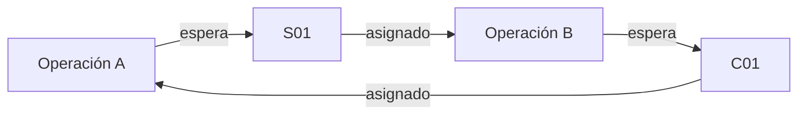

Cada unidad representa un permiso; las flechas forman la espera circular A → S01 → B → C01 → A.

En el grafo, recurso→operación representa asignación y operación→recurso representa solicitud pendiente. Como cada unidad tiene un permiso, la vuelta A→S01→B→C01→A impide progreso. El personal adicional existe, pero no es necesario para representar este ciclo y se omite del grafo.

**Secuencia de provocación del deadlock**

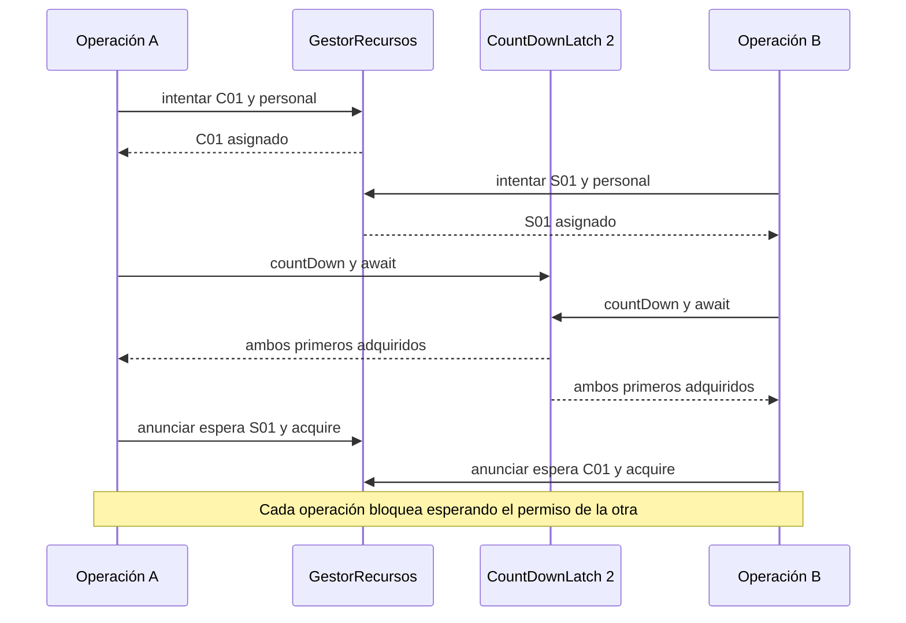

El latch coordina los primeros permisos; los acquire posteriores son esperas reales de semáforos.

La secuencia usa el latch para que el orden de inicio de los hilos no determine el resultado: ambos primeros recursos deben estar retenidos antes de solicitar el segundo. No se usa `Thread.sleep()` para producir el conflicto. Si los primeros recursos están ocupados por trabajo ordinario, las tareas esperan avisos de disponibilidad; no se cancela arbitrariamente a sus propietarios.

### Condiciones de Coffman en REDXela

| Condición necesaria | Manifestación concreta |
| --- | --- |
| Exclusión mutua | C01 y S01 tienen cada uno un permiso; no pueden pertenecer simultáneamente a dos operaciones |
| Retención y espera | A mantiene C01 al pedir S01 y B mantiene S01 al pedir C01; también conservan su personal |
| Ausencia de expropiación automática | Un permiso no se quita por timeout; la operación cancela cooperativamente y libera sus asignaciones |
| Espera circular | Cada operación necesita la unidad retenida por la otra |

La recuperación posterior rompe la retención/espera de una víctima; no significa que no hubiera deadlock antes. No se utiliza `Thread.stop()` ni una liberación arbitraria desde el controlador.

### Detección basada en estado del gestor

`consultar()` pide una `fotoConflicto()` conjunta de unidades y solicitudes físicas. Construye las vistas y comprueba que A posea C01 y espere S01, mientras B posea S01 y espere C01. Solo entonces `deadlock=true`, con explicación textual. Estado EN_CURSO por sí solo no demuestra el ciclo. Los pedidos siguen esperando recursos, sin acumular procesamiento ficticio por estar bloqueados.

Este es un detector específico de dos operaciones, no un algoritmo general de búsqueda de ciclos ni un detector de monitores JVM. Se evita un grafo genérico porque el escenario obligatorio tiene dos recursos y sus dependencias son conocidas. La representación es equivalente al pequeño grafo de espera A→B y B→A. No identifica cualquier deadlock que una futura modificación introdujera.

### Recuperación: ejemplo seleccionando A

1. El usuario envía el ID de A a `resolver`. Se exige motor EJECUTANDO, estado EN_CURSO y ciclo real. Un ID ajeno o una segunda resolución se rechaza.
2. El gestor reserva S01 para la espera de A mediante `reservarParaEspera`; así un trabajo ordinario no se adelanta al ganador al liberarse.
3. Se registra A como ganador, estado RECUPERANDO y se interrumpe **el hilo B**. Su `Semaphore.acquire()` se cancela y elimina la espera por C01.
4. B reconoce que es víctima. En un paso corto libera sus propias asignaciones S01 y personal y llama a `esperarDespachoConflicto`. No incrementa `completados` ni completa el futuro del pedido.
5. B espera `adquiridoGanador.await()` y `ganadorTerminado.await()` fuera de `ContextoTrabajo.avanzar`. A adquiere S01 realmente, confirma inicio de trabajo, espera la duración simulada y completa solo su paso de despacho.
6. A confirma el latch de finalización y su `finally` libera C01, S01 y personal. B puede volver a la selección ordinaria mediante `devolverDespachoConflicto`; la demostración marca RESUELTA. Puede existir un breve solapamiento entre esa notificación y la limpieza final de A, por lo que B aún compite por recursos reales.
7. B retoma su despacho pendiente con adquisición completa y puede completar. Sus retiros y empaques anteriores no se repiten: el índice sigue en despacho y `retirar` solo se llama en pasos RETIRO.

**Detección y recuperación con A ganadora**

```mermaid
sequenceDiagram
  actor U as Usuario
  participant D as DemostracionDeadlock
  participant G as GestorRecursos
  participant A as Operación A
  participant B as Operación B
  D->>G: foto de propietarios y esperas
  G-->>D: A tiene C01 y espera S01, B inverso
  D-->>U: deadlock detectado
  U->>D: resolver seleccionando A
  D->>G: reservar S01 para A
  D->>B: interrumpir espera
  B->>G: liberar S01 y personal propios
  B->>B: esperar latches fuera del lock del motor
  G-->>A: acquire S01 completa
  A->>A: ejecutar y confirmar despacho
  A-->>B: señalar ganadorTerminado
  par Limpieza del ganador
    A->>G: liberar asignaciones en finally
  and Reencolado de la víctima
    B->>B: volver a selección ordinaria
  end
  D-->>U: estado RESUELTA
```

RESUELTA indica que se devolvió el perdedor al flujo; su pedido aún puede estar esperando recursos.

La secuencia destaca la transferencia reservada al ganador y la ubicación de las esperas. Esperar un latch mientras se conserva el lock del motor impediría que el ganador entrara a confirmar progreso: la recuperación introduciría otro bloqueo. Aquí las esperas largas están fuera de esa puerta. Si se elige B, los papeles se invierten: A libera C01 y B lo adquiere.

### Garantías, cancelación y límites

Las asignaciones son `AutoCloseable` con cierre idempotente; cada operación libera sus objetos en `finally`, cancela esperas y reservas y retira señales registradas. Al detener, el motor cancela ambos trabajos, incluyendo una víctima que espere latches; no se basa en expirar una espera para declarar resuelto. La interrupción durante recuperación puede llevar a CANCELADA/ERROR, no a una finalización ficticia.

La demostración tiene INACTIVA, ESPERANDO_DESPACHOS, EN_CURSO, RECUPERANDO, RESUELTA y CANCELADA. RESUELTA significa que se rompió el conflicto y el perdedor se devolvió al flujo; no implica que ambos pedidos completos ya hayan terminado. El control impide dos demostraciones activas en la misma corrida. La disponibilidad del encargado y de las unidades iniciales puede retrasar la preparación.

La prevención ordinaria sigue intacta: `intentarAsignar` no conserva parciales. Solo el camino didáctico `intentarFisico`/`adquirirFisicoEsperado` permite el orden inverso. Integrarlo con despachos registrados permite conservar inventario y progreso y evita una demostración desconectada del trabajo logístico. Limitarlo a ese caso reduce complejidad, a cambio de no resolver conflictos arbitrarios ni aplicar elección automática de víctimas.

**Evidencia:** `DemostracionDeadlock.iniciar/operar/consultar/resolver`, `GestorRecursos.adquirirFisicoEsperado/reservarParaEspera`, métodos de despacho de conflicto del procesador. `DemostracionDeadlockTest` verifica A, B, detención/reinicio, detención durante recuperación y cierre interrumpido sin permisos retenidos. `MetricasServiceTest.deadlockAcumulaEsperaYOcupacionSinProcesamientoFicticio` y `ApiIntegracionTest` añaden medición y flujo HTTP/STOMP.

## 15. Métricas y comparación de políticas

### Problema, fundamento y recopilación

Contar pedidos creados como si hubieran sido procesados confundiría carga registrada con trabajo atendido. `MetricasService.resumenActual()` consulta solo ejecuciones admitidas de la corrida actual. Solicita una copia breve de tiempos y estados mediante el motor; después calcula promedios fuera del lock. No mantiene un hilo que incremente estadísticas ni un historial ilimitado de eventos.

**Recopilación de métricas**

```mermaid
flowchart LR
  U["Consulta o publicador"] --> M["MetricasService.resumenActual"]
  M --> R["Foto del reloj y corrida"]
  M --> P["Copia de estados y tiempos de pedidos"]
  M --> G["Foto de ocupación por unidad"]
  R --> C["Calcular promedios y porcentajes"]
  P --> C
  G --> C
  C --> V["Resumen de la corrida"]
```

Se copian los datos protegidos y luego se agregan; no se conserva un historial de eventos para obtener cada promedio.

El gestor registra ocupación al adquirir/liberar, no mediante muestras periódicas que podrían perder asignaciones cortas. El publicador WebSocket sí solicita métricas periódicamente para presentar datos; eso no cambia que el cálculo del servicio sea bajo demanda. Las instantáneas son seguras por módulo, pero no una transacción global de todos los servicios: algunas liberaciones en `finally` pueden ocurrir entre las copias.

### Fórmulas y poblaciones

Sea `a` la admisión, `i` el primer inicio de etapa y `f` la confirmación de finalización de un pedido, todos simulados:

| Indicador | Cálculo y población |
| --- | --- |
| Admitidos | Cantidad de `Ejecucion` con corrida actual; no todos los registros de `PedidoService` |
| Conteos por estado | Estados actuales del procesador; espera agrupa inventario separadamente de planificación/recursos |
| Primera atención | `i − a`; `null` antes del primer inicio |
| Espera acumulada | Suma de intervalos ESPERANDO_INVENTARIO y ESPERANDO_RECURSOS, incluidos conflicto y reintentos |
| Procesamiento | Suma de intervalos EN_PROCESO; trabajo que la simulación representa como efectivo, no consumo de CPU real |
| Tiempo total | `f − a` para COMPLETADO |
| Promedio final | Suma de valores / cantidad de completados con dato no nulo |
| Cumplimiento | `100 × completados con primeraAtencion <= objetivo / completados` |
| Pendientes vencidos | Sin primera atención, aún activos y con antigüedad mayor que el objetivo; no se suman a completados |
| Utilización de un tipo | `100 × suma de nanos ocupados por sus unidades / (capacidad × tiempo observado)` |

Sin observaciones, los cálculos backend devuelven cero y Angular muestra Sin datos suficientes para promedios sin completados. No se suma el tiempo real de pausa. El conteo CANCELADO está previsto en el DTO pero la detención actual genera ERROR; no hay acción de cancelación independiente.

Para cada unidad, `ocupacion()` suma ocupación cerrada e intervalo de una posesión aún activa. Incluye escaneo de Recepción y C01/S01 retenidos por deadlock, aunque ese intervalo sea espera para el pedido. El reloj se obtiene mediante `motor.relojMedicion()` —foto del reloj con su propio monitor— para no tomar el lock del motor desde el gestor. El constructor `GestorRecursos()` sin reloj usa tiempo cero y sirve a pruebas básicas, no a medición productiva. Al cambiar corrida reinicia acumulados; el servicio limita el porcentaje a 100 y evita división por cero.

### Ejemplos matemáticos didácticos

- Dos pedidos completados con primera atención 10 s y 30 s → promedio `(10+30)/2=20 s`. Si sus esperas acumuladas son 15 s y 45 s → 30 s. Son promedios diferentes.
- Un pedido espera 60 s y ejecuta tres pasos de 3 s → 9 s de trabajo nominal y 69 s totales en el ejemplo ideal sin esperas adicionales. Las mediciones reales pueden incluir demora en confirmar el fin.
- Dos de seis estaciones ocupadas 60 s cada una durante una observación de 120 s → `100 × 120/(6×120)=16,67 %` de utilización del tipo.
- S01 retenido durante 20 s de deadlock en una observación de 100 s suma 20 % a ocupación del escáner; no suma 20 s de procesamiento a los despachos bloqueados.

El objetivo Exprés de 30 segundos es una elección del proyecto para concretar «casi instantáneo»; no una cifra del enunciado. Los restantes 10/30/60/120 minutos se aplican a primera atención. Medir cumplimiento no equivale a garantizar siempre esos objetivos con cualquier carga.

### Comparación justa implementada

`ComparacionPoliticas.comparar` ejecuta PRIORIDAD, AGING y SJF secuencialmente, creando para cada una catálogo, clientes, pedidos, inventario, motor, recursos, procesador y métricas nuevos. Usa **un trabajador** por escenario, mismas capacidades físicas, factor y observación, y 40 unidades iniciales de GEN-01 y 40 de FRA-01. No comparte el inventario residual de la simulación principal.

| Orden fijo | Nivel | Producto | Cantidad |
| --- | --- | --- | --- |
| 1 | ECONOMICO | GEN-01 | 12 |
| 2 | EXPRES | GEN-01 | 3 |
| 3 | PROGRAMADO | FRA-01 | 6 |
| 4 | PRIORITARIO | GEN-01 | 7 |
| 5 | ESTANDAR | FRA-01 | 2 |
| 6 | ECONOMICO | GEN-01 | 1 |

**Comparación de políticas con carga equivalente**

```mermaid
flowchart LR
  S["Lista fija de seis pedidos y stock fijo"] --> P["Instancia aislada PRIORIDAD"]
  S --> A["Instancia aislada AGING"]
  S --> J["Instancia aislada SJF"]
  P --> R["Resultados por indicador"]
  A --> R
  J --> R
  R --> V["Comparación sin ganador absoluto"]
```

Las instancias se ejecutan secuencialmente y no comparten inventario ni motor de la simulación principal.

Un latch mantiene ocupado el único trabajador mientras se admite toda la lista; se libera después y comienza la observación solicitada. El reloj ya había comenzado al preparar la carga: el tiempo observado en métricas incluye ese breve intervalo. Al final se pausa, toma resumen y cierra las instancias. No se construye un segundo algoritmo de simulación: se reutilizan las mismas clases.

`mejores` clasifica por indicador, conserva empates y solo compara promedios/cumplimiento cuando hay completados. Mayor utilización no implica mejor servicio; puede ser saturación. No hay ganador absoluto. Los IDs son nuevos, pero los datos relevantes y orden de llegada son equivalentes. Los instantes de admisión y ejecución no son idénticos al nanosegundo, y solo seis pedidos no sostienen superioridad estadística general. Con aging de cinco minutos y observaciones cortas, puede no existir diferencia sustancial frente a prioridad.

### Justificación, alternativas y evidencia

Calcular en la consulta evita un hilo de monitoreo y datos agregados que podrían quedar desincronizados. Un muestreo periódico serviría para gráficas históricas, pero no se implementó ni hace falta para sumar ocupación por intervalos. Comparar cargas aleatorias distintas confundiría efecto de política con efecto de entradas; repetir un escenario fijo controla esa variable. Un simulador totalmente determinista simplificaría cifras pero ocultaría la concurrencia real que se necesita demostrar.

**Evidencia:** `MetricasService.resumenActual`, `ProcesadorPedidos.datosMetricas`, `GestorRecursos.ocupacion`, `ComparacionPoliticas.comparar/ejecutar`; `MetricasServiceTest` y `ComparacionPoliticasTest`. No se conserva historial general de resúmenes de corridas: la comparación devuelve los propios y el controlador HTTP retiene hasta 20 ejecuciones de comparación.

## 16. API REST y WebSocket

### Problema y organización

Una interfaz necesita solicitar operaciones, conocer su resultado y consultar el estado sin acceder a semáforos, hilos o mapas internos. `ApiController` agrupa operaciones del dominio; `ComparacionesController` gestiona comparaciones asíncronas. `ContratosApi` define solicitudes y vistas mediante records Java; `ErroresApi` centraliza la traducción de excepciones. Las reglas siguen en los servicios.

**Secuencia de una operación REST**

```mermaid
sequenceDiagram
  actor U as Usuario
  participant V as PedidosPage
  participant A as ApiService
  participant C as ApiController
  participant S as Servicios de dominio
  U->>V: registrar pedido
  V->>A: ejecutar POST
  A->>C: JSON por HTTP
  C->>S: validar, crear y admitir
  S-->>C: progreso o excepción
  C-->>A: respuesta o error HTTP
  A-->>V: actualizar resultado y aviso
  V-->>U: presentar estado
```

HTTP comunica una acción y su respuesta; la ejecución física posterior sigue siendo asíncrona.

La secuencia muestra una creación de pedido: la respuesta exitosa sigue a la validación y admisión. No describe una transacción distribuida. Si falla antes de la admisión, el controlador descarta el pedido recién creado; si la ejecución ya está admitida, conserva el identificador en el error.

### Contrato HTTP real

El prefijo es `/api`. Los UUID identifican entidades; enumeraciones usan sus nombres Java. `ContratosApi` convierte duraciones a milisegundos simulados, y usa `null` para valores aún no disponibles. Los objetos expuestos no incluyen `Semaphore`, `Future` ni locks. Se devuelven records inmutables o vistas, aunque algunas respuestas incluyen registros de dominio que también son inmutables.

| Método | Ruta | Responsabilidad |
| --- | --- | --- |
| GET | `/simulacion` | Estado, corrida, reloj y factor |
| POST | `/simulacion/iniciar`, `/simulacion/pausar`, `/simulacion/reanudar`, `/simulacion/detener` | Transiciones del motor |
| PUT | `/simulacion/velocidad` | Cambiar factor temporal |
| GET, POST | `/clientes` | Consultar y registrar clientes |
| GET | `/clientes/{id}`, `/catalogo` | Detalle de cliente y catálogo |
| GET, POST | `/pedidos` | Consultar o crear y admitir |
| GET | `/pedidos/{id}`, `/pedidos/cola` | Progreso y cola ordenada |
| GET | `/generador` | Estado e intervalo |
| POST | `/generador/iniciar`, `/generador/detener` | Control del generador |
| PUT | `/generador/intervalo` | Intervalo en milisegundos simulados |
| GET | `/recursos` | Identificadores, disponibilidad y propietarios |
| GET | `/inventario`, `/inventario/ubicaciones` | Existencias y fragmentos |
| POST, GET | `/recepciones`, `/recepciones/{id}` | Aceptación asíncrona y seguimiento |
| GET, PUT | `/planificacion` | Política y aging |
| GET | `/metricas` | Resumen de la corrida |
| POST, GET | `/comparaciones`, `/comparaciones/{id}` | Iniciar y consultar resultado aislado |
| GET | `/deadlock` | Vista del conflicto |
| POST | `/deadlock/iniciar`, `/deadlock/resolver` | Preparar y elegir ganador |

Las rutas de la tabla llevan el prefijo `/api`. `POST /recepciones` y `POST /comparaciones` devuelven 202: aceptación no es finalización. La comparación permite una ejecución activa, conserva hasta 20 resultados, limita la observación a 24 horas simuladas, factor a 1 000 000 y tiempo real estimado a cinco segundos por política. Si se exceden límites se rechaza la entrada.

Ejemplo de entrada, con un UUID registrado sustituido por el cliente real:

```json
{"clienteId":"00000000-0000-0000-0000-000000000001","nivelServicio":"EXPRES","lineas":[{"productoId":"GEN-01","cantidad":2}]}
```

Una solicitud válida recibe una vista con pedido y progreso; el UUID del ejemplo solo ilustra la forma, no identifica un cliente preexistente.

### Errores y CORS

`ErroresApi` devuelve `{codigo,mensaje}`: 400 para datos inválidos, 404 para elementos o rutas ausentes, 405 para método no permitido, 409 para estado incompatible, 429 por rechazo de capacidad y 500 para fallos inesperados sin traza en el cuerpo. Las excepciones inesperadas se registran en servidor; `InterruptedException` restaura la interrupción. No toda validación incorrecta requiere un DTO con anotaciones: los constructores y servicios ya aplican reglas del dominio.

`ComunicacionConfig` autoriza `http://localhost:4200` y `http://127.0.0.1:4200` para `/api/**` y `/ws`. No es autenticación, autorización de usuarios ni protección para un despliegue público. La aplicación no implementa sesiones ni control de identidad.

### Publicación STOMP

**Publicación de una instantánea STOMP**

```mermaid
sequenceDiagram
  participant P as PublicadorEstado
  participant A as ApiController y servicios
  participant B as Broker simple Spring
  participant W as WebsocketService
  participant E as EstadoService
  P->>A: consultar simulación, métricas y recursos
  A-->>P: vistas de estado
  P->>B: enviar snapshot a topic estado
  B-->>W: mensaje STOMP por WebSocket
  W->>W: actualizar signal snapshot
  W-->>E: signal observada
  E->>E: actualizar simulación y recursos
```

Un único publicador envía vistas aproximadamente cada segundo real; el cliente puede reconectar y recuperar estado.

`PublicadorEstado.publicar` usa `@Scheduled(fixedDelay=1000)` y `SimpMessagingTemplate` para enviar a `/topic/estado` una vista con simulación, conteos, recursos y deadlock. El endpoint de conexión es `/ws`. Las vistas detalladas siguen consultándose por REST. Si publicar falla se registra una advertencia; no se detiene el motor. La construcción del snapshot llama a servicios por separado y no debe entenderse como una transacción atómica global entre todos ellos.

### Justificación, alternativas y límites

REST ofrece métodos y códigos de resultado fácilmente probables con HTTP. WebSocket reduce sondeo constante del estado operativo y permite compartir cada publicación entre suscriptores. No garantiza que el navegador reciba cada instantánea: ante desconexión hay reconexión y consultas posteriores. Una arquitectura de eventos por cada transición permitiría más detalle, pero exigiría historial y reglas de entrega adicionales; aquí se publica el estado actual.

Los DTOs desacoplan nombres y unidades públicas de estructuras de sincronización; sus copias no convierten el sistema en un almacén persistente. El backend conserva validación y planificación para que dos clientes no tomen decisiones contradictorias. **Evidencia:** `ApiController`, `ContratosApi`, `ErroresApi`, `ComparacionesController`, `ComunicacionConfig`, `PublicadorEstado`; `ApiIntegracionTest` comprueba REST, CORS y una suscripción STOMP real.

## 17. Arquitectura Angular

### Componentes y comunicación

`bootstrapApplication` inicia `App` standalone con `provideHttpClient` y `provideRouter`. `app.routes.ts` conecta `DashboardPage`, `PedidosPage`, `InventarioPage`, `RecursosPage`, `PlanificacionPage` y `DeadlockPage`. Sus plantillas presentan estados y acciones; no toman decisiones de sincronización ni calculan el plan operativo.

**Comunicación de Angular y backend**

```mermaid
flowchart LR
  V["Páginas standalone"] -->|"acciones y consultas"| API["ApiService"]
  API -->|"HTTP JSON"| B["Spring Boot"]
  B -->|"STOMP snapshot"| W["WebsocketService"]
  W -->|"signal snapshot"| E["EstadoService"]
  E -->|"signals"| V
  E -->|"REST de respaldo si desconectado"| API
  R["Router Angular"] --> V
```

El estado compartido alimenta las vistas; el backend permanece como fuente de planificación, recursos e inventario.

`ApiService`, provisto en raíz, centraliza `BACKEND = http://localhost:8080`, GET/POST/PUT, timeout de diez segundos, mensajes y una señal de operaciones en curso para evitar duplicados por clave. Un timeout no prueba que el servidor no haya completado la acción; el mensaje recomienda consultar antes de reintentar.

`WebsocketService` usa un `Client` STOMP compartido, se suscribe a `/topic/estado`, publica `snapshot` y `conectado` como signals y configura reconexión de cinco segundos. Al cerrar o producirse un error STOMP limpia el snapshot; en `ngOnDestroy` desactiva el cliente. `EstadoService` deriva estado y recursos del snapshot y consulta REST cada cinco segundos cuando falta conexión. Una única conexión compartida evita una conexión por pantalla.

`Actualizacion` consulta detalles de la vista al entrar y cada cinco segundos, evita consultas simultáneas y detiene el temporizador al destruir la vista. Las respuestas pendientes comprueban `vistaActiva` antes de modificar signals locales. `PlanificacionPage` consulta el resultado de una comparación cada 1,5 s mientras la vista está activa y la operación continúa; la referencia compartida en `ApiService` permite retomarla al volver. Recepciones y comparaciones de la sesión son estado de interfaz en memoria, no almacenamiento durable.

### Decisiones y límites

Signals hacen observable el estado compartido sin incorporar NgRx ni duplicar la lógica de negocio. Un servicio HTTP por cada pantalla o una conexión por componente incrementarían solicitudes y suscripciones. Una biblioteca de gestión de estado más completa sería razonable para una aplicación mayor, pero no es necesaria para estas vistas.

REST sigue disponible cuando WebSocket está desconectado. El refresco de los detalles es periódico y puede mostrar información anterior hasta la siguiente consulta. La interfaz deriva las etiquetas `BLOQUEADO_DEADLOCK` y `RECUPERANDO` de la vista del conflicto; no crea el bloqueo. Su filtro de elegibilidad es conservador: admite pedidos cuyas líneas son todas GENERAL, mientras el backend valida el próximo despacho.

**Evidencia:** `app.routes.ts`, `ApiService`, `WebsocketService`, `EstadoService`, `Actualizacion` y las seis clases en `pages/`; pruebas `api.service.spec.ts`, `websocket.service.spec.ts`, `pages.spec.ts` y `app.spec.ts` usan mocks y no sustituyen una prueba integrada.

## 18. Seguridad de concurrencia y manejo de excepciones

Las secciones críticas hacen indivisible una operación respecto de otras que usan el mismo mecanismo. No basta con que una colección sea concurrente si una regla necesita actualizar varias estructuras. REDXela combina monitores para invariantes cortos, lock/condición para ciclo de vida y semáforos para permisos físicos y avisos.

| Riesgo | Mecanismo utilizado | Clase responsable | Evidencia |
| --- | --- | --- | --- |
| Dos inicios simultáneos | Lock del motor y comprobación de estado | `MotorSimulacion` | `iniciosConcurrentesSoloCreanUnaCorrida` |
| Tiempo avanza en pausa | Reloj compartido y puerta cooperativa | `RelojSimulado`, `ContextoTrabajo` | `RelojSimuladoTest`, `MotorSimulacionTest` |
| Doble uso de unidad | Semáforo binario y metadatos bajo monitor | `GestorRecursos` | `intentosSimultaneosNoCompartenUnidadFisica` |
| Retener combinación parcial normal | `tryAcquire` y devolución en el mismo intento | `GestorRecursos` | `adquisicionEsCompletaYLiberaInclusoTrasExcepcion` |
| Doble reserva de stock | Comprobación y registro bajo un monitor | `InventarioService` | `dosPedidosNoReservanLasMismasUnidades` |
| Doble retiro o almacenamiento | Checkpoint por paso; reserva por tipo; UUID de lote comprobado | `ProcesadorPedidos`, `InventarioService` | `reservaCompletaYRetiroNoRepetido`, pruebas F5 de publicación |
| Mensaje perdido al pausar | Extracción y almacenamiento a través de puerta del motor | `RecepcionService` | `pausaNoAlmacenaPendientesAunqueSeLibereEspacio` |
| Trabajador retenido por stock o recursos | Espera en coordinador; intento de recursos no bloqueante | `ProcesadorPedidos` | `esperaPorRecursosSinRetenerTrabajadorYContinuaAlLiberarlos` |
| Fuga ante interrupción | `finally`, `Asignacion.close`, cancelación de reservas | Procesador, recepción y conflicto | Pruebas de cierre, detención y recuperación |
| Espera bloqueante con lock del motor | Los latches de recuperación se esperan fuera de `avanzar` | `DemostracionDeadlock` | `detenerDuranteRecuperacionInterrumpeAmbasTareasSinRetenerRecursos` |
| Mezclar relojes de corridas | Identidad de corrida y copia de tiempos | Motor, procesador y métricas | `utilizacionUnidadesPausaYSeparacionDeCorridas` |
| Respuesta tardía a vista destruida | Temporizador cancelado y comprobación de `vistaActiva` | `Actualizacion`, páginas | `pages.spec.ts` |

`Asignacion.close()` se sincroniza e ignora llamadas posteriores sobre el mismo objeto; `finally` la ejecuta si llegó a adquirirse. En detención se solicita interrupción, se despiertan condiciones y se espera salida efectiva de ejecutores; una tarea que ignore interrupciones mantiene el motor en DETENIENDO. La recuperación cooperativa libera asignaciones de la víctima y deja que el ganador adquiera su permiso. Un semáforo no controla propiedad de hilo, así que la garantía depende de usar las asignaciones correctamente.

Las pruebas cubren intercalaciones seleccionadas y varios casos repetidos; no constituyen demostración formal de ausencia universal de carreras o deadlocks. Los locks anidados y futuros cambios requieren revisar orden de adquisición. Las estructuras crecen en memoria y no están protegidas frente a agotamiento de memoria o pérdida del proceso.

## 19. Pruebas y validación

### Comandos reproducibles

```bash
cd backend
./mvnw verify
```

```bash
cd frontend
npm ci
npm test
npm run build
```

En esta revisión se ejecutó el backend con Java 21 y `./mvnw -o -B -ntp verify`: **181 pruebas, cero fallos, errores u omisiones; BUILD SUCCESS**. `-o` utiliza dependencias ya descargadas. Se ejecutó `npm test` con Node 24: **13 pruebas aprobadas**. Son resultados de esta revisión, no porcentaje de cobertura. La compilación Angular y `npm ci` se registraron en F10; no se repitieron como parte de esta revisión exclusivamente documental.

Para validar este documento se comprobaron las rutas y anclas locales, los ejemplos aritméticos y los 26 bloques Mermaid. Cada diagrama se analizó y renderizó como SVG con el motor Mermaid incluido en IntelliJ, mediante Chromium local. Esto verifica la sintaxis y la generación de SVG en ese entorno; la presentación exacta en GitHub depende de su versión de Mermaid. Los enlaces históricos remotos se contrastaron con el contenido disponible en Git local, sin una comprobación HTTP independiente.

### Relación entre pruebas y requisitos

| Categoría | Pruebas o evidencia | Qué comprueban |
| --- | --- | --- |
| Dominio | `CatalogoTest`, `ClienteServiceTest`, `PedidoServiceTest`, `PlanTrabajoTest` | Perfiles, validaciones, identidad, agrupación y creaciones concurrentes |
| Motor y reloj | `MotorSimulacionTest`, `RelojSimuladoTest`, `SimulacionConfigurationTest` | Inicio, pausa, velocidad, interrupción, cierre y reinicio |
| Planificación | `PlanificadorPedidosTest`, `PlanificacionIntegracionTest` | Orden, desempate, aging, pausa, cambios y contención |
| Recursos y pedidos | `GestorRecursosTest`, `ProcesadorPedidosTest` | Exclusión, liberación, avance concurrente y pasos |
| Inventario y recepción | `InventarioIntegracionTest` | Reserva atómica, fragmentación, S01, saturación, pausa y reinicio |
| Deadlock y generador | `DemostracionDeadlockTest`, `GeneradorPedidosTest` | Ciclo real, ambos ganadores, detención y reloj del generador |
| Métricas y comparación | `MetricasServiceTest`, `ComparacionPoliticasTest` | Promedios, ocupación, pausa, corridas y escenario equivalente |
| HTTP y WebSocket | `ApiIntegracionTest`, `AdmisionPedidoTest` | Rutas reales, CORS, STOMP y fallo de admisión |
| Angular | `app.spec.ts`, `pages.spec.ts`, `api.service.spec.ts`, `websocket.service.spec.ts` | Navegación, formularios, servicios y presentación con mocks |

Las pruebas backend de integración HTTP levantan un servidor local y necesitan permitir conexiones locales. Las pruebas Angular usan mocks: no verifican por sí solas el sistema extremo a extremo. La suite usa latches, semáforos, futuros y límites de tiempo para coordinar o detectar fallos; que una prueba pase no cubre todas las intercalaciones.

### Evidencia manual y pendientes

El informe histórico de F10 registra recorridos con navegador, backend y Angular reales, incluyendo recepción, conflicto y ambas elecciones; con B también se comprobó finalización de ambos pedidos y stock. El Manual de Usuario incorporado posteriormente contiene capturas reales de una ejecución con generación, cola, inventario, métricas y conflicto resuelto. Esas evidencias se distinguen de esta ejecución de pruebas automatizadas.

La fragmentación no contigua está probada en backend, pero no se afirma una comprobación visual exhaustiva; tampoco se comprobó aquí la ejecución mediante la configuración particular de IntelliJ del usuario. El historial F10 señala recorridos visuales no exhaustivos de todas las políticas y de los estados/tiempos. Las capturas posteriores muestran generación real y comparación, pero no sustituyen una prueba de carga sostenida ni pruebas de todos los escenarios posibles.

## 20. Limitaciones y decisiones de alcance

| Limitación confirmada | Consecuencia o razón de alcance |
| --- | --- |
| Estado en memoria; sin base de datos | Reiniciar Spring pierde clientes, pedidos, inventario, recepciones y resultados. Aceptable para simulación académica; no para durabilidad operativa. |
| Estructuras históricas y demanda sin límite de negocio | Una ejecución sostenida puede agotar memoria; «sin límite fijo de clientes» no significa memoria infinita. |
| Nueva corrida en la misma JVM | Reinicia reloj, identidad y métricas; no borra automáticamente clientes, pedidos históricos ni inventario. La comparación usa instancias aisladas. |
| Cancelación de pedido | La detención marca ERROR; no existe cancelación independiente y `CANCELADO` queda sin uso operativo habitual. |
| Mercancía ya retirada al fallar | Se cancelan reservas restantes, pero no hay devolución automática al almacén ni flujo para recuperar lo ya retirado. |
| Demostración de deadlock | Dos despachos compatibles y ciclo C01/S01; no detecta ciclos arbitrarios. La interfaz exige pedidos exclusivamente generales. |
| Aging y SJF | Aging incluye espera por inventario; SJF usa unidades totales, no tiempo restante exacto ni complejidad de todos los tipos. No garantizan plazo. |
| Prioridad y recursos | Semáforos no justos, stock insuficiente o sobrecarga pueden causar esperas largas; no se demuestra ausencia universal de inanición. |
| Comparación | Seis pedidos fijos, un trabajador y mismo stock por política; resultados variables, no extrapolables a toda carga. |
| Métricas | Promedios finales sobre completados; fotos seguras por componente pero no transacción global entre todos los servicios. |
| Recepciones | Aceptación sin pérdida mientras viva el proceso; registros históricos no se purgan y no son durables. |
| Pausa del generador en una ventana de carrera | Si `esperarTiempo` retorna justo antes de pausar y la puerta de progreso observa PAUSADA, el bucle del generador termina. La prueba existente cubre pausa durante la espera, no fuerza esta ventana; es un riesgo identificado por lectura y no reproducido aquí. |
| API e interfaz | CORS local y sin autenticación; snapshots pueden perderse en desconexión y vistas detalladas se actualizan periódicamente. |
| Ingreso manual «en cualquier momento» | El formulario y API exigen motor ejecutándose; durante pausa o detención rechazan la operación. Es una restricción de la implementación frente a una lectura literal irrestricta del enunciado. |
| Enunciado y documentos históricos eliminados de `main` | Se consultaron en Git; el README principal actual contiene enlaces rotos a esos archivos. Restaurarlos o corregirlos requiere otra tarea fuera de esta rama. |

No se incorporan soluciones hipotéticas como si existieran. Estas restricciones deben discutirse antes de usar REDXela con datos reales o presentar las métricas como compromisos de servicio.

## 21. Conclusiones técnicas

REDXela demuestra planificación al ordenar cada paso por nivel, espera o unidades; la preferencia se vuelve trabajo solo si existen stock, trabajador y recursos. Los semáforos representan exclusión física y su adquisición completa evita retener recursos parciales en el flujo normal. Los monitores hacen atómica la reserva de varias líneas y la distribución por ubicaciones, mientras los mensajes permiten que Recepción e Inventario progresen a ritmos diferentes.

El escenario didáctico rompe deliberadamente esa prevención: dos despachos esperan realmente C01 y S01 en orden inverso. La detección comprueba el ciclo y la elección manual coordina la liberación y reintento. El reloj simulado mantiene coherencia de pausa, procesamiento y métricas, y las vistas REST/STOMP permiten observar las consecuencias sin trasladar las decisiones concurrentes al navegador.

## 22. Matriz de decisiones de diseño

Las alternativas se presentan como comparación técnica, no como historial comprobado de decisiones.

| Problema | Decisión implementada | Justificación | Alternativa | Ventaja | Limitación |
| --- | --- | --- | --- | --- | --- |
| Concurrencia real | Java 21 y `java.util.concurrent` | APIs de hilos y sincronización estándar | Simulación visual | Permisos y esperas observables | Requiere diseñar cierre e invariantes |
| Servicios web | Spring Boot | Integra servicios, HTTP y ciclo de vida | Servidor Java manual | Menos infraestructura propia | Dependencias y configuración de framework |
| Presentación | Angular standalone | Componentes y contratos TypeScript | Interfaz de escritorio | Navegador y separación de vistas | Compilación y proceso de desarrollo adicional |
| Estado coordinado | Monolito modular | Mismos recursos reales en una JVM | Microservicios | Menor complejidad de coordinación | Escalado y fallo afectan al proceso completo |
| Tiempo coherente | `RelojSimulado` monotónico | Acelera y congela intervalos | Tiempo de pared o hilo de ticks | Métricas compatibles y sin ticks | Requiere cooperación de tareas |
| Exceso de pedidos | Ejecutores con trabajadores y cupos limitados | No crear hilo por pedido | Hilo por pedido o cola ilimitada | Capacidad controlada | Pendientes siguen ocupando memoria |
| Unidad física exclusiva | Semáforo binario por unidad | Identificar y limitar cada recurso | Contador por tipo o boolean | Propietario y C01/S01 visibles | Sin justicia garantizada por semáforo |
| Espera circular normal | Adquisición completa con `tryAcquire` | Evita retener parciales | Orden global bloqueante | No monopoliza trabajador al esperar | Puede existir inanición por contención |
| Invariantes compartidas | Monitores `synchronized` | Agrupa comprobación y escritura | Locks por producto | Implementación comprensible | Menos paralelismo en secciones críticas |
| Pausa y cierre | `ReentrantLock` y `Condition` | Espera eficiente con predicado | `sleep` o suspensión forzada | Pausa cooperativa y reanudación | Código ajeno que ignore contexto no se congela |
| Ritmos entre áreas | `ArrayBlockingQueue` acotada | Transferencia segura y presión explícita | Lista manual o broker externo | Sin infraestructura externa | Capacidad finita y estado volátil |
| Independencia operativa | Productor y consumidor en hilos de una JVM | Desacoplar publicación y almacenamiento | Llamada directa síncrona | Ritmos independientes | No son procesos del SO separados |
| Sobreasignación de stock | Reserva completa atómica | Todas las líneas o ninguna | Reservas parciales | Evita compromisos incompletos | Pedido grande puede esperar indefinidamente |
| Espacio por lote | Ubicaciones y First Fit | Localizar fragmentos y cumplir capacidad | Best Fit, compactación | Recorrido sencillo | Fragmentación; sin optimización |
| Preferencias de atención | PRIORIDAD, AGING y SJF | Comparar criterios del enunciado | Una sola cola FCFS | Explica ventajas y compromisos | Resultados dependen de carga y concurrencia |
| Conflicto demostrable | Adquisición inversa C01/S01 y latch | Crear ciclo reproducible | Estado visual ficticio | Bloqueo real verificable | Detector limitado al escenario |
| Resolver conflicto | Ganador manual y víctima cooperativa | Cumplir elección y conservar progreso | Timeout automático o `Thread.stop` | Control explícito y permisos liberados | Requiere intervención y manejo de interrupción |
| Estadísticas | Instantáneas bajo demanda y ocupación por intervalos | Evita sondeo constante de métricas | Muestreo e historial continuo | Cálculos simples y pausas coherentes | Sin historia detallada ni transacción global |
| Comandos y consultas | API REST y DTOs | Respuestas y errores explícitos | Protocolo propio | Contrato comprobable | HTTP no asegura que un timeout signifique fallo |
| Actualización de vistas | WebSocket/STOMP con snapshots | Difundir estado operativo | Solo polling REST | Una conexión compartida | Sin garantía de entrega de cada snapshot |
| Persistencia | Colecciones en memoria | Alcance académico y simplicidad | Base de datos | Ejecución local sin infraestructura | Pérdida al cerrar y crecimiento de memoria |

## 23. Trazabilidad contra el enunciado

**Estados usados:** CUMPLE = existe implementación y evidencia señalada; PARCIAL = existe una limitación frente a la lectura o verificación; NO VERIFICADO = no hay evidencia suficiente para una afirmación más amplia. No se atribuye a las pruebas una garantía formal. Los objetivos de espera son metas y su cumplimiento se mide, no se asegura bajo cualquier carga.

| Requisito del enunciado | Implementación | Sección del manual | Prueba o evidencia | Estado |
| --- | --- | --- | --- | --- |
| Recursos: 6 empaque, 2 carga, 10 encargados, 3 montacargas, 4 calidad y escáner compartido | `TipoRecurso`, `GestorRecursos`, `RecepcionService` | 8, 11 | `CatalogoTest`, `GestorRecursosTest`, prueba de S01 compartido | CUMPLE |
| Almacén de capacidad elegida | 100 ubicaciones de volumen 10 | 13 | `InventarioIntegracionTest` | CUMPLE |
| Clientes, cuentas de simulación y cinco niveles | `ClienteService`, `NivelServicio` y formulario | 5, 10, 16 | Tests de dominio y `ApiIntegracionTest` | CUMPLE |
| Identidad, cliente, líneas, cantidad y estado de cada pedido | `Pedido`, `LineaPedido`, `Progreso` | 5, 10 | `PedidoServiceTest`, `ProcesadorPedidosTest` | CUMPLE |
| Llegadas automáticas de todos los niveles y clientes sin límite fijo | `GeneradorPedidos`, servicio de clientes | 7 | `GeneradorPedidosTest`; capturas de generación | CUMPLE, sujeto a memoria finita |
| Registro manual en cualquier momento | API y formulario | 10, 16, 20 | `ApiIntegracionTest` | PARCIAL: solo con motor ejecutándose |
| Seleccionar y comparar criterios de atención | `PlanificadorPedidos`, `ComparacionPoliticas` | 9, 15 | Tests de planificación y comparación | CUMPLE para escenario fijo; no prueba superioridad universal |
| Más unidades implican más tiempo de trabajo | `ProcesadorPedidos.duracion` por paso | 10 | `duracionDependeDeUnidades` | CUMPLE |
| Mínimo cinco tipos con descripción y perfiles distintos | `TipoMercancia`, catálogo | 5 | `CatalogoTest` | CUMPLE |
| Lista de espera si faltan recursos | `ProcesadorPedidos.consultarCola` | 9, 10 | `PlanificacionIntegracionTest` | CUMPLE |
| Recepción e Inventario coordinados sin alterar estructuras internas ajenas | `RecepcionService`, `BlockingQueue`, `InventarioService` | 11, 12 | `InventarioIntegracionTest` | CUMPLE dentro de una JVM |
| Presión del productor sin pérdida de aceptados ni bloqueo indefinido | Crédito de 100 no terminales y rechazo 429 | 11 | Pruebas de cola, pausa y reinicio | CUMPLE durante la vida del proceso; sin persistencia |
| Catálogo predefinido, recepción desde interfaz y actualización automática | `CatalogoProductos`, `InventarioPage`, consumidor | 5, 11–13, 17 | `ApiIntegracionTest`, capturas de usuario | CUMPLE |
| Revaluar pedidos tras reposición | Avisos e intento de reserva | 11–12 | `esperaInventarioSeReactivaPorRecepcionSinDobleRetiro` | CUMPLE |
| Ubicaciones no contiguas y lotes fragmentados | `InventarioService` y fragmentos | 13 | Prueba de huecos no contiguos | CUMPLE; visualización exhaustiva de ese caso no verificada |
| Provocar y mostrar recursos, operaciones y causa de bloqueo | `DemostracionDeadlock`, S01/C01, vista Angular | 14, 17 | `DemostracionDeadlockTest`, `ApiIntegracionTest` | CUMPLE para escenario controlado |
| Selección manual y regreso de otra operación a espera | `resolver`, interrupción cooperativa y checkpoint | 14 | Pruebas de A y B; capturas de usuario | CUMPLE; detector no es general |
| Interfaz: recurso, propietario, pedidos en proceso, progreso, tiempo restante y cola | Seis páginas y REST/STOMP | 10, 16–17 | `pages.spec.ts`, `ApiIntegracionTest`, capturas | CUMPLE; observación manual exhaustiva de todos los estados no verificada |
| Estadísticas: completados, espera, procesamiento y ocupación | `MetricasService` y dashboard | 15, 17 | `MetricasServiceTest`, capturas | CUMPLE para métricas definidas; datos de cumplidos únicamente en promedios finales |
| Entrada manual de pedidos y mercancía | API y formularios Angular | 10–11, 16–17 | `ApiIntegracionTest`, Manual de Usuario | PARCIAL respecto al ingreso con motor pausado o detenido |
| Java, hilos reales, sincronización, comentarios y excepciones | Motor, recursos, servicios y manejo HTTP | 6–8, 18 | Código y pruebas JUnit | CUMPLE; pruebas no prueban ausencia universal de carreras |
| Código fuente y Manual de Usuario | `backend/`, `frontend/`, `docs/manual-usuario/README.md` | 4, 17, 24 | Archivos presentes en la base | CUMPLE |
| Manual técnico con fundamentos y decisiones | Este archivo | 1–24 | Revisión documental y enlaces de evidencia | CUMPLE para el alcance documentado |
| Enunciado en árbol actual | Versión histórica disponible en Git | Alcance y procedencia | Commit `5466e58` lo eliminó | NO VERIFICADO como archivo de entrega actual; se recuperó su contenido histórico para el análisis |

## 24. Índice de evidencias y referencias

Las rutas siguientes permiten localizar el código y las pruebas citadas. No es necesario abrir los documentos históricos de fases para comprender este manual.

| Componente | Código |
| --- | --- |
| Motor y reloj | [MotorSimulacion.java](../../backend/src/main/java/gt/edu/usac/cunoc/redxela/simulacion/MotorSimulacion.java), [RelojSimulado.java](../../backend/src/main/java/gt/edu/usac/cunoc/redxela/simulacion/RelojSimulado.java), [EjecutorTrabajos.java](../../backend/src/main/java/gt/edu/usac/cunoc/redxela/simulacion/EjecutorTrabajos.java) |
| Dominio | [CatalogoProductos.java](../../backend/src/main/java/gt/edu/usac/cunoc/redxela/catalogo/CatalogoProductos.java), [TipoMercancia.java](../../backend/src/main/java/gt/edu/usac/cunoc/redxela/catalogo/TipoMercancia.java), [NivelServicio.java](../../backend/src/main/java/gt/edu/usac/cunoc/redxela/catalogo/NivelServicio.java), [Pedido.java](../../backend/src/main/java/gt/edu/usac/cunoc/redxela/pedidos/Pedido.java), [PlanTrabajo.java](../../backend/src/main/java/gt/edu/usac/cunoc/redxela/pedidos/PlanTrabajo.java) |
| Procesamiento y políticas | [ProcesadorPedidos.java](../../backend/src/main/java/gt/edu/usac/cunoc/redxela/pedidos/ProcesadorPedidos.java), [GeneradorPedidos.java](../../backend/src/main/java/gt/edu/usac/cunoc/redxela/pedidos/GeneradorPedidos.java), [PlanificadorPedidos.java](../../backend/src/main/java/gt/edu/usac/cunoc/redxela/planificacion/PlanificadorPedidos.java) |
| Recursos e inventario | [GestorRecursos.java](../../backend/src/main/java/gt/edu/usac/cunoc/redxela/recursos/GestorRecursos.java), [TipoRecurso.java](../../backend/src/main/java/gt/edu/usac/cunoc/redxela/recursos/TipoRecurso.java), [InventarioService.java](../../backend/src/main/java/gt/edu/usac/cunoc/redxela/inventario/InventarioService.java), [RecepcionService.java](../../backend/src/main/java/gt/edu/usac/cunoc/redxela/recepcion/RecepcionService.java) |
| Conflicto y estadísticas | [DemostracionDeadlock.java](../../backend/src/main/java/gt/edu/usac/cunoc/redxela/conflicto/DemostracionDeadlock.java), [MetricasService.java](../../backend/src/main/java/gt/edu/usac/cunoc/redxela/metricas/MetricasService.java), [ComparacionPoliticas.java](../../backend/src/main/java/gt/edu/usac/cunoc/redxela/metricas/ComparacionPoliticas.java) |
| API y tiempo real | [ApiController.java](../../backend/src/main/java/gt/edu/usac/cunoc/redxela/api/ApiController.java), [ContratosApi.java](../../backend/src/main/java/gt/edu/usac/cunoc/redxela/api/ContratosApi.java), [ErroresApi.java](../../backend/src/main/java/gt/edu/usac/cunoc/redxela/api/ErroresApi.java), [ComparacionesController.java](../../backend/src/main/java/gt/edu/usac/cunoc/redxela/api/ComparacionesController.java), [ComunicacionConfig.java](../../backend/src/main/java/gt/edu/usac/cunoc/redxela/api/ComunicacionConfig.java), [PublicadorEstado.java](../../backend/src/main/java/gt/edu/usac/cunoc/redxela/api/PublicadorEstado.java) |
| Angular | [app.routes.ts](../../frontend/src/app/app.routes.ts), [ApiService](../../frontend/src/app/core/api.service.ts), [EstadoService](../../frontend/src/app/core/estado.service.ts), [WebsocketService](../../frontend/src/app/core/websocket.service.ts), [Actualizacion](../../frontend/src/app/core/actualizacion.ts), [DeadlockPage](../../frontend/src/app/pages/deadlock.ts) |
| Pruebas | [backend/src/test/java](../../backend/src/test/java/gt/edu/usac/cunoc/redxela/), [pruebas Angular](../../frontend/src/app/) |
| Configuración y uso | [POM](../../backend/pom.xml), [application.yml](../../backend/src/main/resources/application.yml), [package.json](../../frontend/package.json), [Manual de Usuario](../manual-usuario/README.md) |

La fuente principal histórica, el informe F10 y la guía tienen enlaces por commit en el inicio. Si el repositorio se distribuye sin historial ni acceso a ese commit, deben incorporarse por separado para que el enunciado acompañe a la entrega; no se ha restaurado en esta rama documental.
