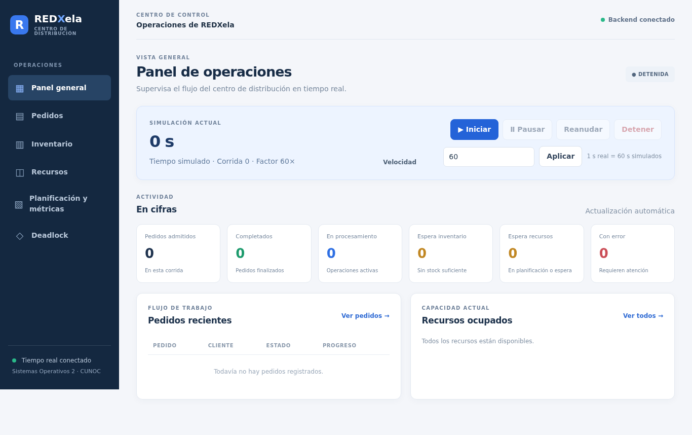
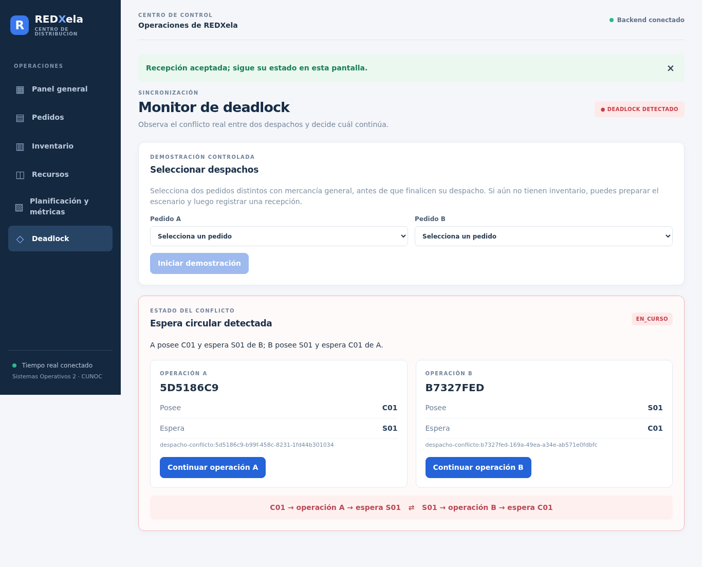

# Manual de usuario de REDXela

## 1. Preparación e inicio

Instale JDK 21 y Node.js 24 con npm. Se requiere acceso a Internet en la primera descarga de dependencias. Abra dos terminales en la raíz del repositorio:

```bash
cd backend
./mvnw spring-boot:run
```

```bash
cd frontend
npm ci
npm start
```

En Windows use `mvnw.cmd`. Espere el mensaje de inicio del backend y abra **http://127.0.0.1:4200**. La API escucha en `http://localhost:8080`. El sistema empieza detenido y el inventario comienza vacío.

## 2. Panel general y controles

En **Panel general**, observe el estado, número de corrida, reloj simulado, factor y conexión. Pulse **Iniciar**; el estado cambia a EJECUTANDO. Use **Pausar** para congelar tiempo y trabajo, **Reanudar** para continuar y **Detener** para cancelar la corrida de forma controlada. Cambie el factor con el campo de velocidad y aplíquelo: 60 significa 60 segundos simulados por segundo real. Las tarjetas muestran pedidos y recursos reales.

## 3. Clientes, pedidos y generación

1. Abra **Pedidos**. En Registrar cliente escriba nombre, correo único y nivel preferido; pulse **Registrar cliente**. Verá una confirmación.
2. En Nuevo pedido seleccione el cliente, nivel, producto y cantidad positiva. Agregue líneas si necesita productos distintos y pulse **Registrar pedido**. El pedido aparece en la tabla; use **Detalle** para ver sus productos e ID completo.
3. Si falta mercancía aparece `ESPERANDO_INVENTARIO`; registre una recepción como se explica abajo. La cola indica el orden calculado por el servidor, no garantiza recursos inmediatos.
4. En Generador introduzca el intervalo en segundos simulados, pulse **Guardar** y después **Iniciar generador**. Aparecerán pedidos nuevos. Al pausar el motor se detiene su avance; use **Detener** en el panel del generador para desactivarlo.

## 4. Inventario y recepción

1. Abra **Inventario**, seleccione un producto y una cantidad positiva; pulse **Registrar recepción**. La respuesta es asíncrona.
2. Observe el registro hasta `ALMACENADA`. Si aparece `PENDIENTE_ESPACIO`, el lote espera capacidad disponible. El ID completo permite volver a consultar una recepción después de recargar la página.
3. La tabla muestra físico, reservado y disponible. Las ubicaciones muestran ocupación y fragmentos por lote. El retiro de pedidos reduce el físico y libera espacio. Un pedido pendiente se reactiva automáticamente cuando puede reservar todas sus líneas.

## 5. Recursos, planificación y métricas

En **Recursos**, observe cada unidad, disponibilidad y propietario; S01 es compartido por recepción y despacho. En **Planificación y métricas**, seleccione PRIORIDAD, AGING o SJF y pulse **Aplicar política**. Aging considera espera simulada; SJF favorece menor cantidad de unidades. Los trabajos ya iniciados continúan.

En la misma pantalla consulte los promedios, cumplimiento y utilización. «Sin datos suficientes» significa que no hay pedidos completados para esos promedios. La primera atención y la espera acumulada son indicadores diferentes. Para comparar, configure segundos simulados y factor, pulse **Ejecutar comparación** y espere el resultado de las tres políticas. El período real por política no debe superar cinco segundos; por ejemplo, 60 segundos simulados y factor 100 son válidos. La comparación es una muestra del escenario fijo y puede variar por concurrencia.

## 6. Demostrar y resolver deadlock

1. Inicie la simulación. Cree dos pedidos distintos con **solo mercancía GENERAL**, por ejemplo una unidad GEN-01 cada uno, sin existencias suficientes.
2. Entre a **Deadlock**, seleccione ambos pedidos y pulse **Iniciar demostración**. Puede mostrarse `ESPERANDO_DESPACHOS`.
3. En **Inventario** reciba dos unidades GEN-01 y espere `ALMACENADA`. Vuelva a **Deadlock**.
4. Cuando aparezca **Espera circular detectada**, observe que A posee C01 y espera S01, mientras B posee S01 y espera C01. Consulte **Recursos** para ver sus propietarios.
5. Pulse **Continuar operación A** o **Continuar operación B**. Espere la confirmación `RESUELTA`; el perdedor vuelve a la cola y puede continuar. Consulte los pedidos y recursos para comprobar la finalización y liberación.

Para repetir el escenario cree dos pedidos nuevos y prepare nuevamente la demostración. No se puede resolver mientras el motor esté pausado.

## 7. Problemas habituales

- **Backend desconectado:** confirme que Spring inició y que el puerto 8080 está libre. La API no requiere que haya clientes WebSocket conectados.
- **Tiempo real desconectado:** compruebe el backend y espere la reconexión; REST puede seguir funcionando.
- **Error en IntelliJ `WebSocketMessageBrokerConfigurer` no existe:** importe `backend/pom.xml` como proyecto Maven y use **Reload All Maven Projects**; compruebe JDK 21 y que Maven haya descargado `spring-boot-starter-websocket`. Compare con `./mvnw spring-boot:run` en terminal. Si persiste, revise la configuración de ejecución y su classpath de módulo.
- **Puerto ocupado:** cierre únicamente la instancia que usted haya iniciado o configure los puertos; la URL del frontend y CORS deben coincidir con la configuración de desarrollo.
- **Formulario deshabilitado:** inicie o reanude la simulación y complete los campos válidos.
- **Sin stock o sin espacio:** registre mercancía, o espere que se libere capacidad. El estado de la recepción indica el motivo.
- **Datos desaparecieron al reiniciar:** el almacenamiento es en memoria y no persiste al cerrar el backend.

## Capturas

Las imágenes siguientes se capturaron de la aplicación real durante la comprobación aislada de F10:




