# REDXela

## Manual de Usuario

**Proyecto final de Sistemas Operativos 2**

Centro Universitario de Occidente

Universidad de San Carlos de Guatemala

**Versión:** 1.0 · **Fecha:** 27 de octubre de 2026

---

## Contenido

1. [Introducción](#1-introducción)
2. [Requisitos previos](#2-requisitos-previos)
3. [Instalación e inicio](#3-instalación-e-inicio)
4. [Descripción de la interfaz](#4-descripción-de-la-interfaz)
5. [Panel general](#5-panel-general)
6. [Control de simulación](#6-control-de-simulación)
7. [Registro de clientes](#7-registro-de-clientes)
8. [Registro manual de pedidos](#8-registro-manual-de-pedidos)
9. [Seguimiento de pedidos](#9-seguimiento-de-pedidos)
10. [Generación automática](#10-generación-automática)
11. [Cola de pedidos](#11-cola-de-pedidos)
12. [Inventario](#12-inventario)
13. [Recepción de mercancía](#13-recepción-de-mercancía)
14. [Ubicaciones de almacenamiento](#14-ubicaciones-de-almacenamiento)
15. [Monitoreo de recursos](#15-monitoreo-de-recursos)
16. [Políticas de planificación](#16-políticas-de-planificación)
17. [Métricas](#17-métricas)
18. [Comparación de políticas](#18-comparación-de-políticas)
19. [Deadlock](#19-deadlock)
20. [Mensajes y problemas frecuentes](#20-mensajes-y-problemas-frecuentes)
21. [Recomendaciones de uso](#21-recomendaciones-de-uso)
22. [Glosario](#22-glosario)

## 1. Introducción

REDXela permite observar y controlar una simulación del centro de distribución: registrar clientes, pedidos y mercancía, consultar recursos e inventario, comparar políticas y resolver un conflicto entre dos despachos. Los datos se conservan en memoria mientras el backend permanece abierto.

## 2. Requisitos previos

- JDK 21 y `JAVA_HOME` configurado para ese JDK.
- Node.js 24 y npm. Si usa nvm, la versión recomendada está en `frontend/.nvmrc`.
- Maven Wrapper incluido en el proyecto; no es necesario instalar Maven globalmente.
- Navegador moderno, por ejemplo Chromium o Chrome.
- Acceso a Internet para descargar dependencias la primera vez. No se necesita base de datos.

## 3. Instalación e inicio

Abra una terminal en la raíz del repositorio e inicie el servidor:

```bash
cd backend
./mvnw spring-boot:run
```

En Windows utilice `mvnw.cmd spring-boot:run`. En una segunda terminal, desde la raíz:

```bash
cd frontend
npm ci
npm start
```

Abra **http://127.0.0.1:4200**. El backend utiliza **http://localhost:8080**. Espere a que ambos procesos indiquen que iniciaron; mantenga abiertas las terminales mientras utiliza la aplicación. El motor inicia detenido y el inventario vacío cuando se reinicia el backend.

## 4. Descripción de la interfaz

El menú lateral permite abrir **Panel general**, **Pedidos**, **Inventario**, **Recursos**, **Planificación y métricas** y **Deadlock**. El encabezado informa la conexión en tiempo real. Cambiar de pantalla no detiene la simulación.

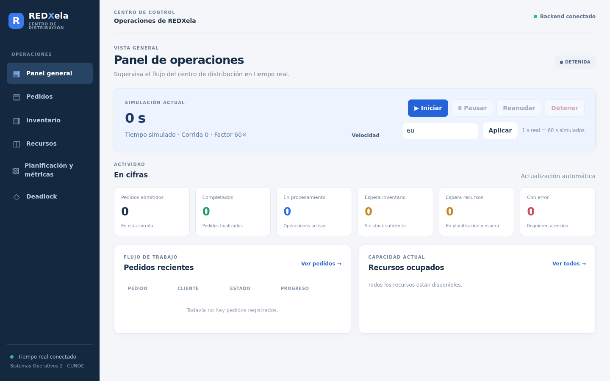

**Resultado esperado:** se ve el menú, el estado del motor y los indicadores principales. Las capturas de este manual corresponden a una ejecución real con datos de demostración; sus identificadores y cifras cambiarán en cada ejecución.

## 5. Panel general

El panel muestra el reloj simulado, número de corrida, factor de velocidad, conexión y tarjetas de pedidos admitidos, completados, procesándose, esperando inventario o recursos y con error. Abajo aparecen pedidos recientes y recursos ocupados. Si aún no se han recibido datos, se indica en pantalla.

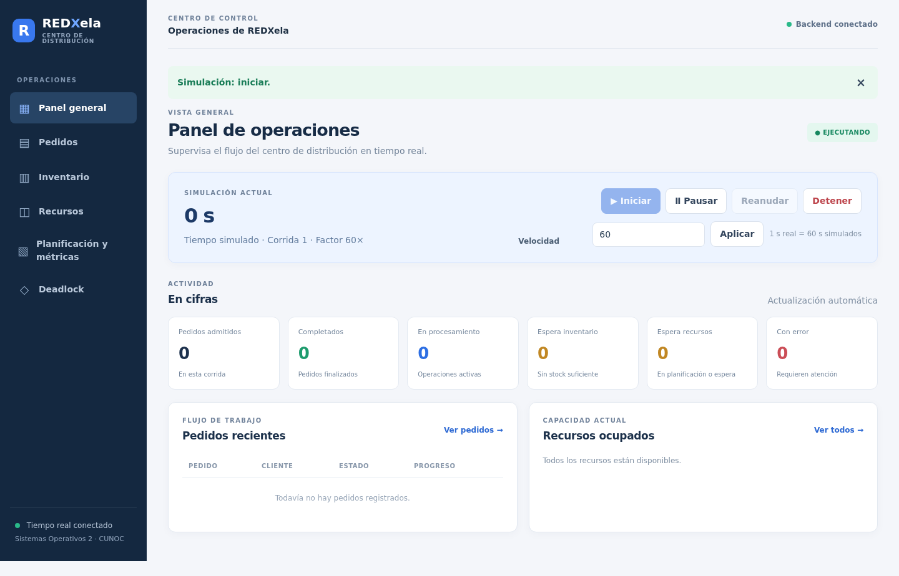

**Resultado:** el panel indica `EJECUTANDO` y actualiza su reloj y estado operativo.

## 6. Control de simulación

1. Pulse **Iniciar** para comenzar una corrida.
2. Pulse **Pausar** para congelar el reloj y el avance; observe `PAUSADA`.
3. Pulse **Reanudar** para continuar desde el mismo tiempo.
4. Pulse **Detener** para terminar la corrida. Las operaciones en curso se cancelan.
5. Para cambiar la velocidad, escriba un factor positivo y pulse **Aplicar**. Por ejemplo, 60 significa que un segundo real representa 60 segundos simulados.

Los botones no disponibles para el estado actual aparecen deshabilitados.


**Resultado:** durante la pausa el reloj no avanza. Reanude antes de registrar pedidos o recepciones.

## 7. Registro de clientes

1. Abra **Pedidos** y localice **Registrar cliente**.
2. Escriba nombre y correo electrónico; el correo debe ser válido y único.
3. Elija el nivel preferido y pulse **Registrar cliente**.
4. Espere la confirmación y revise el selector **Cliente** de Nuevo pedido.

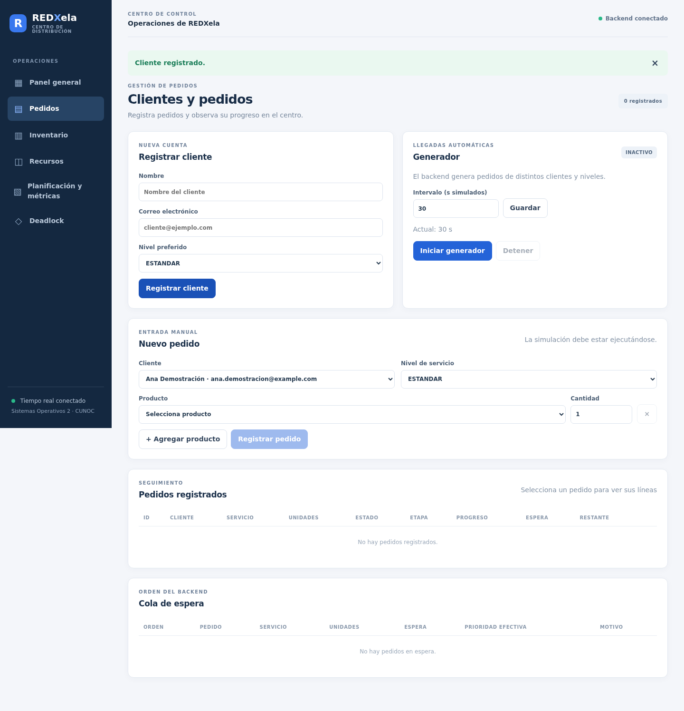

**Resultado:** el cliente queda registrado y puede seleccionarse para un pedido.

## 8. Registro manual de pedidos

1. Con el motor ejecutándose, abra **Pedidos** y seleccione un cliente y un nivel de servicio.
2. Seleccione un producto del catálogo e indique una cantidad entera positiva.
3. Use **+ Agregar producto** para incorporar otras líneas con productos distintos.
4. Pulse **Registrar pedido** y espere **Pedido admitido**.


**Resultado:** el pedido aparece en **Pedidos registrados**; puede esperar inventario antes de iniciar el procesamiento.

## 9. Seguimiento de pedidos

En **Pedidos registrados** consulte ID abreviado, cliente, servicio, unidades, estado, etapa, progreso, espera y restante estimado. Pulse **Detalle** para ver el ID completo, productos y recursos. Un guion indica que no existe un tiempo restante calculable en ese momento.

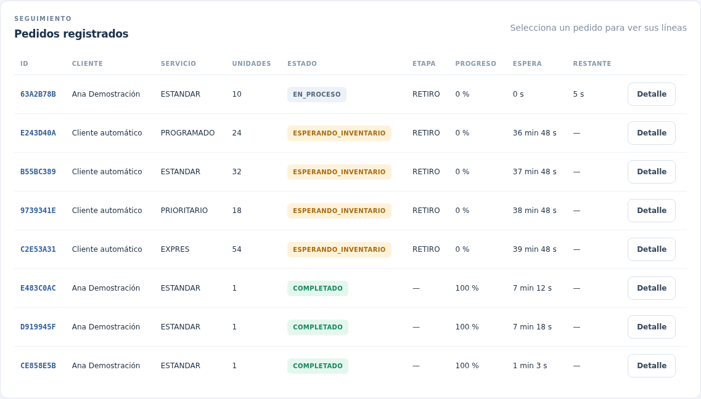

**Resultado:** la tabla refleja el avance real. `ESPERANDO_INVENTARIO` indica falta de existencias, `ESPERANDO_RECURSOS` indica que aún no puede iniciar una etapa, `EN_PROCESO` muestra trabajo en curso y `COMPLETADO` indica finalización; también pueden aparecer error o estados del conflicto.

## 10. Generación automática

1. En **Pedidos**, escriba el intervalo en **segundos simulados** y pulse **Guardar**.
2. Con la simulación ejecutándose, pulse **Iniciar generador**.
3. Observe `ACTIVO` y los nuevos pedidos en la tabla.
4. Pulse **Detener** en el panel del generador cuando termine. Una pausa de la simulación congela su avance.

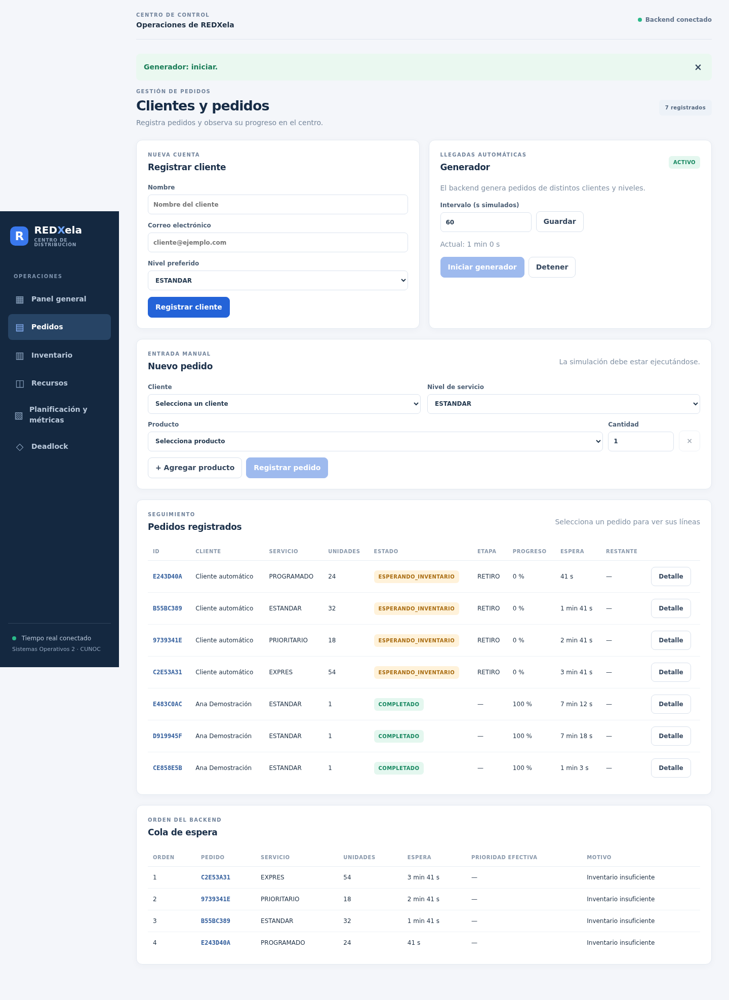

**Resultado:** los pedidos nuevos se registran automáticamente y pueden quedar esperando inventario.

## 11. Cola de pedidos

Abra **Pedidos** y baje hasta **Cola de espera**, o consulte **Cola del planificador** en Planificación y métricas. La tabla muestra orden, pedido, nivel, unidades, espera, prioridad efectiva cuando aplica y motivo.

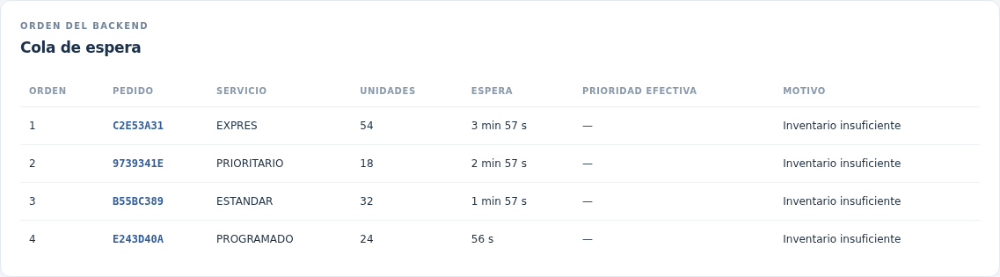

**Resultado:** se muestra el orden de preferencia informado por el sistema. Una posición preferente no garantiza que los recursos o existencias estén disponibles inmediatamente.

## 12. Inventario

Abra **Inventario** y consulte **Inventario de productos**. Puede buscar por código, nombre o tipo. **Físico** es lo almacenado; **Reservado** está comprometido para pedidos; **Disponible** es físico menos reservado.

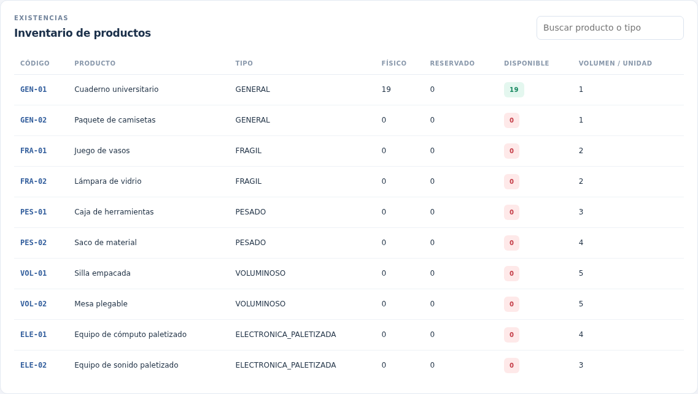

**Resultado:** las cantidades corresponden a las recepciones y retiros procesados; un producto sin disponibilidad aparece resaltado.

## 13. Recepción de mercancía

1. Con el motor ejecutándose, abra **Inventario**.
2. En **Registrar llegada**, elija un producto y escriba la cantidad positiva.
3. Pulse **Registrar recepción**. La confirmación inicial indica que la solicitud fue aceptada, no que ya esté almacenada.
4. En **Recepciones**, espere `ALMACENADA`. Si recarga la página, puede consultar una recepción mediante su ID completo.

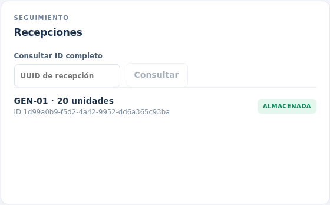

**Resultado:** una recepción `ALMACENADA` ya actualizó el inventario; `PENDIENTE_ESPACIO` indica que espera capacidad.

## 14. Ubicaciones de almacenamiento

En **Inventario**, consulte **Ubicaciones y lotes**. Cada fila muestra identificador, volumen ocupado, capacidad y fragmentos. La opción **Solo ocupadas** permite ocultar ubicaciones vacías.

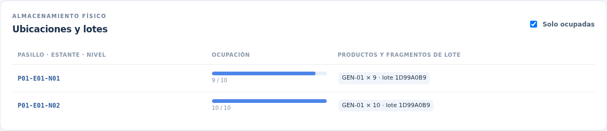

**Resultado:** una recepción puede aparecer repartida en varias ubicaciones. Las barras muestran la proporción ocupada.

## 15. Monitoreo de recursos

Abra **Recursos**. Las tarjetas agrupan estaciones, áreas, personal, montacargas, control de calidad y escáner. Cada una muestra su identificador, `DISPONIBLE` u `OCUPADO` y, cuando corresponde, la operación propietaria.

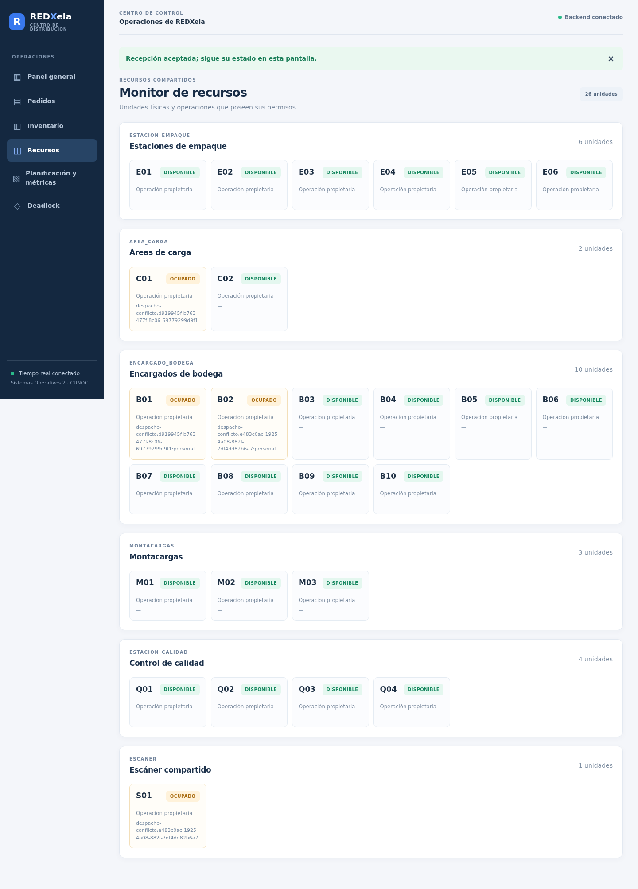

**Resultado:** los propietarios se actualizan durante las operaciones. S01 es el escáner compartido; C01 es un área de carga.

## 16. Políticas de planificación

1. Abra **Planificación y métricas**.
2. En **Política activa**, seleccione **Prioridad estricta**, **Prioridad con aging** o **SJF · menos unidades**.
3. Introduzca un intervalo positivo de aging en minutos simulados y pulse **Aplicar política**.
4. Observe la política activa y la cola del planificador.

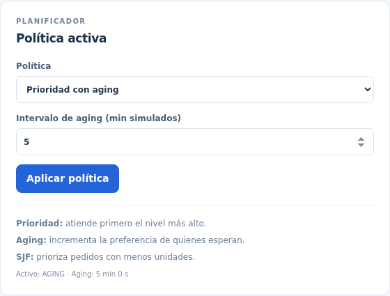

**Resultado:** prioridad favorece el nivel más alto; aging aumenta la preferencia de quienes esperan; SJF favorece pedidos con menos unidades. La nueva política afecta selecciones futuras, no interrumpe una etapa ya iniciada.

## 17. Métricas

En **Planificación y métricas** consulte pedidos completados, primera atención promedio, espera acumulada, procesamiento y tiempo total promedio, cumplimiento por nivel y utilización por recurso. Los tiempos corresponden a la simulación. Si aún no hay pedidos completados, verá **Sin datos suficientes**.

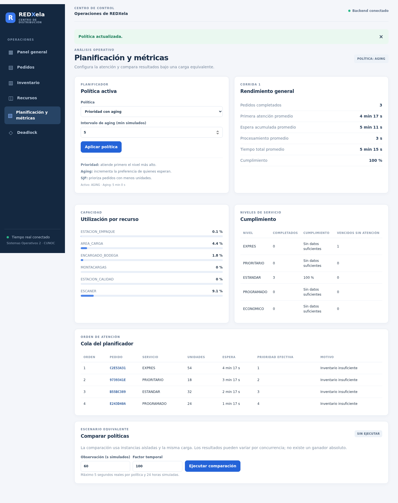

**Resultado:** los indicadores describen la corrida actual. La primera atención mide hasta el primer trabajo; la espera acumulada también incluye esperas posteriores.

## 18. Comparación de políticas

1. En **Comparar políticas**, escriba la observación en segundos simulados y el factor temporal.
2. Pulse **Ejecutar comparación** y espere el estado `COMPLETADA`.
3. Compare las columnas de PRIORIDAD, AGING y SJF por cada indicador.

Por ejemplo, 60 segundos simulados con factor 100 es una configuración válida. La observación admite hasta 24 horas simuladas y el tiempo real por política no puede superar cinco segundos.

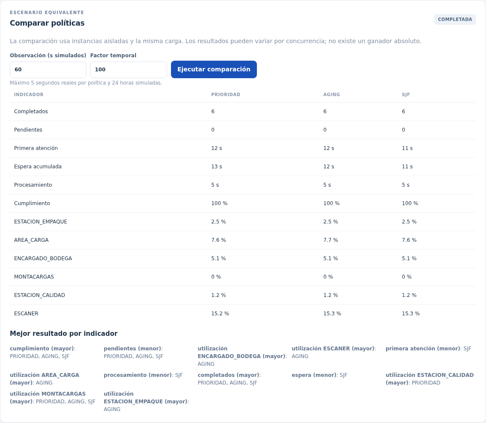

**Resultado:** se muestran resultados de las tres políticas para una misma carga de prueba. Pueden variar por concurrencia y no identifican un ganador universal.

## 19. Deadlock

La demostración utiliza dos pedidos distintos que contengan **únicamente mercancía GENERAL** y cuyos despachos todavía puedan prepararse. Es más sencillo crearlos sin existencias suficientes y registrar la recepción después.

### Preparación

1. Inicie el motor y registre un cliente.
2. Cree dos pedidos de una unidad de GEN-02, siempre que ese producto no tenga stock disponible.
3. Abra **Deadlock**, elija los dos pedidos en **Pedido A** y **Pedido B** y pulse **Iniciar demostración**.
4. Si aparece `ESPERANDO_DESPACHOS`, vaya a Inventario, reciba dos unidades de GEN-02 y espere `ALMACENADA`. Regrese a Deadlock.

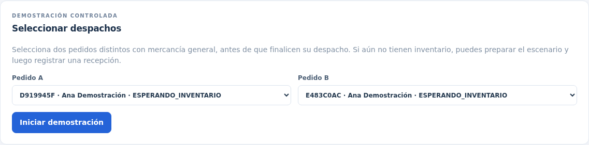

**Resultado:** el sistema prepara los despachos y espera a que ambos alcancen la etapa necesaria.

### Conflicto y resolución

5. Espere **Espera circular detectada**. La operación A posee C01 y espera S01; la B posee S01 y espera C01.

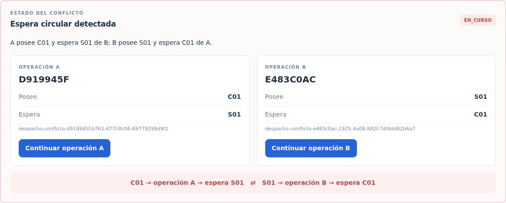

**Resultado:** se identifican las operaciones, lo que poseen y el recurso que espera cada una.

6. Pulse **Continuar operación A** o **Continuar operación B**. La elección se envía al servidor; espere la confirmación, pues la solicitud no significa que la recuperación ya terminó.
7. Observe `RECUPERANDO` si permanece visible y espere `RESUELTA`. La otra operación regresa a la cola y puede continuar.

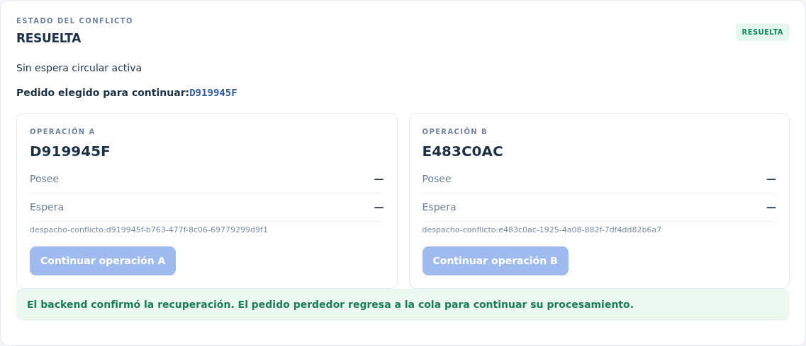

**Resultado:** la pantalla confirma `RESUELTA` e identifica el pedido elegido. Durante la captura de esta ejecución, `RECUPERANDO` fue demasiado breve para obtener una imagen; la confirmación mostrada corresponde al estado final informado por el sistema.

8. Abra **Pedidos** y revise que ambos continúen y puedan completarse. En **Recursos**, compruebe que C01 y S01 se liberen al concluir las operaciones.

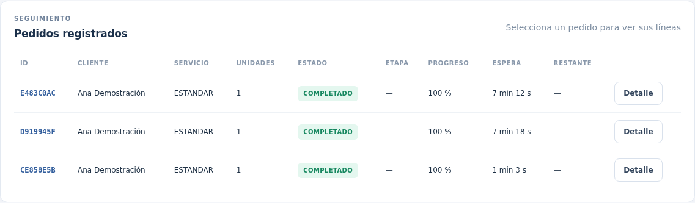

**Resultado:** los pedidos conservan su progreso y el perdedor continúa cuando puede obtener recursos. Para repetir, cree dos pedidos nuevos; no se puede resolver mientras el motor está pausado.

## 20. Mensajes y problemas frecuentes

| Situación | Qué hacer |
| --- | --- |
| Backend desconectado | Compruebe la terminal de Spring, JDK 21 y disponibilidad del puerto 8080. |
| Tiempo real desconectado | Compruebe el backend y espere la reconexión. Las operaciones REST pueden seguir funcionando. |
| Operación no permitida o botón deshabilitado | Revise si el motor está ejecutándose, complete los campos y espere una solicitud anterior. |
| Pedido sin inventario | Registre una recepción suficiente; el pedido se reevaluará automáticamente. |
| Recepción pendiente de espacio | Espere a que el retiro de mercancía libere espacio; consulte de nuevo el estado. |
| Simulación pausada | Pulse **Reanudar** para continuar pedidos, generador y recepciones. |
| Comparación en curso | Espere el resultado antes de iniciar otra comparación. |
| Deadlock no disponible | Seleccione dos pedidos generales distintos y aún elegibles; prepare el conflicto antes de que termine su despacho. El backend valida la selección. |
| No hay datos tras reiniciar el backend | Es normal: los registros se almacenan solo en memoria. |
| IntelliJ indica que falta `WebSocketMessageBrokerConfigurer` | Importe `backend/pom.xml` como Maven, recargue los proyectos Maven y revise el JDK y classpath; pruebe el arranque en terminal. |

## 21. Recomendaciones de uso

Inicie ambos servidores y la simulación; registre un cliente; reciba mercancía; cree y siga un pedido. Después pruebe una espera por inventario, el generador, las políticas y las métricas. Para el conflicto, prepare primero dos pedidos generales sin stock, active la demostración y únicamente entonces reciba la mercancía. Detenga el generador antes de cerrar la demostración y recuerde que reiniciar el backend borra los datos.

## 22. Glosario

- **Corrida:** una ejecución iniciada del simulador.
- **Tiempo simulado:** tiempo mostrado por el sistema según el factor temporal.
- **Primera atención:** espera hasta que comienza el primer trabajo del pedido.
- **Espera acumulada:** tiempo total esperando antes o entre etapas.
- **Reserva:** unidades comprometidas para un pedido que todavía no se han retirado.
- **Ubicación y fragmento:** posición del almacén y parte de un lote guardada allí.
- **Cola:** lista de pedidos pendientes con su orden de preferencia.
- **Deadlock:** conflicto en que dos operaciones esperan recursos retenidos entre sí.
- **Propietario:** operación que utiliza o tiene asignado un recurso.
